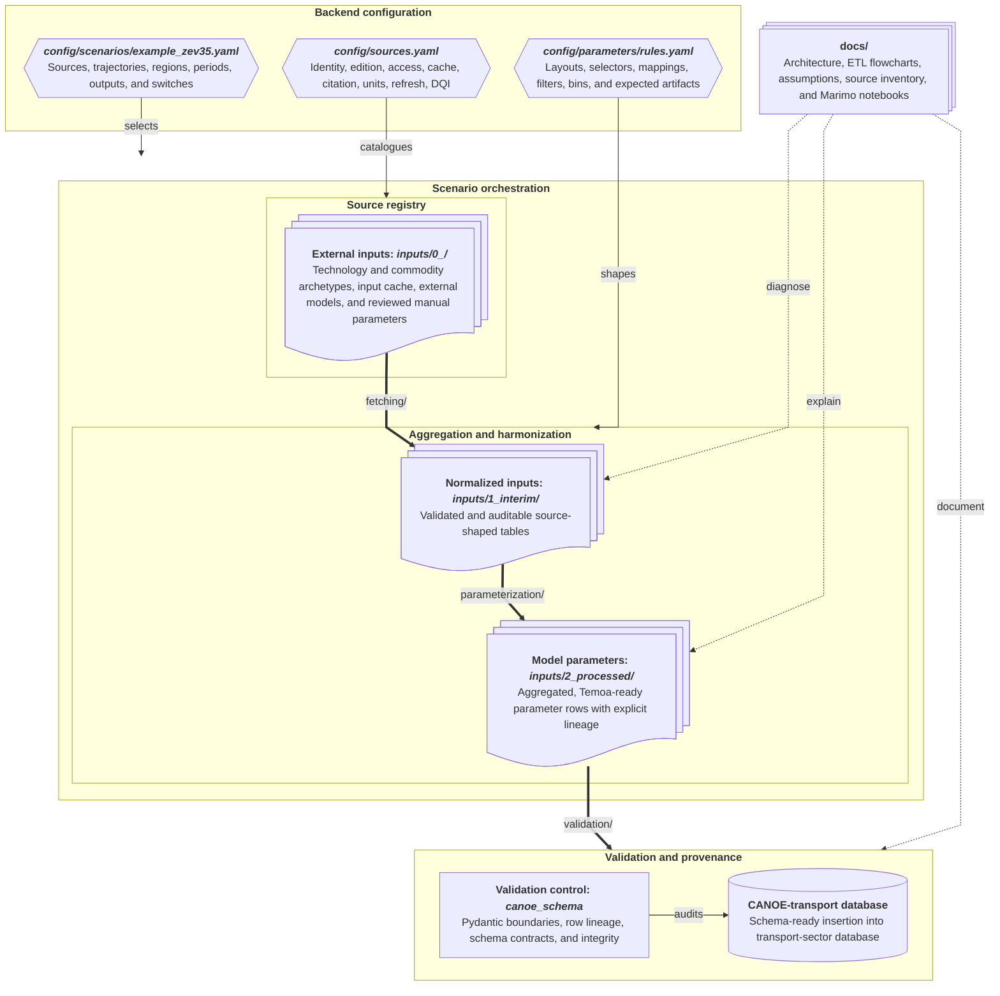

# CANOE Transportation Backend

Compile registered Canadian transportation evidence into validated, provenance-traceable
CANOE/Temoa v4 SQLite databases. YAML selects sources, regions, periods and modelling
options; the native Python build prepares inputs, validates rows and publishes the result.

## Install

Install [Git](https://git-scm.com/downloads) and
[uv](https://docs.astral.sh/uv/getting-started/installation/). The project requires
Python 3.13 or later; uv can provision it.

```sh
git clone --branch v2.0 https://github.com/CANOE-main/canoe-transportation.git
cd canoe-transportation
uv sync --frozen
```

The lockfile supplies the package versions, including `canoe-schema` and marimo.
Registered manual tables, reviewed mappings and external-model outputs must also be
available; installation and source downloads do not generate those inputs. See the
[source registry](config/sources.yaml) and [scenario guidance](config/scenarios/README.md).
New GREET result generation requires Windows and desktop Excel; replay reads the
registered result bank. On Windows, use a short clone path or enable repository-local
long paths with `git config core.longpaths true` if a legacy filename is too long.

## Build a scenario

From the repository root, build the [default scenario](config/scenarios/default.yaml),
allowing acquisition of missing registered source caches:

```sh
uv run python src/build_transport.py --scenario config/scenarios/default.yaml --overwrite --download-sources
```

For subsequent builds using local inputs and installed dependencies:

```sh
uv run --offline python src/build_transport.py --scenario config/scenarios/default.yaml --overwrite
```

`--overwrite` replaces the configured database. Every invocation regenerates production
prerequisites; no manual fetch/parameter commands are needed. Downloads stay pinned to
the registry, and mismatched caches fail validation. Run scenarios serially while paths
are shared. Database/report paths come from scenario YAML and `config/paths.yaml`;
run logs are saved under `outputs/logs/` by default. Add `--debug` for detailed audits.

To author a scenario, copy the complete [default.yaml template](config/scenarios/default.yaml),
choose distinct output names and follow the [scenario guide](config/scenarios/README.md).
The [architecture reference](docs/backend_architecture.md#running-and-extending-the-backend)
explains replay, validation and publication behavior.

## Update source snapshots

Source maintenance is explicit and separate from builds. Inspect eligible publishers
without changing the registry or caches:

```sh
uv run python -m fetching.source_updater --scenario config/scenarios/default.yaml
```

Review the printed log, JSON audit and exact registry diff, then adopt selected sources:

```sh
uv run python -m fetching.source_updater --scenario config/scenarios/default.yaml --source nrcan_fuel_consumption_ratings --apply
```

Repeat `--source` for a batch; omitting it selects all eligible families. The updater
validates the complete selection, retains old caches and publishes the registry
atomically. Changed registered coverage, incompatible layouts and unverifiable replacements
stop adoption. New years or editions require separate review. Logs default to
`outputs/logs/source_updates/`; audits and `sources.diff` to
`outputs/validation/source_updates/`. Review the applied diff, rebuild, and compare outputs
before committing. See
[source-update boundaries](docs/backend_architecture.md#explicit-source-updates).

## Load diagnostic notebooks

Prepare the stock and efficiency notebooks together. This preset captures the evidence
from a successful build; add `--download-sources` if registered caches are missing:

```sh
uv run python src/build_transport.py --scenario config/scenarios/notebook_diagnostics.yaml --overwrite
```

Open either notebook as an interactive, read-only app:

```sh
uv run --offline marimo run docs/insights/vehicle_stock_diagnosis.py
uv run --offline marimo run docs/insights/ldv_efficiency_diagnosis.py
```

Each command runs a local server; stop it with `Ctrl+C` before opening the other in the
same terminal. Opening a notebook loads the latest successful recorded bundle and runs
no ETL. Rebuild the preset to capture newer evidence; missing or incompatible bundles
provide a rebuild instruction. Comparison and growth research have separate prerequisites
listed below. See [diagnostic evidence](docs/backend_architecture.md#diagnostic-and-research-evidence)
for capture, provenance and interpretation.

## Backend at a glance



The overview is conceptual: scenario labels illustrate configuration ownership.
[`default.yaml`](config/scenarios/default.yaml) contains the current selections;
`inputs/0_canoe_template/` holds backend-owned structural rows.

## Documentation and resources

Use these references for detail rather than treating this README as a second architecture
or parameter specification.

| Resource | What it covers | How to interpret it |
| --- | --- | --- |
| [Backend architecture](docs/backend_architecture.md) | Module ownership, artifact locations, build lifecycle, source maintenance and diagnostics. | Current structural reference; verify interfaces against code/config when changing them. |
| [ETL flowcharts](docs/etl_flowcharts.md) | Parameter-specific source-to-row lineage, harmonization, equations and conditional branches. | Solid paths describe defaults; dashed paths describe conditional alternatives. Review/planned content needs verification. |
| [Assumptions](docs/assumptions.md) | Enduring source limitations, data gaps, proxies and modelling treatments. | Read alongside the owning source, parameter and scenario YAML; review markers do not imply acceptance. |
| [Source inventory](docs/source_inventory.md) | Source families, uses, native formats and input footprint. | Dated inventory; sizes/counts describe its recorded snapshot. `sources.yaml` owns live registrations. |
| [Executive summary](docs/executive_summary.md) | Project purpose, baseline criteria, retrospective progress and roadmap. | Historical planning context; progress statements and old commands require verification. |
| [Codebase diagnostic snapshot](docs/codebase_diagnostic_snapshot.md) | Structural metrics, complexity, ownership risks and improvement priorities. | Point-in-time assessment; recheck findings before making architectural changes. |
| [CANOE-main integration context](docs/canoe_main_orchestrator.md) | Upstream lifecycle, shared-database ownership and the transportation integration seam. | Commit-pinned routing snapshot; reverify upstream. The transport adapter remains planned. |
| [Vehicle-stock notebook](docs/insights/vehicle_stock_diagnosis.py) | Mapping coverage, unresolved stock, class/vintage weights and retention/survival evidence. | Uses the shared captured bundle above. Administrative retention diagnostics do not establish physical survival assumptions. |
| [LDV-efficiency notebook](docs/insights/ldv_efficiency_diagnosis.py) | NRCan distributions/filtering, OMEGA composition and the observed-to-ATB bridge. | Uses the same captured ETL tables; SQLite supplies publication/hash evidence. Sensitivity and exact-powertrain MTO weighting remain diagnostic. |
| [Transport-comparison notebook](docs/insights/transport_comparison_diagnosis.py) | Ranked parameter and coverage differences against legacy SQLite. | First build [legacy_comparison.yaml](config/scenarios/legacy_comparison.yaml); [comparison config](config/parameters/transport_comparison.yaml) selects fingerprinted inputs. Interpret differences against units, keys and tolerances. |
| [Growth-constraint notebook](docs/insights/growth_constraint_diagnosis.py) | HATCH/EAFO evidence, growth calibration, seeds and provisional envelopes. | Exploratory research outside production insertion. Its removed scenario reference currently needs repair before use. |
