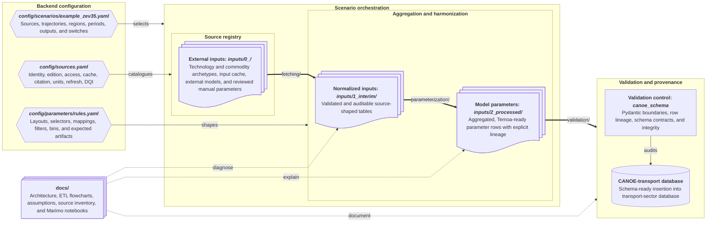

# CANOE Transportation Backend

Build CANOE/Temoa v4 SQLite databases from registered Canadian transportation data,
reviewed assumptions and external-model results. YAML selects the scenario; Python
prepares inputs, calculates parameters, validates their source lineage and publishes
the database.

Read the current [model documentation](docs/index.md)
for the methods, figures and assumptions, or start with the commands below.

## Install and check

Install [Git](https://git-scm.com/downloads) and
[uv](https://docs.astral.sh/uv/getting-started/installation/). Python 3.13 or later is
required; uv can provision it. Run all commands from the repository root.

```sh
git clone --branch main https://github.com/CANOE-main/canoe-transportation.git
cd canoe-transportation
uv sync --frozen
uv run --offline python scripts/doctor.py --scenario config/scenarios/default.yaml
```

The doctor checks imports, configuration, paths and registered manual tables.
Supply the registered inputs before building: downloads belong in `inputs/0_cache/`,
reviewed tables in `inputs/0_manual_params/`, and external-model results in
`inputs/0_external_models/`. The [source registry](config/sources.yaml) records their
identity, access and required coverage. Installation and downloads do not create
reviewed mappings or external-model results. New GREET simulations require Windows
and desktop Excel; replay uses the registered result bank.

On Windows, use a short clone path or enable repository-local long paths with
`git config core.longpaths true` if a legacy filename is too long.

## Build a scenario

Replay registered local inputs and replace the configured database:

```sh
uv run --offline python src/build_transport.py --scenario config/scenarios/default.yaml --overwrite
```

To acquire missing registered source caches, explicitly permit downloads:

```sh
uv run python src/build_transport.py --scenario config/scenarios/default.yaml --overwrite --download-sources
```

Every build regenerates production prerequisites. Caches stay pinned to the registry;
mismatched files fail validation. `--overwrite` permits replacing the output, and
`--debug` adds detailed audits. **Run scenarios serially:** their preparation paths
are shared even when database names differ.

The default covers ten model regions with a prospective 2025 reference. BCT combines
British Columbia and the territories. Its main outputs are:

| Output | Default location |
| --- | --- |
| SQLite database | `outputs/sqlite/canoe_transport_baseline.sqlite` |
| Validation report | `outputs/validation/baseline_database_bootstrap.json` |
| Persistent run log | `outputs/logs/`, named by scenario and UTC start time |
| Normalized evidence and parameter tables | `inputs/1_interim/` and `inputs/2_processed/` |

Start with the validation report: check source identity, coverage, skipped rows,
provenance, parameter support, integrity and foreign keys. A successful build checks
the database; it does not run a Temoa optimization.

To create a scenario, copy every section of [default.yaml](config/scenarios/default.yaml),
choose distinct output names and follow the [scenario guide](config/scenarios/README.md).

| Configuration | What to change here |
| --- | --- |
| `config/scenarios/*.yaml` | Regions, periods, source editions, model options and outputs. |
| `config/sources.yaml` | Registered source files, access, citations and data-quality evidence. |
| `config/parameters/*.yaml` | Mappings, aggregation rules, conversions and parameter metadata. |
| `config/paths.yaml` | Artifact locations and their owners. |

## Current model support

- Sales-derived road cohorts support fixed lifetimes or annual survival curves.
  Car and truck utilization matches projected `base_year` demand using the selected
  demand method, including the optional car/light-truck split.
- Light-duty vehicle (LDV) powertrain shares use new registrations. Ontario MTO and Transport Canada iZEV composition
  evidence informs consumption, with explicit coverage and fallback checks.
- Optional CEUD energy calibration matches reported gasoline/diesel energy for
  cars and trucks. Heavy-truck aggregate energy is treated as entirely diesel, as
  confirmed in the reviewed source interpretation. The option remains off by default;
  the same class adjustment applies to its powertrains and vintages.
- Charger costs divide total port expenditure by matched rated power. Registered
  charging profiles preserve their timing and rescale to the reviewed annual utilization of 20%.
- Diagnostics and the website/PDF show mapping results, cohort alternatives,
  consumption matching, regional calibration changes and charging normalization.

## Compare methods and calibrate energy

These comparison presets require their configured legacy SQLite and supplied CSV/
notebook evidence under `legacy_backend/`. Builds do not create that historical evidence.

Build the Ontario control, then capture its fleet, charger and vehicle-cost reports:

```sh
uv run --offline python src/build_transport.py --scenario config/scenarios/validation_baseline.yaml --overwrite
uv run --offline python -m validation.transportation_research --scenario config/scenarios/validation_baseline.yaml --write-report
uv run --offline python -m validation.charging_cost_comparison --scenario config/scenarios/validation_baseline.yaml --write-report
uv run --offline python -m validation.vehicle_cost_diagnostic --scenario config/scenarios/validation_baseline.yaml --write-report
```

Build the matched calibration-on case and compare final rows:

```sh
uv run --offline python src/build_transport.py --scenario config/scenarios/validation_energy_calibration.yaml --overwrite
uv run --offline python -m validation.ceud_calibration_diagnostic --baseline outputs/sqlite/validation_baseline.sqlite --baseline-report outputs/validation/validation_baseline.json --calibrated outputs/sqlite/validation_energy_calibration.sqlite
```

The switch is `efficiencies.ceud_energy_calibration`. It requires fixed road lifetimes
and flat annual utilization. The comparison holds fleet,
activity and source selections fixed while checking energy closure and parameter
changes. Closure is a calibration check, not independent validation of each vehicle.
For regional anchor heatmaps, run the following **after** the matched Ontario audit:

```sh
uv run --offline python src/build_transport.py --scenario config/scenarios/validation_energy_calibration_regions.yaml --overwrite
```

For the separate parameter-by-parameter legacy comparison:

```sh
uv run --offline python src/build_transport.py --scenario config/scenarios/legacy_comparison.yaml --overwrite
uv run --offline python -m validation.transport_comparison --write-report
```

Reports live under `outputs/validation/`. Keep their build fingerprints intact;
rebuild and recapture stale evidence rather than editing its recorded identity.

## Open diagnostic notebooks

Prepare the shared population/efficiency evidence, then open an app:

```sh
uv run --offline python src/build_transport.py --scenario config/scenarios/notebook_diagnostics.yaml --overwrite
uv run --offline marimo run docs/insights/vehicle_population_diagnosis.py
```

Use the same `marimo run` command with a notebook below. Each starts a local server;
use separate terminals or stop it with `Ctrl+C` before opening another.

| Notebook under `docs/insights/` | Purpose and prerequisite |
| --- | --- |
| `vehicle_population_diagnosis.py`, `ldv_efficiency_diagnosis.py` | Mapping, composition and consumption; use the shared preset above. |
| `stock_cohort_diagnosis.py` | Sales/stock cohort alternatives and retirement; recalculates from prepared registered evidence. |
| `transportation_validation_diagnosis.py` | Activity, energy and charger comparisons; use the control/research/calibration sequence above. |
| `vehicle_cost_diagnosis.py`, `ceud_calibration_diagnosis.py` | Cost or energy-calibration reports captured above. |
| `charging_profile_diagnosis.py` | Annual utilization rescaling; reads registered charging simulations. |
| `legacy_comparison_diagnosis.py` | Parameter differences; use the legacy comparison above. |
| `growth_constraint_diagnosis.py` | Exploratory adoption evidence; its preparation remains separate from production. |

These apps do not run ETL. Missing or stale captured evidence gives its preparation
instruction. The [publication guide](docs/publication.md) provides the complete serial
sequence for all published figures, including documentation-support evidence.

## Update source snapshots

Inspect publisher updates without adopting them, then review the audit and registry
diff before applying a selected source:

```sh
uv run python -m fetching.source_updater --scenario config/scenarios/default.yaml
uv run python -m fetching.source_updater --scenario config/scenarios/default.yaml --source nrcan_fuel_consumption_ratings --apply
```

Repeat `--source` for a batch. The updater validates the selection, retains old caches
and publishes the registry atomically. New coverage, layouts or editions need review.
Logs go to `outputs/logs/source_updates/`; audits and exact diffs go to
`outputs/validation/source_updates/`. Rebuild and compare affected outputs after adoption.

## Build the website and PDF

The committed figures let you render the documentation without transport inputs or ETL.
Prepare the locked documentation environment and local renderers once:

```sh
uv sync --frozen --group docs
uv run --group docs python scripts/build_docs.py prepare-assets
uv run --group docs playwright install chromium
```

Build, check and preview the site, or export the same content as PDF:

```sh
uv run --offline --group docs python scripts/build_docs.py build
uv run --offline --group docs python scripts/build_docs.py pdf
uv run --offline --group docs python scripts/build_docs.py serve
```

The preview uses `/canoe-transportation/`. The site is in `outputs/documentation/site/`;
the PDF is `outputs/documentation/canoe_transportation_report.pdf`. Installed Chrome
can replace bundled Chromium with `pdf --browser-channel chrome`. Build and PDF checks
record identities and page-review images in `outputs/validation/documentation/`.

To refresh publication figures after preparing their reports and notebook evidence:

```sh
uv run --offline python -m validation.documentation_support --write-report --write-nonroad-report
uv run --offline --group docs python scripts/export_documentation_figures.py
```

Figure export is an explicit evidence operation; site rendering does not trigger it.
The manual [Documentation workflow](.github/workflows/docs.yml) builds review artifacts;
its `deploy` input explicitly controls GitHub Pages publication.
Pages must use **GitHub Actions** as its source; merging into `main` alone does not
publish the MkDocs site. The [hosted website](https://canoe-main.github.io/canoe-transportation/)
is updated separately from these source files.

## Develop, check and clean up

Run focused checks for the changed owner, for example:

```sh
uv run --offline pytest tests/test_road_utilization.py tests/test_ceud_energy_calibration.py
uv run --offline ruff check src/parameterization/road_utilization.py
uv run --offline marimo check docs/insights/ldv_efficiency_diagnosis.py
uv run --offline python src/build_transport.py --help
```

Inspect cleanup targets before removing runtime scratch:

```sh
uv run --offline python scripts/clean_runtime.py
uv run --offline python scripts/clean_runtime.py --apply
```

`--include-generated` also selects generated inputs and outputs; `--include-cache`
also selects downloaded caches. Reviewed manual inputs and external-model results
are outside those cleanup categories. Read the dry-run list before adding either flag.

CANOE-main callers can reuse `prepare_scenario_inputs`, `prepare_transport_contribution`
and `insert_transport_contribution` from [build_transport.py](src/build_transport.py).
The caller owns shared structures, transactions and final publication. Full upstream
adapter integration and representative-time checks remain separate work; see the
[integration boundary](docs/model/integration.md).

## Backend at a glance



The overview is conceptual: scenario labels illustrate configuration ownership.
[default.yaml](config/scenarios/default.yaml) contains the current selections;
`inputs/0_canoe_template/` holds backend-owned structural rows.

## Further guidance

| Reference | Use it for |
| --- | --- |
| [Backend architecture](docs/backend_architecture.md) | Ownership, artifact paths, build lifecycle and extension points. |
| [Parameter flowcharts](docs/etl_flowcharts.md) | Source-to-row transformations, equations and conditional branches. |
| [Assumptions](docs/assumptions.md) | Reviewed treatments, source limitations and unresolved modeling choices. |
| [Source inventory](docs/source_inventory.md) | Source families and their recorded scope; the registry owns current identities. |
| [Publication guide](docs/publication.md) | Complete evidence preparation, figure export and rendering commands. |
