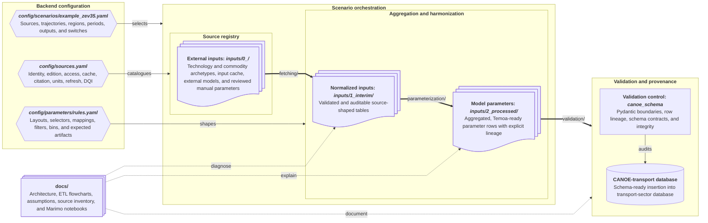

# CANOE Transportation Backend

Build CANOE/Temoa v4 SQLite databases from registered Canadian transportation data,
reviewed assumptions and external-model results. YAML selects the scenario; Python
prepares inputs, calculates parameters, validates their source lineage and publishes
the database.

The model represents road fleets, passenger and freight service by air, rail and
marine, direct off-road energy demand, and charging and hydrogen refueling.
Use the [Executive Summary](docs/executive_summary.md) for the research context
and integration overview, or follow the commands below to build a scenario.

## Install and check

Install [Git](https://git-scm.com/downloads) and
[uv](https://docs.astral.sh/uv/getting-started/installation/). Python 3.13 or later is
required; uv can provision it. Run all commands from the repository root.

```sh
git clone --branch main https://github.com/CANOE-main/canoe-transportation.git
cd canoe-transportation
uv sync --frozen
uv run --offline python scripts/doctor.py --scenario config/scenarios/default.yaml
```

The doctor checks imports, configuration, paths and registered manual tables.
Supply the registered inputs before building: downloads belong in `inputs/0_cache/`,
reviewed tables in `inputs/0_manual_params/`, and external-model results in
`inputs/0_external_models/`. The [source registry](config/sources.yaml) records their
identity, access and required coverage. Installation and downloads do not create
reviewed mappings or external-model results. New GREET simulations require Windows
and desktop Excel; replay uses the registered result bank.

## Build a scenario

Replay registered local inputs and replace the configured database:

```sh
uv run --offline python src/build_transport.py --scenario config/scenarios/default.yaml --overwrite
```

To acquire missing registered source caches, explicitly permit downloads:

```sh
uv run python src/build_transport.py --scenario config/scenarios/default.yaml --overwrite --download-sources
```

Every build regenerates production prerequisites. Caches stay pinned to the registry;
mismatched files fail validation. `--overwrite` permits replacing the output, and
`--debug` adds detailed audits. **Run scenarios serially:** their preparation paths
are shared even when database names differ.

The default covers ten model regions with a prospective 2025 reference. BCT combines
British Columbia and the territories. Its main outputs are:

| Output | Default location |
| --- | --- |
| SQLite database | `outputs/sqlite/canoe_transport_baseline.sqlite` |
| Validation report | `outputs/validation/baseline_database_bootstrap.json` |
| Persistent run log | `outputs/logs/`, named by scenario and UTC start time |
| Normalized evidence and parameter tables | `inputs/1_interim/` and `inputs/2_processed/` |

Start with the validation report: check source identity, coverage, skipped rows,
provenance, parameter support, integrity and foreign keys. A successful build checks
the database; it does not run a Temoa optimization.

To create a scenario, copy every section of [default.yaml](config/scenarios/default.yaml),
choose distinct output names and follow the [scenario guide](config/scenarios/README.md).

| Configuration | What to change here |
| --- | --- |
| `config/scenarios/*.yaml` | Regions, periods, source editions, model options and outputs. |
| `config/sources.yaml` | Registered source files, access, citations and data-quality evidence. |
| [Parameter contract instructions](config/parameters/AGENTS.md) | Routing, lineage and ownership for the rule partitions and specialized contracts. |
| `config/paths.yaml` | Artifact locations and their owners. |

## Current model support

- Historical sales and survival reconstruct car and truck cohorts. Choose fixed
  retirement ages or annual survival curves. Flat utilization for each road
  class matches its base-year activity using prepared physical stock.
- Configure road technology trajectories and plug-in vehicle range detail.
  Optional vehicle-cycle emissions trace materials, manufacturing and decommissioning
  to the registered GREET results.
- Choose aggregated or explicit charger types. Aggregated LDV chargers can
  use six registered survey/strategy profiles scaled to the reviewed 20% annual
  utilization target. Explicit chargers use annual utilization and
  rated-power share constraints.
- The default uses prospective periods, MOVES survival curves, new-capacity
  range shares, and aggregated chargers with the NHTS uncontrolled profile.
  See the [scenario guide](config/scenarios/README.md) for supported combinations.

## Backend at a glance



The overview is conceptual: scenario labels illustrate configuration ownership.
[default.yaml](config/scenarios/default.yaml) contains the current selections;
`inputs/0_canoe_template/` holds backend-owned structural rows.

## Core documentation

| Reference | Use it for |
| --- | --- |
| [Model documentation](docs/index.md) | Research overview, scenario walkthroughs and scientific methods. |
| [Getting started](docs/getting_started.md) | Installation, build controls, validation reports and diagnostic preparation. |
| [Backend architecture](docs/backend_architecture.md) | Ownership, artifact paths, build lifecycle and extension points. |
| [Parameter flowcharts](docs/etl_flowcharts.md) | Source-to-row transformations, equations and conditional branches. |
| [Assumptions](docs/assumptions.md) | Reviewed treatments, source limitations and unresolved modeling choices. |
| [Source inventory](docs/source_inventory.md) | Source families and their recorded scope; the registry owns current identities. |
| [Publication guide](docs/publication.md) | Figure evidence, MkDocs and the printable report. |

## Open diagnostic notebooks

Prepare the shared Ontario population and LDV efficiency captures, then open an app:

```sh
uv run --offline python src/build_transport.py --scenario config/scenarios/notebook_diagnostics.yaml --overwrite
uv run --offline marimo run docs/insights/vehicle_population_diagnosis.py
```

Use the same `marimo run` command with another notebook after preparing its
evidence. Stop the local server with `Ctrl+C`.

| Notebook under `docs/insights/` | Purpose and prerequisite |
| --- | --- |
| [Vehicle population](docs/insights/vehicle_population_diagnosis.py) | Reviewed mapping, unresolved coverage, composition and Ontario retention. Shared capture above. |
| [LDV efficiency](docs/insights/ldv_efficiency_diagnosis.py) | Canadian ratings, ranges, class weights and future efficiency. Shared capture above. |
| [Stock cohorts](docs/insights/stock_cohort_diagnosis.py) | Compare historical acquisitions, reference-year stock and survival. Uses separately prepared registered inputs. |
| [Vehicle costs](docs/insights/vehicle_cost_diagnosis.py) | Price bases, range weighting and maintenance per unit of service. Uses a matched build and cost report. |
| [Transportation validation](docs/insights/transportation_validation_diagnosis.py) | Checks stock, activity, energy and chargers against current and curated historical evidence. |
| [Charger infrastructure](docs/insights/charger_infrastructure_diagnosis.py) | Compare port costs, rated GW and utilization across charger representations. Uses registered evidence and charger reports. |
| [LDV charging](docs/insights/ldv_charging_diagnosis.py) | Compare timing and annual utilization across the six registered Ontario simulations. |
| [Travel survey](docs/insights/travel_survey_diagnosis.py) | Examine NHTS inclusion rules, trip timing and inputs to RAMP. Uses explicit survey preparation. |
| [Documentation support](docs/insights/documentation_support.py) | Fleet and non-road publication figures. Uses dedicated figure evidence. |
| [Growth constraints](docs/insights/growth_constraint_diagnosis.py) | Research on technology adoption and deployment seeds. Uses separately prepared growth evidence. |
| [CEUD energy calibration](docs/insights/ceud_calibration_diagnosis.py) | Optional fitted energy comparison that preserves travel activity. Uses matched control and calibration reports. |

Use the [diagnostic preparation guide](docs/getting_started.md#prepare-diagnostics-explicitly)
and the prerequisites in each notebook. Run preparation serially and rebuild
stale evidence through its producer.

## Compare methods and calibrate energy

Build the Ontario control and capture its current fleet, charger and cost reports:

```sh
uv run --offline python src/build_transport.py --scenario config/scenarios/validation_baseline.yaml --overwrite
uv run --offline python -m validation.transportation_research --scenario config/scenarios/validation_baseline.yaml --write-report
uv run --offline python -m validation.charging_cost_comparison --scenario config/scenarios/validation_baseline.yaml --write-report
uv run --offline python -m validation.vehicle_cost_diagnostic --scenario config/scenarios/validation_baseline.yaml --write-report
```

For a database regression check, build a matching reference first and use
[`comparison.mode: scenario`](config/scenarios/README.md#sqlite-comparisons)
in the candidate YAML. Use the reports with the transportation validation
notebook to interpret differences alongside curated historical evidence.

The optional [CEUD comparison](docs/model/energy.md#optional-ceud-energy-calibration)
fits reported gasoline and diesel energy with fixed road lifetimes and flat
utilization. The [publication workflow](docs/publication.md#prepare-model-evidence-explicitly)
gives the matched Ontario and regional diagnostic commands.

## Update source snapshots

Inspect publisher updates without adopting them, then review the audit and registry
diff before applying a selected source:

```sh
uv run python -m fetching.source_updater --scenario config/scenarios/default.yaml
uv run python -m fetching.source_updater --scenario config/scenarios/default.yaml --source nrcan_fuel_consumption_ratings --apply
```

Repeat `--source` for a batch. The updater validates the selection, retains old caches
and publishes the registry atomically. New coverage, layouts or editions need review.
Logs go to `outputs/logs/source_updates/`; audits and exact diffs go to
`outputs/validation/source_updates/`. Rebuild and compare affected outputs after adoption.

## Develop, check and clean up

Run focused checks for the changed owner, for example:

```sh
uv run --offline pytest tests/test_road_utilization.py tests/test_ceud_energy_calibration.py
uv run --offline ruff check src/parameterization/road_utilization.py
uv run --offline marimo check --strict docs/insights/ldv_efficiency_diagnosis.py
uv run --offline python src/build_transport.py --help
```

Inspect cleanup targets before removing runtime scratch:

```sh
uv run --offline python scripts/clean_runtime.py
uv run --offline python scripts/clean_runtime.py --apply
```

`--include-generated` also selects generated inputs and outputs; `--include-cache`
also selects downloaded caches. Reviewed manual inputs and external-model results
are outside those cleanup categories. Read the dry-run list before adding either flag.

CANOE-main callers can reuse `prepare_scenario_inputs`, `prepare_transport_contribution`
and `insert_transport_contribution` from [build_transport.py](src/build_transport.py).
The caller owns shared structures, transactions and final publication. Full upstream
adapter integration and representative-time checks remain separate work; see the
[integration boundary](docs/model/integration.md).
