Solid paths describe the default lineage and dashed paths describe conditional or
scenario-dependent alternatives. File and config labels identify the intended owner of
each operation. The legend below is local to these diagrams.

### Table of Contents

- [Flowchart legends](#flowchart-legends)
- [`existing_capacity`](#existing_capacity)
- [`demand`](#demand)
- [`limit_annual_capacity_factor`](#limit_annual_capacity_factor)
- [`lifetime_tech`, `lifetime_process` and `lifetime_survival_curve`](#lifetime_tech-lifetime_process-and-lifetime_survival_curve)
- [`efficiency`](#efficiency)
- [`cost_invest`](#cost_invest)
- [`cost_variable`](#cost_variable)
- [`emission_embodied`](#emission_embodied)
- [EV charger parameters](#ev-charger-parameters)
- [`limit_new_capacity_share` for LDV PEV range composition](#limit_new_capacity_share-for-ld-pev-range-composition)
- [`capacity_factor_tech` for BEV charging profiles](#capacity_factor_tech-for-bev-charging-profiles-pending-refactor)

### Flowchart Legends

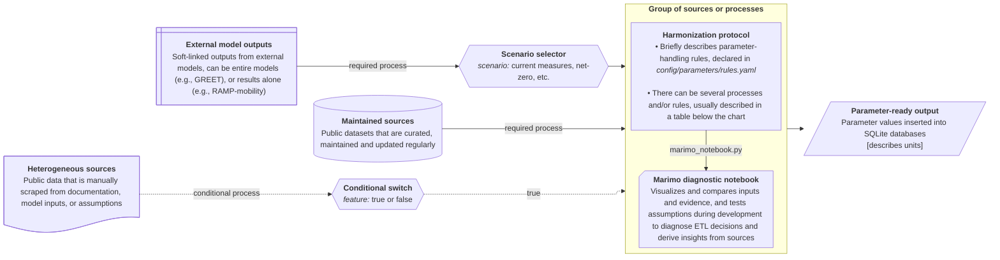

### `existing_capacity`

!!! note "Read capacity together with its lifetime representation"
    The [ageing chapter](model/ageing.md) distinguishes acquired vehicles, physical survivors and capacity supplied to Temoa. The selected representation governs the exported denominator. #to-review

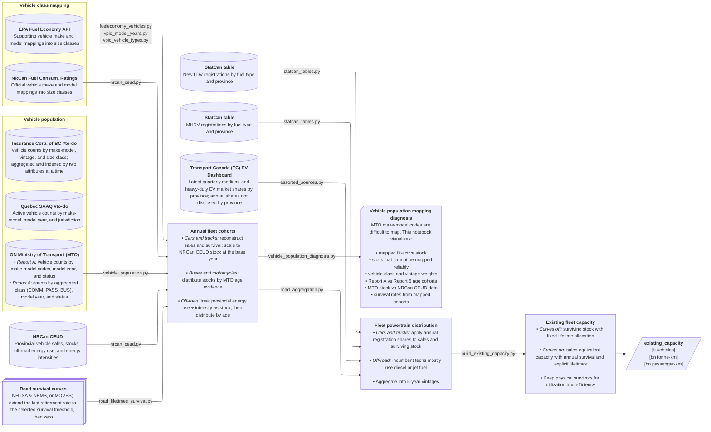

| Harmonization rule                                     | Affected classes      | Description                                                                                                                          |
| ------------------------------------------------------ | --------------------- | ------------------------------------------------------------------------------------------------------------------------------------ |
| Fetch vehicle counts by inferred size class            | Cars and light trucks | Map make-model-vintage keys with the reviewed NRCan and [*US FuelEconomy.gov*](https://www.fueleconomy.gov/feg/ws/index.shtml) evidence crosswalk                                       |
| Reconstruct and calibrate cohorts | Cars and trucks | `k = CEUD reference stock / sum(sales * survival)`, one factor per region/class; preserve annual acquisitions and survivors separately. [*Ontario MTO*](https://data.ontario.ca/dataset/vehicle-population-data) stock-age allocation is diagnostic only. #to-review |
| Retain stock-age allocation | Buses and motorcycles | Keep their existing [*Ontario MTO*](https://data.ontario.ca/dataset/vehicle-population-data) age distributions and fixed lifetime treatment. #to-review |
| Treat energy use<sub>province</sub>÷intensity as stock | Off-road modes        | Air, rail, and marine fleet size are estimated from the available supply capacity to satisfy demand by vintage (in demand units)      |
| Distribute stock by age                                | Off-road modes        | Available demand supply by vintage is estimated with a fleet turnover approximation assuming an avg. annual retirement of 1÷lifetime |
| Distribute stock<sub>age</sub> by powertrain           | Cars and light trucks | Each stock by vintage gets distributed over vehicle market shares by fuel type                                                       |
| Distribute stock<sub>age</sub> by powertrain           | MD trucks             | Each stock by vintage gets distributed over vehicle registration shares by fuel type – mainly diesel and gasoline                    |

#### Existing period handling
This example uses five-year vintage bins and the selected 2023 observation year:

| `period_mode: legacy` | `period_mode: prospective` |
| --------------------- | --------------------- | 
| - 2014 → 2015<br>- 2015 → 2015<br>- 2016 → 2020<br>- 2019 → 2020<br>- 2020 → 2020<br>- 2021 → 2023<br>- 2023* → 2023<br> | - 2014 → 2010<br>- 2015 → 2010<br>- 2016 → 2015<br>- 2019 → 2015<br>- 2020 → 2015<br>- 2021 → 2020<br>- 2023* → 2020<br> |

*The example uses the registered 2023 observation endpoint.*

### `demand`

!!! note "Keep observations and projected service separate"
    The [activity chapter](model/activity.md) explains the observed-year anchor, GDP growth and optional car/light-truck allocation. Parameter extension is not a new activity observation. #to-review

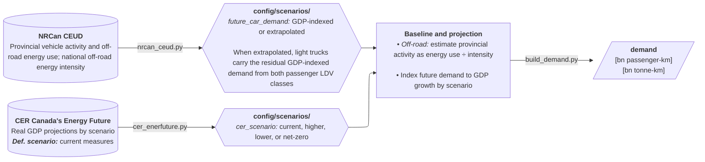

| Harmonization rule                                                      | Affected classes | Description                                                                                                    |
| ----------------------------------------------------------------------- | ---------------- | -------------------------------------------------------------------------------------------------------------- |
| Estimate provincial activity as energy use<sub>province</sub>÷intensity | Off-road modes   | Provincial energy consumption [PJ] divided by national energy intensity [PJ/bn-tkm] as provincial demand proxy |
| Index future demand to GDP growth                                       | All              | Base year demand is indexed to future GDP growth projections by scenario                                       |

### `limit_annual_capacity_factor`

!!! warning "Mileage profiles do not imply emitted age-dependent factors"
    The current schema emits the supported flat class baseline. Age-dependent mileage profiles remain diagnostic audit products until a joint period/vintage interface is available. #to-review

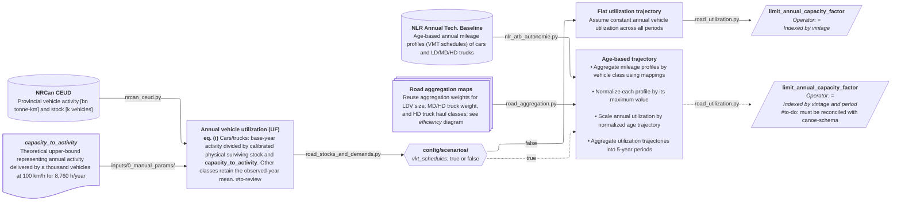

#### Equations

```math
(i)\;\mathrm{UF[\text{-}]}=\frac{\mathrm{Activity[bn\;tonne\text{-}km/year]}}{\mathrm{Stock[k\;units]}\cdot \mathrm{C2A[bn\;t\text{-}km/k\;units\cdot year]}}
```

**UF** is the dimensionless annual utilization fraction; **Activity** is annual
service in billion passenger-km or tonne-km; **Stock** is thousand physical
vehicles; and **C2A** is the capacity-to-activity scaling constant in billion
service-km per thousand vehicles per year. #to-review

| Harmonization rule                          | Affected classes | Description                                                                                                                                                           |
| ------------------------------------------- | ---------------- | --------------------------------------------------------------------------------------------------------------------------------------------------------------------- |
| Annual utilization as activity÷stock ratios | Road vehicles    | Represents how much activity a unit of capacity can deliver annually. Utilization is scaled with an arbitrary `capacity_to_activity` factor to avoid near-zero values |
| `capacity_to_activity` | Road vehicles    | An inconsequential scaling constant that represents the theoretical upper-bound of annual activity delivered by a thousand vehicle units operating year-round. |
| Assume constant annual utilization          | Road vehicles    | The emitted class-level baseline applies in every active operating period. Existing technologies are keyed to actual positive stock cohorts in each region; new technologies are keyed to model vintages. |
| Aggregate profiles and normalize            | Road vehicles    | Aggregate annual mileage profiles by vehicle size/weight class using aggregation mappings (see `efficiency` flowchart) and apply max scaling to each series           |
| Retain age-dependent mileage evidence | Road vehicles | Prepare normalized mileage trajectories as audit artifacts; emitted annual utilization remains the class-level baseline because the schema cannot index period and vintage together. #to-review |

### `lifetime_tech`, `lifetime_process` and `lifetime_survival_curve`

!!! warning "Registration changes are apparent retention"
    [*Ontario MTO*](https://data.ontario.ca/dataset/vehicle-population-data) edition-to-edition counts mix retirement with administrative changes and migration. Source schedules and their extrapolated tails remain distinct from those diagnostic observations. #to-review

```mermaid
---
config:
  layout: elk
  flowchart:
    nodeSpacing: 35
    rankSpacing: 50
    wrappingWidth: 250
---
flowchart LR
  %% ############ Sources ###########
  %% Source profile selection includes MOVES and NHTSA/NEMS. #to-review
  subgraph survival["US survival schedules"]
    direction LR
    s2[("`**NHTSA CAFE model**
      Car, light- and medium-truck survival rates`")]
    s3[("`**EIA NEMS model**
      HD truck scrappage rates (Class 7–8)`")]
    s7[("`**EPA MOVES6 model**
      Cars, light and heavy truck survival rates (Table C-1)`")]
  end

  subgraph population["Population evidence"]
    direction LR
    s0[("`**ON Ministry of Transport (MTO)**
      • *Report A:* vehicle counts by make-model codes, model year, and status`")]
    s1[("`**Quebec SAAQ #to-do**
      Active vehicle counts by make-model, model year, and jurisdiction`")]
  end

  s6@{shape: processes, label: "**Road aggregation maps**
    Reuse aggregation weights for LDV size, MD/HD truck weight, and HD truck haul classes; see *efficiency* diagram"}

  %% ############ Processes ###########
  p4@{shape: hex, label: "**config/scenarios/**
    *road_lifetime_survival_source:*
    NHTSA CAFE & EIA NEMS, or EPA MOVES6 rates"}
  s2 & s3 & s7 -- "assorted_sources.py" --> p4

  p0["`**Survival rate estimation**
    • **eq. (i)** Estimate apparent retirement from make-model-vintage cohorts across Report A editions before mapping<br>
    • The MTO make-model mapping separates LDV stock exposure from unmapped and non-LDV; and aggregates evidence accordingly<br>
    • **eq. (ii)** The empirical rates by class and age are the total apparent retirement (*D*) divided by total starting exposure (*E*)<br>
    • Production uses the selected NHTSA/NEMS or MOVES profile; MTO estimates remain diagnostic #to-review`"]
  p4 -- "road_lifetimes_survival.py" --> p0
  s0 -. "`vehicle_population.py
    *\*diagnostic-only*`" .-> p0
  s6 -- road_aggregation.py --> p0

  p0_2@{shape: notch-rect, label: "**Vehicle population mapping diagnosis**
    MTO make-model codes are difficult to map. This notebook visualizes:<br>
    • mapped fit-active stock
    • stock that cannot be mapped reliably
    • vehicle class and vintage weights
    • Report A vs Report 5 age cohorts
    • MTO stock vs NRCan CEUD data
    • survival rates from mapped cohorts"}
  p0 -- vehicle_population_diagnosis.py --> p0_2

  p1@{shape: hex, label: "**config/scenarios/**
    *survival_curves:* true or false"}
  p0 -- road_lifetimes_survival.py --> p1

  s4[("`**StatCan table**
    Buses avg. lifetime by province`")]
  s5@{shape: doc, label: "**SFU CIMS model assumptions**
    Lifetime of remaining modes"}

  p2@{shape: hex, label: "**config/scenarios/**
    *tail_derivation:* constant_retirement<br>
    *tail_survival_threshold:* 0.005 (0.5%)<br>
    *survival_curve_max_age:* optional hard zero cap; null derives the end age #to-review"}
  p1 -. true .-> p2

  p3["`**Fixed lifetimes**
    • Median lifetimes (p<sub>survival</sub>=0.5) by default when survival curves are disabled<br>
    • Get avg. lifetimes from remaining sources`"]
  p1 -- false --> p3
  s4 -- statcan_tables.py --> p3
  s5 -- inputs/0_manual_params/ --> p3

  p2 -. true .-> pt["`**Annual reconciled curves**
    Extend the last annual retirement rate to 0.5% survival, then zero; use the same schedule for stock calibration and vintage curves #to-review`"]
  pt -. "build_lifetime_parameters.py" .-> ol[/"`**lifetime_process**
    Explicit terminal year minus model vintage [years] #to-review`"/]
  pt -. "build_lifetime_parameters.py" .-> o1[/"`**lifetime_survival_curve**
    [-]`"/]
  p3 -- build_lifetime_parameters.py
  offroad_lifetimes.py --> o2[/"`**lifetime_tech**
    [years]`"/]

  %% --- Hyperlinks ---
  click s0 "https://data.ontario.ca/dataset/vehicle-population-data"
  click s1 "https://www.donneesquebec.ca/recherche/dataset/vehicules-en-circulation"
  click s2 "https://www.nhtsa.gov/file-downloads?p=nhtsa/downloads/CAFE/2024-FRM-LD-2b3-2027-2035/Central-Analysis/"
  click s3 "https://github.com/EIAgov/NEMS/blob/main/input/tdm/trnhdvx.xlsx"
  click s7 "https://nepis.epa.gov/Exe/ZyPDF.cgi?Dockey=P101CUN7.pdf#page=192"
  click s4 "https://doi.org/10.25318/3410025401-eng"
  click s5 "https://github.com/EMRG-SFU/cims-models/tree/main/sources/sectors"
```

#### Equations

```math
(i)\quad r^{\mathrm{MTO}}_{p,k,v,a}=\frac{N_{p,k,v,a+1}}{N_{p,k,v,a}}; \qquad a=t-v
```
where $\boldsymbol{r}$: apparent [*Ontario MTO*](https://data.ontario.ca/dataset/vehicle-population-data)-key survival rate, $\boldsymbol{p}$: Report A class (PASS or COMM), $\boldsymbol{k}$: abbreviated [*Ontario MTO*](https://data.ontario.ca/dataset/vehicle-population-data) make-model key, $\boldsymbol{v}$: vintage of that key, $\boldsymbol{a}$: vehicle age, $\boldsymbol{t}$: Report A edition year, and $\boldsymbol{N_{p,k,v,a}}$: observed FIT_ACTIVE stock.

```math
(ii)\quad R^{\mathrm{MTO}}_{c,a}=1 - \frac{\sum_v D_{c,v,a}}{\sum_v E_{c,v,a}}; \qquad E_{c,v,a}=\sum_{p,k → m(k,v)=c}N_{p,k,v,v+a}; \qquad D_{c,v,a}=\sum_{p,k → m(k,v)=c}\left(N_{p,k,v,v+a}-N_{p,k,v,v+a+1}\right)
```
where $\boldsymbol{R}$: aggregated vehicle class survival rate, $\boldsymbol{c}$: target vehicle class, $\boldsymbol{m(k,v)}$ reviewed class assigned to a particular [*Ontario MTO*](https://data.ontario.ca/dataset/vehicle-population-data)-key and vintage, $\boldsymbol{E}$: pooled starting exposure—the sum of beginning-of-transition stock contributing to a class-vintage-age estimate, $\boldsymbol{D}$: aggregated apparent retirements.

```math
S_c(a+1)=S_c(a)R_{c,a}; \qquad S_c(0)=1
```
The cumulative [*Ontario MTO*](https://data.ontario.ca/dataset/vehicle-population-data) survival $\boldsymbol{S_c(a)}$ is a product of those empirical rates with an explicit age-zero baseline, following the [*NHTSA CAFE*](https://www.nhtsa.gov/file-downloads?p=nhtsa/downloads/CAFE/2024-FRM-LD-2b3-2027-2035/Central-Analysis/) indexing method. Because no vehicle-level identifier links editions, **apparent retirements mix physical retirement with administrative status changes, migration, imports, re-registration, and [*Ontario MTO*](https://data.ontario.ca/dataset/vehicle-population-data)-key changes**.

| Harmonization rule | Affected classes | Description |
| --- | --- | --- |
| Standardize source survival schedules | Cars and trucks | Keep [*NHTSA CAFE*](https://www.nhtsa.gov/file-downloads?p=nhtsa/downloads/CAFE/2024-FRM-LD-2b3-2027-2035/Central-Analysis/) cumulative values. Convert [*EIA NEMS*](https://github.com/EIAgov/NEMS/blob/main/input/tdm/trnhdvx.xlsx) scrappage and [*EPA MOVES*](https://www.epa.gov/system/files/documents/2026-09/420r26010.pdf) annual retention to cumulative survival from one at age zero. [*EPA MOVES*](https://www.epa.gov/system/files/documents/2026-09/420r26010.pdf) rate at age a supplies survival at a+1, including rate40 to age41. #to-review |
| Map source schedules to model classes | Cars and trucks | [*NHTSA CAFE*](https://www.nhtsa.gov/file-downloads?p=nhtsa/downloads/CAFE/2024-FRM-LD-2b3-2027-2035/Central-Analysis/)/[*EIA NEMS*](https://github.com/EIAgov/NEMS/blob/main/input/tdm/trnhdvx.xlsx) uses [*NHTSA CAFE*](https://www.nhtsa.gov/file-downloads?p=nhtsa/downloads/CAFE/2024-FRM-LD-2b3-2027-2035/Central-Analysis/) cars, weighted light trucks, [*NHTSA CAFE*](https://www.nhtsa.gov/file-downloads?p=nhtsa/downloads/CAFE/2024-FRM-LD-2b3-2027-2035/Central-Analysis/) 2b/3 medium trucks and [*EIA NEMS*](https://github.com/EIAgov/NEMS/blob/main/input/tdm/trnhdvx.xlsx) heavy trucks. [*EPA MOVES*](https://www.epa.gov/system/files/documents/2026-09/420r26010.pdf) uses car/light/heavy schedules, with medium trucks sharing the heavy schedule. Apply configured class weights. #to-review |
| Compile fixed lifetimes | All | With curves off, selected car/truck classes use the first age at which source survival reaches 50% or less. Remaining modes retain [*StatCan*](https://www.statcan.gc.ca/en/developers/wds) or reviewed fixed lifetimes. #to-review |
| Select the lifetime representation | All | Curves off uses fixed lifetimes. Curves on uses annual survival and a matching process lifetime; Temoa computes period averages. #to-review |
| Reconcile terminal survival | Cars and trucks | Retain native values, extend the last annual retirement rate to 0.5% survival, then append zero. Apply an optional hard zero age from the scenario. Use this schedule for calibration and future survival; preserve annual totals when grouping vintages and audit any adjustment required by Temoa. #to-review |
| Estimate [*Ontario MTO*](https://data.ontario.ca/dataset/vehicle-population-data) annual changes before mapping | Cars and light trucks | Compare `FIT_ACTIVE` counts for the same make-model and model year in consecutive Report A editions. Keep increases as observed rather than forcing every annual ratio between zero and one. |
| Map and aggregate [*Ontario MTO*](https://data.ontario.ca/dataset/vehicle-population-data) diagnostics | Cars and light trucks | Attach reviewed vintage-range mappings only after the raw annual changes are calculated. Sum the starting and following counts by [*NLR ATB*](https://atb.nlr.gov/transportation/2024/data) and [*NRCan CEUD*](https://oee.nrcan.gc.ca/corporate/statistics/neud/dpa/menus/trends/comprehensive_tables/list.cfm) class and age before calculating class-level rates. |
| Limit and check [*Ontario MTO*](https://data.ontario.ca/dataset/vehicle-population-data) diagnostic evidence | Cars and light trucks | Use starting ages 0 through 35, including eligible pre-2000 model years. Report mapping coverage, age gaps, unusual rates, and sample support; do not fill missing ages or the older tail with [*NHTSA CAFE*](https://www.nhtsa.gov/file-downloads?p=nhtsa/downloads/CAFE/2024-FRM-LD-2b3-2027-2035/Central-Analysis/) or [*EIA NEMS*](https://github.com/EIAgov/NEMS/blob/main/input/tdm/trnhdvx.xlsx) values. |
| Keep [*Ontario MTO*](https://data.ontario.ca/dataset/vehicle-population-data) results diagnostic | Cars and light trucks | Treat the results as changes in registered stock, not direct observations of vehicle retirement. Compare them with accepted [*NHTSA CAFE*](https://www.nhtsa.gov/file-downloads?p=nhtsa/downloads/CAFE/2024-FRM-LD-2b3-2027-2035/Central-Analysis/) curves only after the [*Ontario MTO*](https://data.ontario.ca/dataset/vehicle-population-data) series is derived; production uses the configured [*NHTSA CAFE*](https://www.nhtsa.gov/file-downloads?p=nhtsa/downloads/CAFE/2024-FRM-LD-2b3-2027-2035/Central-Analysis/)/[*EIA NEMS*](https://github.com/EIAgov/NEMS/blob/main/input/tdm/trnhdvx.xlsx) or [*EPA MOVES*](https://www.epa.gov/system/files/documents/2026-09/420r26010.pdf) profile. #to-review |

**Notes:**

- **Execution boundary.** The default `parameterization.road_lifetimes_survival` command
  publishes accepted source-based curves and source-derived median lifetimes without
  loading [*Ontario MTO*](https://data.ontario.ca/dataset/vehicle-population-data) history or its reviewed mapping. `--mto-diagnostics` publishes the [*Ontario MTO*](https://data.ontario.ca/dataset/vehicle-population-data)
  review evidence; `--all` runs both paths.
- Detailed [*Ontario MTO*](https://data.ontario.ca/dataset/vehicle-population-data) filters, evidence checks, and comparisons are documented in
  `docs/insights/vehicle_population_diagnosis.py`.

### `efficiency`

!!! note "Keep consumption weighting and fuel boundaries explicit"
    Average physical consumption before inversion. The [energy method](model/energy.md) explains PHEV components, trajectory indexing and optional [*NRCan CEUD*](https://oee.nrcan.gc.ca/corporate/statistics/neud/dpa/menus/trends/comprehensive_tables/list.cfm) calibration. #to-review

*Note: Some technologies are not represented in this diagram; see
`config/parameters/rules.yaml` for implemented harmonization entries.*

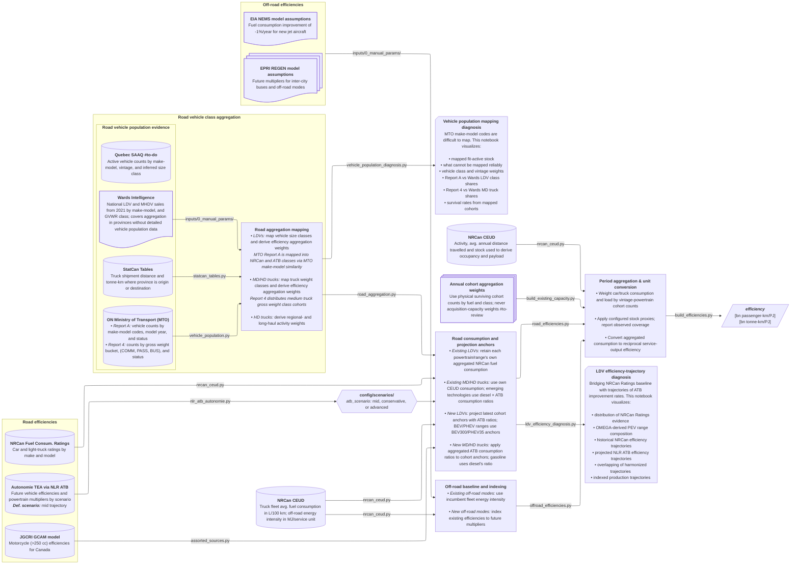

| Harmonization rule | Affected classes | Description |
| --- | --- | --- |
| Map size classes and derive aggregation weights | Cars and light trucks | - Map [*Ontario MTO*](https://data.ontario.ca/dataset/vehicle-population-data) make-model-vintage keys from normalized [*NRCan Ratings*](https://open.canada.ca/data/en/dataset/98f1a129-f628-4ce4-b24d-6f16bf24dd64), [*US FuelEconomy.gov*](https://www.fueleconomy.gov/feg/ws/index.shtml), and [*NHTSA vPIC*](https://vpic.nhtsa.dot.gov/api/) API evidence<br>- Derive latest-snapshot fleet composition weights by mapped vehicle class |
| Map weight classes and derive aggregation weights | MD/HD trucks | Map truck weight-rating counts to classes that align with [*ANL Autonomie*](https://vms.taps.anl.gov/tools/autonomie/) truck projection classes |
| Derive regional- and long-haul activity weights | Heavy-duty trucks | Group HD truck tonne-km into regional- and long-haul activity buckets to aggregate [*ANL Autonomie*](https://vms.taps.anl.gov/tools/autonomie/) haul classes |
| Aggregate NRCan ratings using mappings | Cars and light trucks | Within each exact model-year, size-class and powertrain/range cohort, average distinct make-models (or use the configured median), then apply [*Ontario MTO*](https://data.ontario.ca/dataset/vehicle-population-data) class weights. [*Ontario MTO*](https://data.ontario.ca/dataset/vehicle-population-data) supplies class/vintage evidence, not powertrain/range shares. |
| Retain each range's observed consumption | Cars and light trucks | Retain each range's exact NRCan history. Form PHEV totals from CD electricity/liquid fuel and CS fuel using the matched [*NLR ATB*](https://atb.nlr.gov/transportation/2024/data) bucket's utility factor. Missing years reduce coverage; only wholly empty bins may use a recorded, configured analogue. |
| Anchor future LDVs to Canadian cohorts | Cars and light trucks | Weight the latest historical period bin's consumption by physical survivor counts, independent of solver-capacity representation. #to-review Use each non-PEV's own [*NLR ATB*](https://atb.nlr.gov/transportation/2024/data) improvement ratio; BEV/PHEV ranges use BEV300/PHEV35 anchors: `C_range(y) = C_anchor × ATB_range(y) / ATB_anchor(reference)`. Use observed years in the latest configured historical bin, through `base_year`, to establish the anchor; use the configured [*NLR ATB*](https://atb.nlr.gov/transportation/2024/data) bridge reference year. #to-review |
| Derive emerging truck history | MD/HD trucks | Multiply annual [*NRCan CEUD*](https://oee.nrcan.gc.ca/corporate/statistics/neud/dpa/menus/trends/comprehensive_tables/list.cfm) diesel consumption by the aggregated [*NLR ATB*](https://atb.nlr.gov/transportation/2024/data) target/diesel consumption ratio at the first projection reference year. All truck histories use average fleet consumption as vintage proxies; emerging histories (e.g., battery trucks) are derived, not observed model-year efficiencies. |
| Project from the latest truck cohort | MD/HD trucks | Weight the latest period bin's incumbent or derived emerging consumption by its own cohort counts. Use an explicit diesel cohort proxy when an emerging powertrain has no positive own counts. Apply each powertrain's [*NLR ATB*](https://atb.nlr.gov/transportation/2024/data) future/reference consumption ratio (diesel's for gasoline); hold the load factor averaged with the same cohort weights. |
| Special handling of buses | Transit, school, intercity | Existing school/transit efficiencies are indexed backwards from [*NLR ATB*](https://atb.nlr.gov/transportation/2024/data) using [*NRCan CEUD*](https://oee.nrcan.gc.ca/corporate/statistics/neud/dpa/menus/trends/comprehensive_tables/list.cfm) historical service-intensity ratios. Intercity buses use an [*NLR ATB*](https://atb.nlr.gov/transportation/2024/data) transit diesel baseline with [*EPRI REGEN*](https://us-regen-docs.epri.com/v2025/assumptions/transportation.html) powertrain/diesel consumption ratios; HEVs retain the [*NLR ATB*](https://atb.nlr.gov/transportation/2024/data) transit HEV/diesel ratio. |
| Special handling of motorcycles | Motorcycles | Future efficiencies retain the [*NRCan CEUD*](https://oee.nrcan.gc.ca/corporate/statistics/neud/dpa/menus/trends/comprehensive_tables/list.cfm) baseline and apply [*JGCRI GCAM*](https://github.com/JGCRI/gcam-core/tree/master/input/gcamdata/inst/extdata/energy) consumption ratios from `UCD_trn_data_CORE.csv`; where motorcycle `engine > 250 cc`. |
| Prepare period consumptions | All | Through `base_year`, use the [existing-period year bins](#existing-period-handling). Average car/truck consumption per distance and occupancy/payload with cohort counts before lifetime filtering/redistribution; renormalize over observed years and report covered stock. Normalize each existing LDV PEV range over its supported years, then apply the complete [*EPA OMEGA*](https://github.com/USEPA/EPA_OMEGA_Model) share vector. Weight annual bus, motorcycle and off-road consumption/intensity equally; derive future consumption at interval-end years. |
| Convert to service-output efficiency units | All | Finally, divide aggregated occupancy/payload by aggregated energy per vehicle-km. For [*NRCan CEUD*](https://oee.nrcan.gc.ca/corporate/statistics/neud/dpa/menus/trends/comprehensive_tables/list.cfm) energy-per-service inputs, invert the aggregated intensity once. Convert fuel economy and relative efficiency factors to consumption before indexing or averaging, using configured HHVs and units. |

#### Notes

- Annual PHEV blend technologies use `limit_tech_input_split_annual` for their utility-weighted annual average fuel/electricity consumption split.
!!! note "PHEV architecture changes the comparison basis"
    Current [*NLR ATB*](https://atb.nlr.gov/transportation/2024/data) parameters use Voltec EREV PHEVs. The retained legacy comparison uses parallel PHEVs from [*ANL Autonomie*](https://vms.taps.anl.gov/tools/autonomie/); their parameter differences include that architecture choice. #to-review
- Demand from other off-road modes includes vehicles not registered for on−road travel such as ATVs, snowmobiles, golf carts and some military vehicles, as per [*NRCan CEUD*](https://oee.nrcan.gc.ca/corporate/statistics/neud/dpa/menus/trends/comprehensive_tables/list.cfm) notes; assumed to consume diesel only, passed directly as units of PJ for complete secondary-energy accounting.

#### Vehicle make-model to vehicle classes mapping

The [canonical vehicle reference](../config/parameters/vehicle_reference.csv) owns
year-scoped vehicle identities and classes. The [source-link table](../config/parameters/vehicle_source_links.csv)
owns native labels and their supporting evidence. Mapping uses those reviewed
scopes rather than model-name-only examples. #to-review

### `cost_invest`

!!! warning "Diagram limitation: price factors differ by vehicle family"
    Parameterization divides [*NLR ATB*](https://atb.nlr.gov/transportation/2024/data)
    retail prices by 1.5 for LDVs and 1.2 for MHDVs; retail MSRP is retained
    separately for the LDV repair equation. #to-review
    The diagram's common 1.5 label omits this distinction. #to-fix: the MHDV
    markup label must show 1.2 to describe current investment costs accurately.

*Note: Some technologies are not represented in this diagram; see
`config/parameters/rules.yaml` for implemented harmonization entries.*

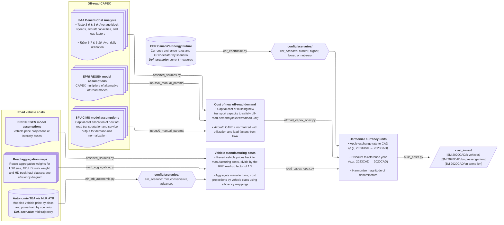

**Cost per block-hour** is maintenance cost per aircraft operating hour;
**Block speed** is distance per hour; **Seats** or **Tonnes** is carrying
capacity; and **Load factor** is the occupied fraction. The quotient is cost
per passenger-distance or tonne-distance, before unit harmonization. #to-review

| Harmonization rule | Affected classes | Description |
| --- | --- | --- |
| Reuse road aggregation maps | - Cars and light trucks<br>- MD/HD trucks<br>- Heavy-duty trucks | - Map vehicle make/model counts to size classes that align with [*NRCan Ratings*](https://open.canada.ca/data/en/dataset/98f1a129-f628-4ce4-b24d-6f16bf24dd64) and [*ANL Autonomie*](https://vms.taps.anl.gov/tools/autonomie/) projections<br>- Map truck weight-rating counts to classes that align with [*ANL Autonomie*](https://vms.taps.anl.gov/tools/autonomie/) truck projection classes<br>- Group HD truck tonne-km into regional- and long-haul activity buckets to aggregate [*ANL Autonomie*](https://vms.taps.anl.gov/tools/autonomie/) haul classes |
| Revert vehicle prices back into manufacturing costs | Road vehicles | Current [*NLR ATB*](https://atb.nlr.gov/transportation/2024/data) treatment divides retail prices by RPE 1.5 for LDVs and 1.2 for MHDVs; the resulting manufacturing-cost proxy retains its source and dollar-year evidence. #to-review |
| Aggregate manufacturing costs using mappings | Cars and trucks | Use mapped weights to aggregate [*ANL Autonomie*](https://vms.taps.anl.gov/tools/autonomie/) projected manufacturing costs of cars, LD, MD, and HD trucks, and school and transit buses |
| CAPEX of new off-road demand capacity | Off-road modes | Obtain input capital costs of building new supply capacity that satisfies off-road demand, derived as dollars per demand unit |
| Special handling of buses | Intercity buses | Use [*EPRI REGEN*](https://us-regen-docs.epri.com/v2025/assumptions/transportation.html) vehicle purchase cost assumptions for intercity buses |
| Special handling of motorcycles | Motorcycles | Use [*JGCRI GCAM*](https://github.com/JGCRI/gcam-core/tree/master/input/gcamdata/inst/extdata/energy) Canada transportation inputs from `UCD_trn_data_CORE.csv` for future motorcycle (engine >250 cc) purchase costs |
| Harmonize currency units | All | Convert values using foreign currencies and/or different dollar years into reference currency-year |

### `cost_variable`

!!! warning "Use the empirical relationship within its stated limits"
    The [technology-cost chapter](model/technology.md#maintenance-and-repair) explains repair evidence, age handling and price-basis limitations. Convert vehicle-distance costs using the same occupancy/payload as efficiency. #to-review

*Note: Some technologies are not represented in this diagram; see
`config/parameters/rules.yaml` for implemented harmonization entries.*

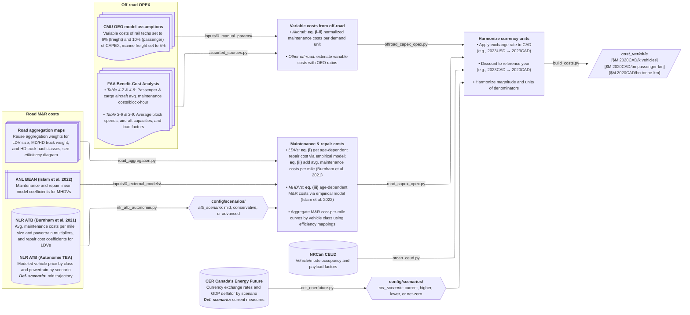

#### Road M&R equations

```math
(i)\; \mathrm{Repair}^{LDV}_{age}=\mathrm{size}\cdot \mathrm{pwt}\cdot C_{age}\cdot e^{\beta\cdot \mathrm{price}}
```

```math
(ii)\; \mathrm{M\&R}^{LDV}_{age}=\mathrm{Repair}^{LDV}_{age}+\mathrm{Maint.}^{LDV}
```

```math
(iii)\; \mathrm{M\&R}^{MHDV}_{age}=\mathrm{pwt}(m\cdot \mathrm{age}+b)
```

In these relationships, **Repair** and **Maint.** are repair and scheduled
maintenance per vehicle-mile; **age** is years; **size** and **pwt** are
dimensionless size/powertrain multipliers; **C** is the source age coefficient;
**price** is retail MSRP on its registered currency/year basis; $\boldsymbol{\beta}$
has reciprocal-currency units; **m** is the medium/heavy-truck slope in source
currency per mile per year; and **b** is its intercept in source currency per mile. Detailed coefficients
and transfer limitations are retained in [cost assumptions](assumptions.md#cost_variable). #to-review

#### Off-road M&R equations

```math
(i)\; \mathrm{M\&R}^\mathrm{Air\;travel}=\frac{\mathrm{Cost\;per\;block\text{-}hour}}{\mathrm{Block\;speed}\cdot \mathrm{Seats}\cdot \mathrm{Load\;factor}}
```

```math
(ii)\; \mathrm{M\&R}^\mathrm{Air\;freight}=\frac{\mathrm{Cost\;per\;block\text{-}hour}}{\mathrm{Block\;speed}\cdot \mathrm{Tonnes}\cdot \mathrm{Load\;factor}}
```

**Cost per block-hour** is maintenance cost per aircraft operating hour;
**Block speed** is distance per hour; **Seats** or **Tonnes** is carrying
capacity; and **Load factor** is the occupied fraction. The quotient is cost
per passenger-distance or tonne-distance, before unit harmonization. #to-review

| Harmonization rule | Affected classes | Description |
| --- | --- | --- |
| Reuse road aggregation maps | - Cars and light trucks<br>- MD/HD trucks<br>- Heavy-duty trucks | - Map vehicle make/model counts to size classes that align with [*NRCan Ratings*](https://open.canada.ca/data/en/dataset/98f1a129-f628-4ce4-b24d-6f16bf24dd64) and [*ANL Autonomie*](https://vms.taps.anl.gov/tools/autonomie/) projections<br>- Map truck weight-rating counts to classes that align with [*ANL Autonomie*](https://vms.taps.anl.gov/tools/autonomie/) truck projection classes<br>- Group HD truck tonne-km into regional- and long-haul activity buckets to aggregate [*ANL Autonomie*](https://vms.taps.anl.gov/tools/autonomie/) haul classes |
| Vehicle prices used in repair cost empirical model | LDVs | Use the registered retail MSRP in the empirical repair relationship, retaining its source-year/currency basis. The investment-cost RPE divisor does not modify this input. #to-review |
| Aggregate M&R costs using mappings | Cars and trucks | Use mapped weights to aggregate M&R cost curves of cars, LD, MD, and HD trucks, and transit buses |
| Variable costs from off-road | Off-road modes | - Estimate annual variable costs of rail and marine vessels with CAPEX-to-OPEX ratios used in the [*OEO*](https://github.com/TemoaProject/oeo/tree/master/database_documentation) model<br>- Estimate M&R costs per demand unit with empirical data from the [*FAA Economic Values*](https://www.faa.gov/regulations_policies/policy_guidance/benefit_cost), converting miles to km and tons to tonnes; same annual utilization and load factors are used for CAPEX and OPEX |
| Special handling of buses | School and intercity buses | Assume same CAPEX-to-OPEX ratios as those from transit buses |
| Special handling of motorcycles | Motorcycles | Use [*JGCRI GCAM*](https://github.com/JGCRI/gcam-core/tree/master/input/gcamdata/inst/extdata/energy) Canada transportation inputs from `UCD_trn_data_CORE.csv` for future motorcycle (engine >250 cc) M&R costs |
| Harmonize currency units | All | - Convert values using foreign currencies and/or different dollar years into reference currency-year<br>- Harmonize denominators; convert miles into km and multiply by [*NRCan CEUD*](https://oee.nrcan.gc.ca/corporate/statistics/neud/dpa/menus/trends/comprehensive_tables/list.cfm) load factors |

#### Notes

[*FAA Economic Values*](https://www.faa.gov/regulations_policies/policy_guidance/benefit_cost) source PDFs: [Section 3 — Aircraft Capacity and Utilization Factors](https://www.faa.gov/regulations_policies/policy_guidance/benefit_cost/econ-value-section-3-capacity.pdf) and [Section 4 — Aircraft Operating Costs](https://www.faa.gov/regulations_policies/policy_guidance/benefit_cost/econ-value-section-4-op-costs.pdf).

### `emission_embodied`

!!! note "Preserve lifetime vehicle-cycle totals"
    These factors apply to new manufacture, with separate gas units and a defined vehicle-cycle scope. They are distinct from fuel-cycle and operating emissions. #to-review

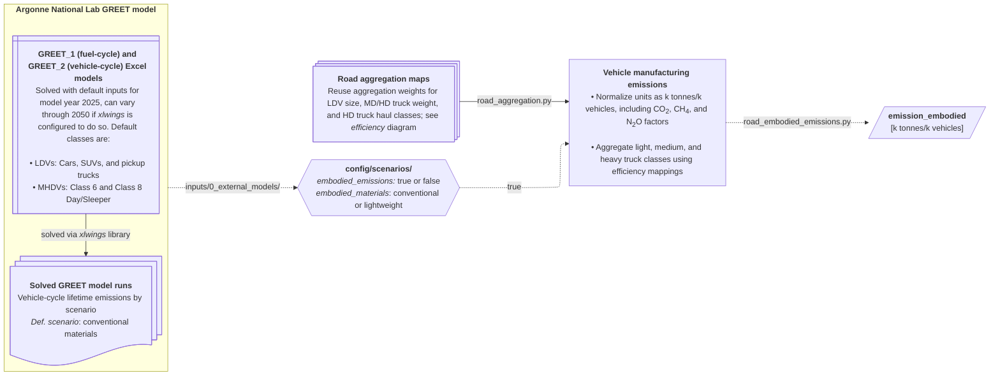

**Cost per block-hour** is maintenance cost per aircraft operating hour;
**Block speed** is distance per hour; **Seats** or **Tonnes** is carrying
capacity; and **Load factor** is the occupied fraction. The quotient is cost
per passenger-distance or tonne-distance, before unit harmonization. #to-review

| Harmonization rule | Affected classes | Description |
| --- | --- | --- |
| Reuse road aggregation maps | - Cars and LD trucks<br>- MD/HD trucks<br>- Heavy-duty trucks | - Map vehicle make/model counts to size classes that align with [*NRCan Ratings*](https://open.canada.ca/data/en/dataset/98f1a129-f628-4ce4-b24d-6f16bf24dd64) and [*ANL Autonomie*](https://vms.taps.anl.gov/tools/autonomie/) projections<br>- Map truck weight-rating counts to classes that align with [*ANL Autonomie*](https://vms.taps.anl.gov/tools/autonomie/) truck projection classes<br>- Group HD truck tonne-km into regional- and long-haul activity buckets to aggregate [*ANL Autonomie*](https://vms.taps.anl.gov/tools/autonomie/) haul classes |
| Vehicle manufacturing emissions | Cars and trucks | - Default vehicle-lifetime emissions from [*ANL GREET*](https://greet.anl.gov/greet/versions.html)-2 are extracted directly, solved for model year 2025 and normalized by k tonnes per thousand vehicles manufactured; model years 2030 through 2050 remain available.<br>- [*ANL GREET*](https://greet.anl.gov/greet/versions.html) 2 calculates the emissions associated with the production and processing of vehicle materials, the manufacturing and assembly of the vehicle, and the EOL decomissioning. EOL credits from material recycling are not considered. Emissions from the transportation of raw and processed materials for each process step are neglected. |

### EV charger parameters

!!! warning "Port count, rated power and throughput are different quantities"
    Use expenditure divided by rated power for charger costs. The [infrastructure chapter](model/infrastructure.md) defines utilization, loss accounting and the different hydrogen-refueling capacity basis. #to-review

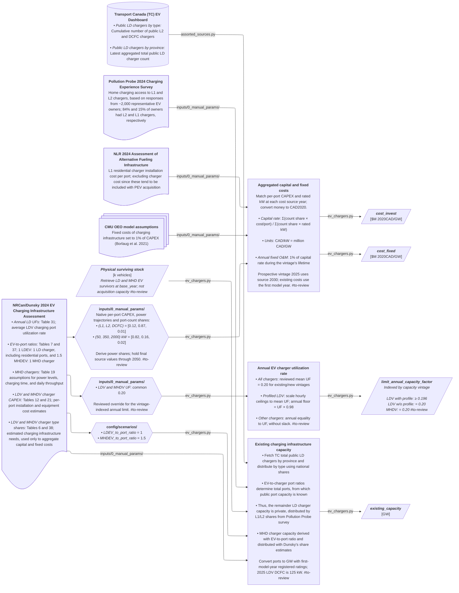

| Harmonization rule | Affected classes | Description |
| --- | --- | --- |
| Aggregated capital and fixed costs | LDV and MHDV chargers | Match native per-port costs and ratings by source year; convert currency, then divide total port expenditure by total rated power. Derive power shares from count shares × kW. Fixed O&M is 1% annually within the vintage lifetime. #to-review |
| Annual EV charger UF | LDV and MHDV chargers | Reviewed common UF = 0.20 for every existing/new vintage. Profiled LDV ceilings have mean 0.20 and annual floor 0.196; no-profile LDV and MHDV use equality 0.20. #to-review |
| Existing charging capacity | LDV and MHDV chargers | Preserve TC public counts, reviewed EV-to-port ratios and private/type mixes. Convert ports with first-model-year registered power trajectories; audit the selected source year and ratings. #to-review |
| Charger efficiency | LDV and MHDV chargers | Unity accounting transfer avoids repeating losses embedded in vehicle consumption. Reviewed ICCT factors remain unapplied; motorcycle losses are omitted, and [*EPRI REGEN*](https://us-regen-docs.epri.com/v2025/assumptions/transportation.html)'s intercity-bus boundary is undisclosed. #to-review |

### `limit_new_capacity_share` for LD-PEV range composition

!!! note "Within-family shares leave total technology adoption open"
    The [range method](model/technology.md#range-is-a-representation-choice) explains the evidence and optimizer choices. Frozen charging composition is not reweighted by the new-vehicle shares. #to-review

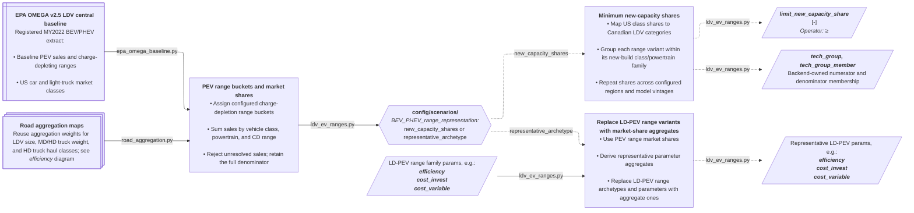

| Harmonization rule | Affected classes | Description |
| --- | --- | --- |
| PEV range buckets | Light-duty BEVs and PHEVs | Get [*EPA OMEGA*](https://github.com/USEPA/EPA_OMEGA_Model) baseline vehicle classes, charge-depleting (CD) miles, and modeled sales. Map regulatory `truck` to `light_truck`; use sales weights and CD-range buckets: BEV ≤150, (150, 250], (250, 350], and >350 miles; PHEV <35 and ≥35 miles. [*NRCan Ratings*](https://open.canada.ca/data/en/dataset/98f1a129-f628-4ce4-b24d-6f16bf24dd64) use these same buckets. |
| Scenario range representation | Light-duty BEVs and PHEVs | `none` adds no new-vehicle range constraints; `representative_archetype` replaces new range families with representative aggregates; `new_capacity_shares` enforces fixed market-share constraint on PEV range compositions by class.  |
| Minimum new-capacity shares | Light-duty BEVs and PHEVs | Numerator: one range variant. Denominator: all range variants in the same category/powertrain. Validate complete, unambiguous template membership; emit `ge` (≥) shares for every configured region/model vintage, excluding existing stock. |
| Representative aggregates | Light-duty BEVs and PHEVs | Use supplied, validated parameter batches, without share constraints; require complete coverage, matching units, and identical utilization, fixed lifetimes, and range survival curves. Its PHEV horizon-mean energy split conserves total energy; component-fuel differences are audited. |
| Existing stock and charging composition | Existing LD BEVs/PHEVs | Existing representatives reuse [*EPA OMEGA*](https://github.com/USEPA/EPA_OMEGA_Model) weights for range-specific parameters independently of the new-vehicle mode, preserving stock totals and cohort ages. Frozen charging profiles already contain fleet/range composition; do not multiply them by these shares again. |

### `capacity_factor_tech` for BEV charging profiles; pending refactor

The preserved diagram describes inherited simulation choices. Current ingestion
reads registered minute-resolution output, computes hourly means, and scales the
native 8,760-hour mean to the selected annual utilization; it does not rerun the
simulation or add a rolling filter. Final representative-period weights need a
separate mean-consistency correction. #to-review

Registered [*RAMP-mobility*](https://github.com/RAMP-project/RAMP-mobility) outputs provide the charging shapes. The native build reads the registered minute-resolution series and prepares hourly means; it does not generate new travel simulations. #to-review

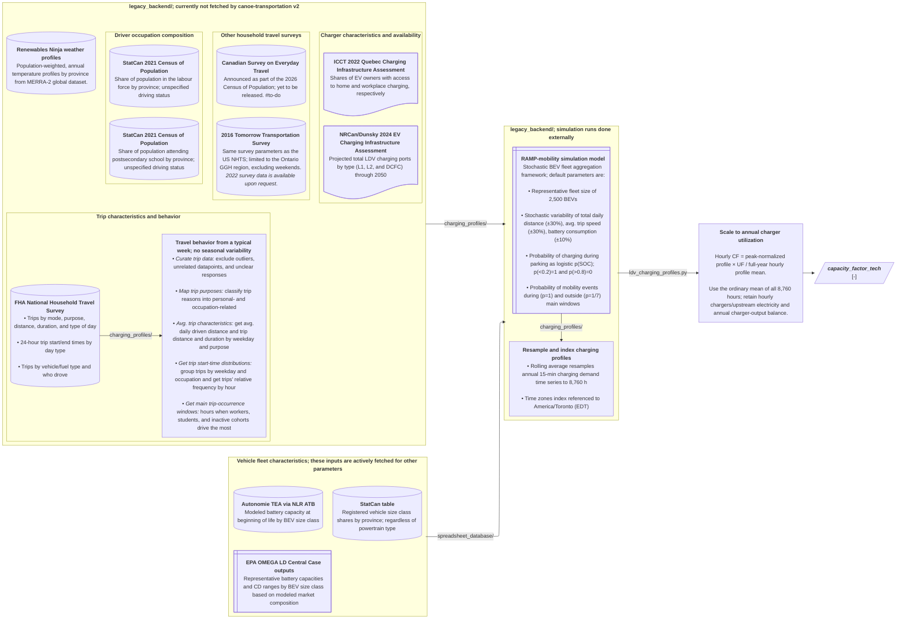

**Representative period clustering (pending refactor).** The current calculation
uses the ordinary mean of 8,760 equal-duration hours. After selecting or clustering
representative periods, rescale the charging shape using the final model time-slice
weights: cluster frequency × slice duration, normalized to fractions of the year.
An unweighted mean of representative slices can change annual utilization. #to-review

For representative shape $\boldsymbol{p_i}$, normalized annual weights $\boldsymbol{w_i}$, and annual charger
utilization target $\boldsymbol{U}$, use the same weights as the model's annual energy balance:
#to-review

```math
\mu_w = \sum_i w_i p_i,\quad \sum_i w_i = 1,\qquad
\mathrm{CF}_i = p_i\,\frac{U}{\mu_w},\quad
\sum_i w_i\,\mathrm{CF}_i = U.
```

For **`U = 0.20`**, the weighted mean of charging ceilings must remain 20%. Do not
multiply each **`CF_i`** by its weight again. The annual utilization floor remains
separate (`0.98 × U = 0.196` for new LDV chargers). Check the weighted mean and
`0 ≤ CF_i ≤ 1`; reject infeasible scaling rather than clipping. Apply this rescaling
in the upstream clustering step; the current transport projection requires a
complete mapping that preserves the full-year integral. #to-review

### Compact manual parameter selectors

Manual lifetime, efficiency, and cost tables use `technology_class` as an exact
selector for `technology.csv` `category`. When present, `powertrain` selects
`sub_category`; configured aliases reconcile reviewed label variants, `all`
selects the complete category, `remainder` excludes explicit peer selectors for
the same parameter, and a terminal year such as `_2035` is retained as
`selector_year`. `parameterization.manual_parameters` never edits the manual
tables: it publishes the row-to-technology expansion, reconciliation, registry,
and unmatched-selector findings under `inputs/1_interim/`.
