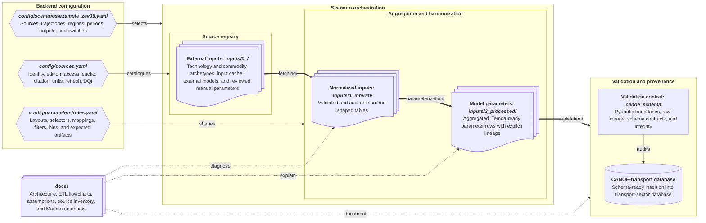

# Executive Summary

## Transport as part of the energy system

The CANOE transportation backend gives researchers a reproducible way to represent
Canadian passenger and freight transport in an energy-system model. It starts from
registered fleet, travel, technology and infrastructure evidence. It produces a
scenario-specific CANOE/Temoa v4 SQLite database and exposes the same transport
contribution for a caller-owned CANOE database.

Vehicle technologies turn fuels or electricity into passenger-kilometres and
tonne-kilometres. The model tracks road fleets by class, powertrain and vintage,
represents service from air, rail and marine technologies, and includes direct
energy demand from other off-road equipment. Charging and hydrogen refueling link
vehicle activity to upstream energy supply. This structure lets researchers study
how fleet turnover, technology costs and energy infrastructure shape the cost and
timing of transport transitions.

## Backend at a glance

The diagram uses an illustrative scenario path. Start from the current
[`default.yaml`](../config/scenarios/default.yaml) and use the [scenario guide](scenario_configuration.md)
to change selections. The source registry records publisher editions, citations
and data-quality evidence. Parameter rules specify how to interpret and combine
those inputs. The scenario specifies which methods and evidence to use for a run.

## What changes when a researcher changes the scenario?

**Fleet turnover changes the pace of replacement.** The backend reconstructs
historical road cohorts from acquisitions and retirement evidence, then calibrates
the surviving stock to the Natural Resources Canada reference. Fixed lifetimes
represent existing capacity as physical survivors and retire a vintage at a
specified age. Survival curves represent capacity on an acquisition-equivalent
basis and apply age-dependent survival through the vintage's operating life.
These choices change when existing capacity becomes unavailable and new purchases
are needed. Period timing also matters because opening and closing conditions can
select different years of demand and technology evidence.

**Technology detail changes what the optimizer can choose.** The backend links
the fleet composition used in vehicle consumption, costs and embodied emissions.
For new light-duty plug-in vehicles, researchers can retain individual ranges,
constrain the within-family range mix, or use a representative technology.
The range-share option applies US modelled range evidence without imposing a
share of plug-in vehicles in total sales. When enabled, vehicle-cycle emissions
account for manufacturing and end-of-life emissions as a separate contribution
from fuel use. The option makes it possible to examine the consequences of vehicle
technology choices beyond tailpipe energy and emissions.

**Charging detail changes the infrastructure question.** The default aggregates
chargers by light-duty and medium/heavy-duty vehicle group. Registered Ontario
charging simulations can constrain when pooled light-duty chargers operate,
with the full-year hourly mean scaled to the reviewed 20% utilization target.
The explicit alternative separates public and private light-duty charging and
overnight and fast truck charging. It constrains the mix in rated GW, so adding
many small ports has a different effect from adding a few high-power ports.
Explicit chargers currently use annual utilization without the pooled hourly
profiles. The distinctions are especially important when interpreting electricity
peaks or comparing charger investment across scenarios. See the [charging and
refueling chapter](model/infrastructure.md) for the denominators and sources.

## How collaborators can check or extend the work

A native build replays the registered inputs locally, regenerates the parameter
families, and checks their coverage, units, support and provenance before
publishing SQLite. The audit path preserves normalized source values and
parameter-ready tables. The validation report and logs identify the selected
evidence and record checks and fallbacks. Collaborators can compare matched
scenarios while holding their other choices fixed. Start with [building and
inspecting a scenario](getting_started.md).

The model chapters explain the physical quantities and equations. For example,
charger investment cost per GW divides port expenditure by rated power. The
[parameter derivations](etl_flowcharts.md) trace the inputs, conversions and rows.
Diagnostic notebooks show where vehicle matching is incomplete, how ratings
combine into fleet consumption, and how utilization scales hourly charging.
Collaborators can revisit the source or assumption and repeat the comparison.

## Research limits and CANOE-main integration

Fitting fleet stock or service totals establishes closure at the fitted level.
Individual historical cohorts remain uncertain. Ontario composition and travel
proxies, US survival and range evidence, and incomplete vehicle matching limit
how directly results transfer across Canada. Estimated private charger counts and
adopted utilization assumptions also affect the infrastructure results. Use the
[assumptions reference](assumptions.md) to identify where sensitivities matter.
Behavioural adoption constraints, dynamic modal shift and a spatial charging
network remain research extensions.

The transport backend exposes the same parameter preparation and validated
insertion for standalone builds and multi-sector assembly. In CANOE-main,
the orchestrator provides the common model axes and connects transport to
upstream energy supply. The [integration chapter](model/integration.md)
describes how to configure that boundary and verify the combined model.
