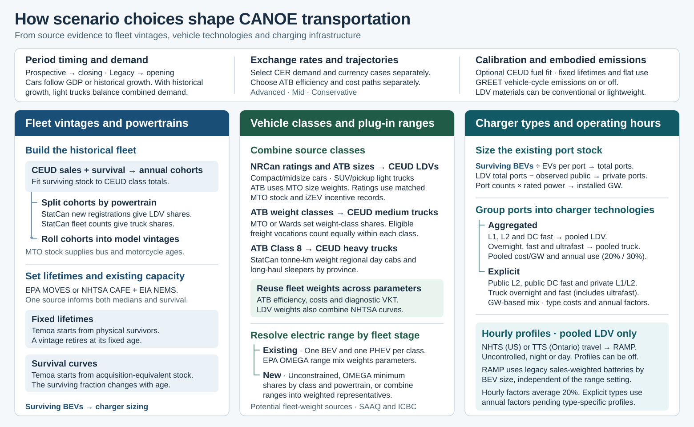

# Executive Summary

## Transport as part of the energy system

The CANOE transportation backend gives researchers a reproducible way to represent
Canadian passenger and freight transport in an energy-system model. It starts from
registered fleet, travel, technology and infrastructure evidence. It produces a
scenario-specific CANOE/Temoa v4 SQLite database and exposes the same transport
contribution for a caller-owned CANOE database.

Vehicle technologies turn fuels or electricity into passenger-kilometres and
tonne-kilometres. The model tracks road fleets by class, powertrain and vintage,
represents service from air, rail and marine technologies, and includes direct
energy demand from other off-road equipment. Charging and hydrogen refueling link
vehicle activity to upstream energy supply. This structure lets researchers study
how fleet turnover, technology costs and energy infrastructure shape the cost and
timing of transport transitions.

## Backend at a glance

The diagram uses an illustrative scenario path. Start from the current
[`default.yaml`](../config/scenarios/default.yaml) and use the [scenario guide](scenario_configuration.md)
to change selections. The source registry records publisher editions, citations
and data-quality evidence. Parameter rules specify how to interpret and combine
those inputs. The scenario specifies which methods and evidence to use for a run.

## What changes when a researcher changes the scenario?

Use these choices to design a scenario comparison. The [scenario guide](scenario_configuration.md#parameter-settings)
lists the configuration keys and supported combinations.

-   **Period timing and CER scenarios**

    **Period mode.** Prospective uses closing-year conditions. Legacy uses
    opening-year conditions.

    **CER scenarios.** Choose currency conversion and demand growth separately.

-   **Fleet aggregation and turnover**

    **Regional fleet weights.** MTO for bus and motorcycle ages and light-duty
    classes. MTO or Wards for medium-truck classes. StatCan for heavy-truck haul.

    **Fixed lifetimes or survival curves.** For cars and trucks, fixed lifetimes
    put surviving stock in Temoa's `existing_capacity`. Curves use
    acquisition-equivalent capacity and apply survival by age. The lifetime
    evidence is EPA MOVES or NHTSA CAFE with EIA NEMS.

-   **Demand and road utilization**

    **Car demand.** Use GDP growth or extend the historical car trend. Under the
    historical trend, passenger light trucks absorb the difference so combined
    demand still follows GDP.

    **Road mileage.** SQLite builds use flat annual utilization. Age-dependent
    mileage schedules (VKT) are **diagnostic only**.

-   **Efficiency and costs**

    **Independent ATB trajectories.** Choose Advanced, Mid, or Conservative
    separately for vehicle efficiencies and costs.

    **Optional energy calibration.** Fit eligible gasoline and diesel use to
    NRCan CEUD totals. Requires fixed lifetimes and flat utilization.

-   **EV infrastructure and charging**

    **Existing ports.** Divide surviving battery EVs by the EVs-per-port ratio.
    For light-duty chargers, subtract observed public ports to estimate private
    stock.

    **Charger detail.** Pool by vehicle group or distinguish public, private
    and truck charger types. **Explicit types use annual factors only.**

    **Hourly profiles.** Pooled light-duty chargers can use US NHTS or Ontario
    TTS travel data and uncontrolled, night, or day charging. Profiles are optional.

-   **Plug-in range and embodied emissions**

    **New light-duty plug-ins.** Keep all variants without range-share rules,
    set minimum range shares within each class and powertrain, or use a
    representative range archetype. Existing cohorts use representative ranges.

    **Embodied emissions.** Turn road vehicle-cycle emissions on or off. With
    emissions on, choose conventional or lightweight GREET inputs for light-duty vehicles.

Quebec SAAQ and British Columbia ICBC vehicle population data are candidates for
future regional fleet weights.

<figure class="wide-figure scenario-choices-figure" markdown="1">

<figcaption markdown="1">
Follow where fleet, battery and charger detail is combined or split and which
parameters it affects. Select the diagram to open the full-size SVG.
</figcaption>

</figure>

## How collaborators can check or extend the work

A native build replays the registered inputs locally, regenerates the parameter
families, and checks their coverage, units, support and provenance before
publishing SQLite. The audit path preserves normalized source values and
parameter-ready tables. The validation report and logs identify the selected
evidence and record checks and fallbacks. Collaborators can compare matched
scenarios while holding their other choices fixed. Start with [building and
inspecting a scenario](getting_started.md).

The model chapters explain the physical quantities and equations. For example,
charger investment cost per GW divides port expenditure by rated power. The
[parameter derivations](etl_flowcharts.md) trace the inputs, conversions and rows.
Diagnostic notebooks show where vehicle matching is incomplete, how ratings
combine into fleet consumption, and how utilization scales hourly charging.
Collaborators can revisit the source or assumption and repeat the comparison.

## Research limits and CANOE-main integration

Fitting fleet stock or service totals establishes closure at the fitted level.
Individual historical cohorts remain uncertain. Ontario composition and travel
proxies, US survival and range evidence, and incomplete vehicle matching limit
how directly results transfer across Canada. Estimated private charger counts and
adopted utilization assumptions also affect the infrastructure results. Use the
[assumptions reference](assumptions.md) to identify where sensitivities matter.
Behavioural adoption constraints, dynamic modal shift and a spatial charging
network remain research extensions.

The transport backend exposes the same parameter preparation and validated
insertion for standalone builds and multi-sector assembly. In CANOE-main,
the orchestrator provides the common model axes and connects transport to
upstream energy supply. The [integration chapter](model/integration.md)
describes how to configure that boundary and verify the combined model.
