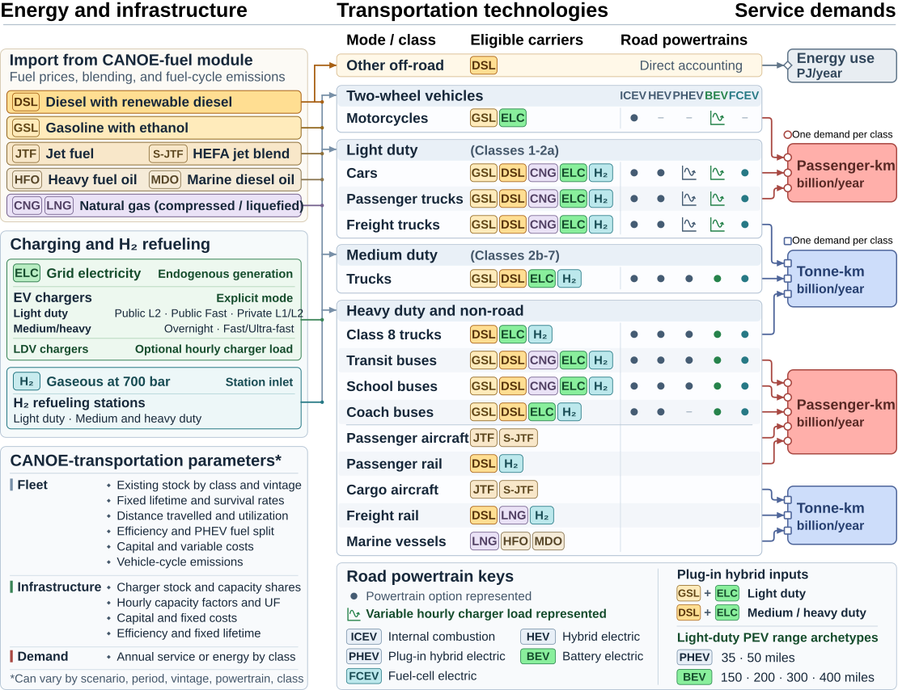

# CANOE transportation

The CANOE transportation backend builds scenario-specific SQLite databases for
CANOE and Temoa with parameters linked to source evidence and reviewed
assumptions. The system diagram connects energy carriers and infrastructure to
transport technologies and annual demand. It shows explicit charger types and
the separate option to apply hourly profiles to aggregated light-duty chargers.

<figure markdown="1">

[{ width="100%" }](assets/figures/canoe-transportation-system-diagram.svg)

<figcaption markdown="1">
In a coupled CANOE solve, powertrain choices shape charging demand and generation
expansion in the electricity sector. Electricity supply costs in turn influence
powertrain choices. CANOE-fuel represents hydrogen as a priced import. The
transport stations shown here receive compressed gaseous hydrogen at 700 bar.
[CANOE-fuel hydrogen import](https://github.com/CANOE-main/canoe-fuel/blob/89a07cfd3925ed20f82a7d804a142af6ce82e183/fuel.md#L49)

[Open the full-size diagram](assets/figures/canoe-transportation-system-diagram.svg)
</figcaption>

</figure>

## Find your starting point

| If you need to… | Start here |
| --- | --- |
| Understand the research value, supported choices and integration status | [Executive Summary](executive_summary.md) |
| Install the backend, build a scenario and interpret its output | [Getting started](getting_started.md) |
| Choose regions, periods, technology assumptions or charging representations | [Scenario configuration](scenario_configuration.md) |
| Follow the modelling argument from fleet stock to charging and fuel use | [Representing the vehicles](model/vehicles.md), then follow the model chapters in order |
| Audit a parameter or the evidence behind it | [Assumptions](assumptions.md), [parameter derivations](etl_flowcharts.md) and [source inventory](source_inventory.md) |
| Reproduce a figure or build this site and the printable report | [Publication and evidence](publication.md) |

Road, air, rail and marine technologies provide passenger or freight services.
Other off-road activities enter the energy accounting directly. The model chapters
explain how stock, retirement and utilization determine available service, how
vehicle efficiency determines energy use, and how charging and refueling connect
transport to the rest of the energy system. Use the [diagnostic notebooks](getting_started.md#prepare-diagnostics-explicitly)
to inspect the data and assumptions behind those relationships.
