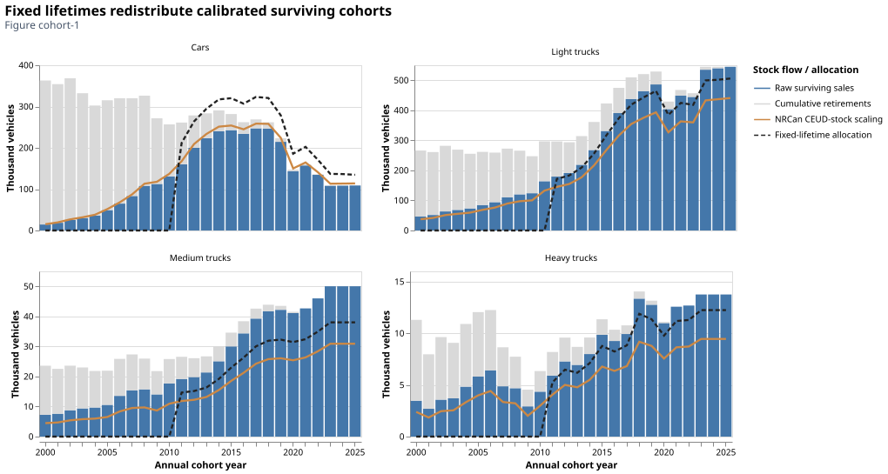
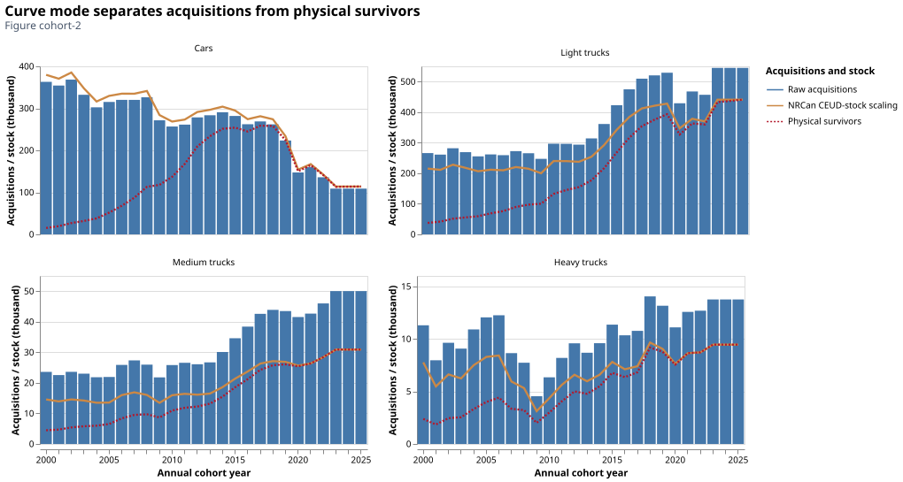
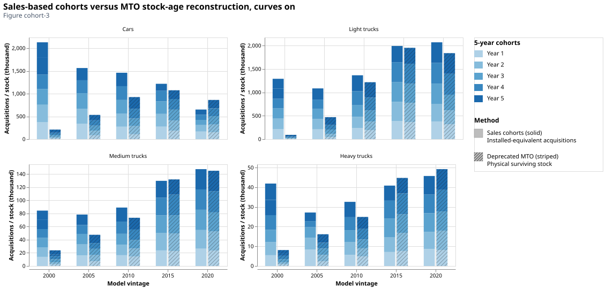
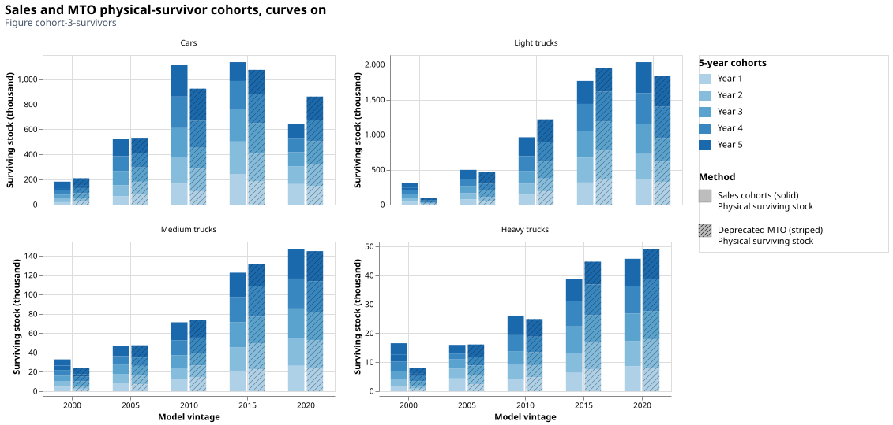
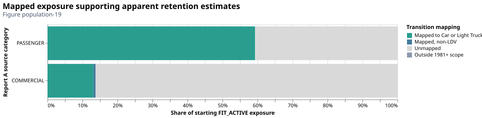
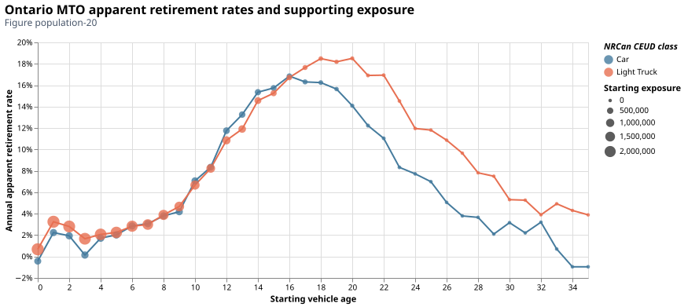
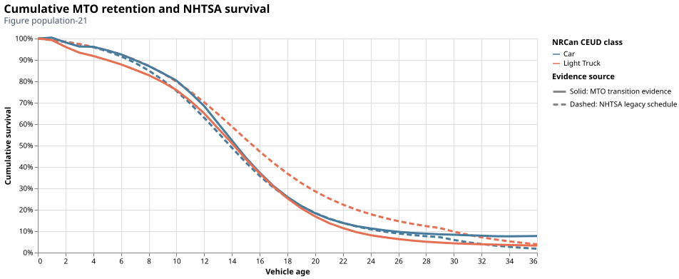
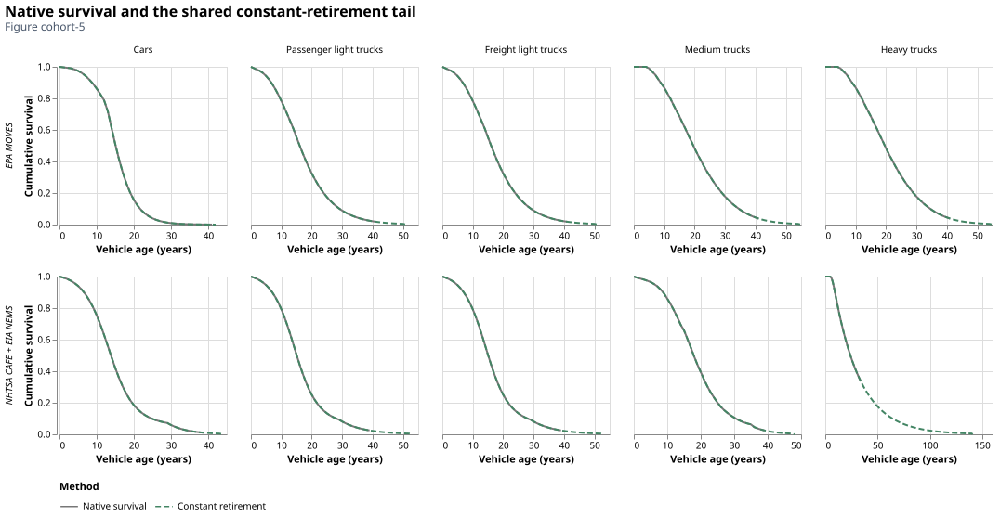
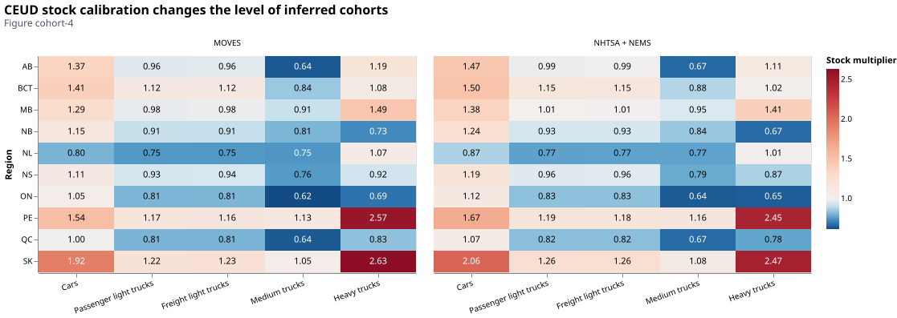

# How does the fleet age and retire?

Existing capacity must distinguish vehicles originally acquired from vehicles
still operating at the reference year. Temoa's lifetime representation determines
which quantity belongs in the database. This also affects the ages used in
[maintenance and repair](technology.md#maintenance-and-repair).

## Sales, survival and stock calibration

The first question is how to infer an annual cohort when only aggregate stock is
observed. The production method starts with annual sales and a survival schedule.
The earlier stock-based method instead allocated the observed class total over an
Ontario MTO age distribution. These alternatives can reproduce the same class
total while giving different vintage sizes. They also differ from the choice of
how Temoa subsequently retires those vehicles.

The illustrated reference is 2025 using CEUD's registered 2023 edition. Its
2024–2025 sales and stock values follow the explicit constant-extension policy;
they are held estimates, while cohort ages and survival are evaluated at 2025.
The first three views select the EPA MOVES survival schedule. Model vintages group
annual inputs; the oldest bin retains the lower history endpoint and can therefore
include one additional annual cohort.

| Derivation and retirement representation | Cohort quantity and interpretation |
| --- | --- |
| Sales with fixed lifetimes | Sales multiplied by reference-year survival, scaled to class stock, then redistributed into lifetime-eligible vintages while preserving the technology total. |
| Sales with annual survival curves | Original-installation-equivalent acquisitions scaled to the same class stock. Temoa applies absolute survival to these acquisitions; the reference-year survivors remain a separate quantity. |
| Earlier MTO stock-age allocation | Class stock distributed using accepted mapped car/light-truck ages and commercial Report 5 truck ages. The configured historical window is retained and renormalized before allocation. This remains a read-only diagnostic comparison. |

*Figure cohort-1. Ontario annual sales divide into surviving vehicles and
cumulative retirements. The stock-calibrated survivor estimate and the
fixed-lifetime redistribution show the two subsequent operations. A redistribution
changes vintage placement; it does not create additional class stock.*

*Figure cohort-2. With curves enabled, acquisitions are the installation basis;
the lower physical-survivor curve represents those acquisitions after historical
retirement. The difference is required by the absolute-survival contract and
must not be interpreted as a disagreement in the number of operating vehicles.*

*Figure cohort-3. Recovered from the specified
[historical notebook](https://github.com/CANOE-main/canoe-transportation/blob/d54585992ccebc413d89b9dec603ee11fba75c15/docs/insights/stock_cohort_diagnosis.py),
the curves-on view compares solid sales-based installation equivalents against
striped MTO age-allocated surviving stock. Colours retain the annual cohort
positions within each model vintage. These default quantities differ: their
height difference combines cohort derivation and quantity basis. The notebook's
“Physical surviving stock” selection compares the two methods on the same
survivor basis. Both are shown before fixed-lifetime redistribution; the earlier
method is diagnostic evidence, not a restored production option.*

*Figure cohort-3-survivors. The recovered chart's physical-survivor selection
puts both methods on the same quantity basis at reference 2025. Solid bars are
sales multiplied by the selected survival schedule and calibrated to class stock;
striped bars allocate that same stock total using MTO ages. Each class therefore
has the same survivor total across methods, while its distribution over annual
cohorts and model vintages can differ. Light trucks combine passenger and freight
services. Neither distribution is independently validated by this fitted equality.*

For region $\boldsymbol{r}$, vehicle class $\boldsymbol{c}$, acquisition year $\boldsymbol{y}$ and reference year $\boldsymbol{b}$,
let $\boldsymbol{A_{rcy}}$ be annual acquisitions in thousand vehicles and $\boldsymbol{S_c(a)}$ the fraction
surviving to age $\boldsymbol{a}$ (dimensionless). Raw surviving stock is $A_{rcy}S_c(b-y)$.
The backend matches the [*NRCan CEUD*](https://oee.nrcan.gc.ca/corporate/statistics/neud/dpa/menus/trends/comprehensive_tables/list.cfm) class stock $\boldsymbol{B_{rcb}}$ using one multiplier:

$$k_{rc}=\frac{B_{rcb}}{\sum_y A_{rcy}S_c(b-y)},\quad
I_{rcy}=k_{rc}A_{rcy},\quad N_{rcyb}=I_{rcy}S_c(b-y).$$

!!! warning "Limitation: one observed total fixes only the level"
    $\boldsymbol{I}$ is calibrated installed-equivalent acquisitions and $\boldsymbol{N}$ is physical surviving
    stock, both in thousand vehicles. Raw sales are retained. One observed total
    constrains the level, not the vintage-by-vintage distribution. Sales start in 2000;
    the multiplier absorbs missing older acquisitions and other source differences
    without identifying their causes. Annual fuel-share allocation can change the
    aggregate powertrain mix when the survivor age distribution changes.

!!! example "Worked example: stock calibration"
    For example, raw survivors totaling 80 thousand and a [*NRCan CEUD*](https://oee.nrcan.gc.ca/corporate/statistics/neud/dpa/menus/trends/comprehensive_tables/list.cfm) target of 100 thousand
    give $k=1.25$. A raw ten-thousand-vehicle surviving cohort becomes 12.5 thousand.
    This is an illustration of the arithmetic, not an Ontario finding.

!!! tip "Modeler note: reference and future activity differ"
    The [cohort notebook](../insights/stock_cohort_diagnosis.py) separates acquisitions,
    physical stock, fixed redistribution, annual curves and projected survivors. A
    reference-year activity calibration is also distinct from future period-average
    activity after retirement.

## What survival evidence establishes

Supported source selections are [*NHTSA CAFE*](https://www.nhtsa.gov/corporate-average-fuel-economy)/[*EIA NEMS*](https://github.com/EIAgov/NEMS) and [*EPA MOVES*](https://www.epa.gov/moves). [*NHTSA CAFE*](https://www.nhtsa.gov/corporate-average-fuel-economy) supplies car,
light-truck and medium-truck schedules; [*EIA NEMS*](https://github.com/EIAgov/NEMS) supplies heavy-truck schedules.
[*EPA MOVES*](https://www.epa.gov/moves) supplies car, light-truck and heavy-vehicle schedules, with the heavy schedule
transferred to medium trucks. The selected source governs both historical
reconstruction and future retirement. The default uses [*EPA MOVES*](https://www.epa.gov/moves).

!!! warning "Diagnostic finding: registration retention has limited validation power"
    Successive [*Ontario MTO*](https://data.ontario.ca/dataset/vehicle-population-data) snapshots provide **apparent registration retention**. Migration,
    status changes, recoding and incomplete mapping can change counts as well as
    retirement. Consequently, similarity to a [*NHTSA CAFE*](https://www.nhtsa.gov/corporate-average-fuel-economy) cumulative curve is not independent
    validation of a physical survival schedule. Annual rates, exposed counts and
    mapping coverage must accompany the cumulative comparison in the population
    notebook. The recorded car result fails the monotone-survival gate; the light-truck
    result fails the mapped-exposure gate (13.12% of its eligible transition exposure,
    versus 59.31% for cars). Neither passes all gates, so these results do not promote
    an [*Ontario MTO*](https://data.ontario.ca/dataset/vehicle-population-data)-derived schedule into production. Transition-exposure denominators differ
    from the single-snapshot fleet denominator in the 100-vehicle illustration.

Primary methods are documented by [*NHTSA CAFE*](https://www.nhtsa.gov/corporate-average-fuel-economy),
[*EPA MOVES*](https://www.epa.gov/moves) and [*EIA NEMS*](https://github.com/EIAgov/NEMS).
The [canonical lifetime assumptions](../assumptions.md#lifetime_tech-lifetime_process-and-lifetime_survival_curve)
identify the registered schedules and their transfer limits.

*Figure population-19. The exposed FIT_ACTIVE population is divided into supported
and unresolved mapping coverage before estimating retention. A curve based on the
mapped subset cannot establish the behavior of excluded vehicles; the source
transition years and denominators remain visible.*

*Figure population-20. Pooled annual [Ontario MTO](https://data.ontario.ca/dataset/vehicle-population-data) apparent retirement rates retain their
starting exposure, shown by point size. Negative rates expose increases in the
tracked registration population; they must not be silently clipped into a fitted
physical-survival curve. The [NHTSA CAFE](https://www.nhtsa.gov/corporate-average-fuel-economy) comparison appears in Figure population-21.*

*Figure population-21. Accumulating annual rates makes the age pattern easier to
compare with [NHTSA CAFE](https://www.nhtsa.gov/corporate-average-fuel-economy), but does not remove registration/mapping effects or create
independent retirement observations. Read this comparison with Figures
population-19 and population-20 and the recorded diagnostic gates.*

## Fixed retirement versus annual curves

| Representation | Exported capacity | What Temoa does |
| --- | --- | --- |
| Fixed lifetime | Calibrated surviving stock after audited lifetime-eligible redistribution | Retires the cohort at its lifetime, with a partial final model period where applicable. |
| Survival curve | Calibrated installed-equivalent acquisitions | Multiplies capacity by absolute annual survival and averages surviving capacity within a period. |

For vintage $\boldsymbol{v}$ and model period $\boldsymbol{p}$ containing $\boldsymbol{L_p}$ annual years, curve-mode
available capacity is

$$C_{pv}=I_v\frac{1}{L_p}\sum_{t\in p}S_v(t).$$

!!! tip "Modeler note: match the capacity and survival definitions"
    $\boldsymbol{I_v}$ and $\boldsymbol{C_{pv}}$ are thousand vehicles; $\boldsymbol{S_v(t)}$ is dimensionless. The backend
    exports annual nodes, not period means. Feeding surviving stock into this absolute
    curve would apply historical retirement twice. See the inspected [Temoa capacity
    rule](https://github.com/TemoaProject/temoa/blob/cb2f51503ddb4dc6607c73635098d34c5e2d1283/temoa/components/capacity.py#L471).

!!! note "Assumption: vintage aggregation and survival tails"
    Annual acquisitions are grouped into model vintages using acquisition-weighted
    survival paths. Their actual acquisition years are retained. The approved tail
    extends the last native annual retirement rate until survival reaches 0.5% or
    less, then appends zero; an explicit age cap can shorten it. Additional retirement
    needed for Temoa's numerical limit is audited, not recalibrated away.

*Figure cohort-5. Native schedules and their shared constant-retirement extension
show where measured/model-source support ends and the tail rule begins. The tail
controls remaining future capacity; it is an explicit modeling rule rather than
additional observed survival. In the [EIA NEMS](https://github.com/EIAgov/NEMS) heavy-truck case, the constant-rate tail
extends beyond a century of vehicle age. This extrapolation is a material
limitation of that alternative, not evidence of such long-lived trucks.*

*Figure cohort-4. Read-only diagnostic recalculations for reference 2025 compare
both survival-source selections across ten regions, using registered prepared
inputs and recorded configuration/source hashes. They are not ten regional
production-build comparisons. Source-dependent factors align inferred survivor totals to [NRCan CEUD](https://oee.nrcan.gc.ca/corporate/statistics/neud/dpa/menus/trends/comprehensive_tables/list.cfm).
The equality is fitted. It does not establish that either source reconstructs
observed annual cohorts or predicts future stock correctly.*
