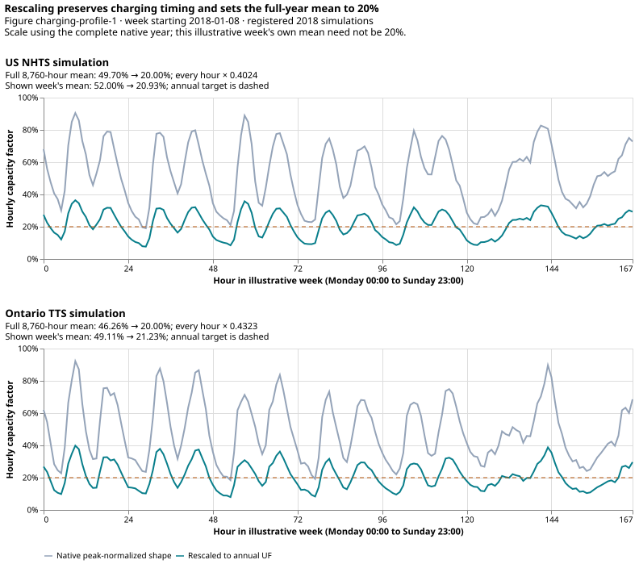
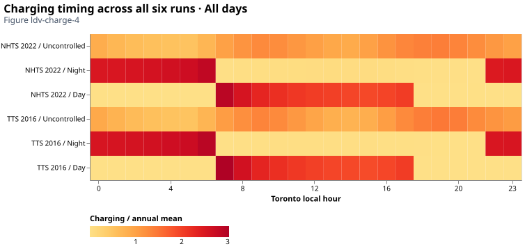
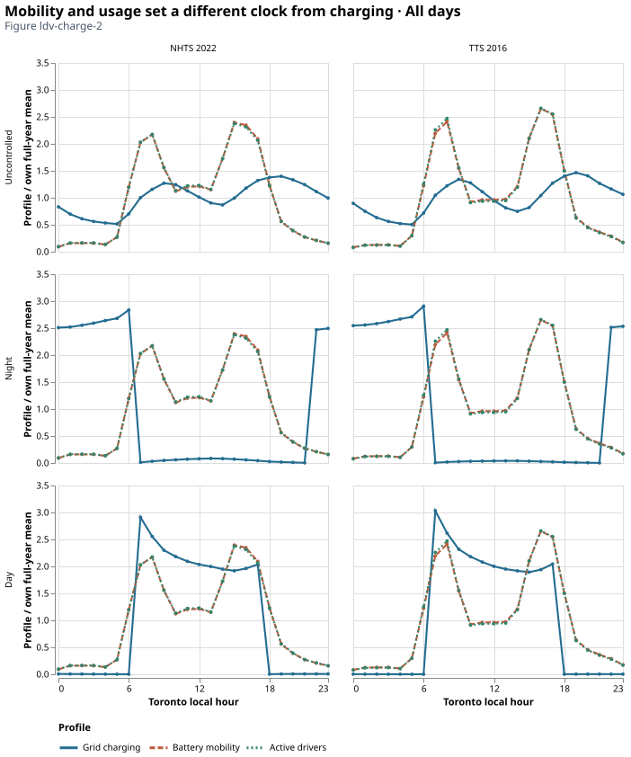

# When can the LDV fleet charge?

The aggregate charger representation can use registered RAMP-mobility simulations
to limit when pooled LDV chargers can operate. Builds replay the selected profile
and retain annual charged-electricity output and vehicle activity. Explicit charger
archetypes require annual operation. See [the infrastructure method](infrastructure.md)
and [registered RAMP inputs](../source_inventory.md).

## What the inherited simulations represent

!!! note "Assumption: composition is embedded in the simulated shape"
    [*US NHTS*](https://nhts.ornl.gov/) and
    [*Ontario TTS*](https://dmg.utoronto.ca/transportation-tomorrow-survey/)
    selections encode different travel evidence. The registered
    Ontario BEV simulation also embeds vehicle/range composition, driver activities
    and charger assumptions. Those choices are frozen in the external output. Applying
    new [*EPA OMEGA*](https://github.com/USEPA/EPA_OMEGA_Model) range weights to that shape would double-count composition.

!!! warning "Coverage limit: calendar, travel behavior and regional transfer"
    The inherited reference uses Toronto time/DST and the 2018 calendar. The [*Ontario TTS*](https://dmg.utoronto.ca/transportation-tomorrow-survey/)
    survey input represents weekdays, and the full-year simulation repeats that
    travel evidence on weekends. Occupation proportions distinguish workers,
    students and inactive people. They leave driving status unobserved. Ontario
    BEV charging is a proxy for future periods, other regions and the PHEVs and
    motorcycles served by the same chargers.

## Native normalization and utilization scaling

Current ingestion converts the registered minute-resolution power series to hourly
means and retains native energy/peak checks. Let $\boldsymbol{f_h}$ be a dimensionless normalized
hourly shape, $\boldsymbol{\bar f}$ its mean across the complete native 8,760-hour year, and $\boldsymbol{u}$
the reviewed annual charger utilization. The emitted profile is

$$f'_h=f_h\frac{u}{\bar f},\qquad
\frac1{8760}\sum_hf'_h=u.$$

!!! tip "Modeler note: hourly ceilings and annual utilization"
    The native shape is retained; the amplitude changes. Values outside the physical
    capacity-factor bounds fail validation. The hourly values are ceilings, accompanied
    by an annual utilization floor $0.98u$ when profiles are enabled. At current
    $u=0.20$, that floor is 0.196. Without a profile, annual utilization equals 0.20.
    This $\boldsymbol{u}$ is not the PHEV distance utility factor used in consumption calculations.

*Figure charging-profile-1. The same registered week is shown before and after
rescaling for both inherited travel simulations. Every hourly value is multiplied
by $0.20/\bar f$, computed from the complete 8,760-hour year. Titles report the
actual full-year means and multiplier. Timing, daily peaks and relative variation
are preserved; the illustrated week's mean need not equal 20%. The dashed line
marks the annual target, rather than a flat hourly charging requirement.*

The [read-only LDV charging notebook](../insights/ldv_charging_diagnosis.py) calls
the production hourly transformation and rescaling functions on verified registered
source bytes. The same notebook compares the six registered survey/strategy runs
below. It performs no source acquisition, simulation, or production writes.

## How travel and charging rules shape aggregate hourly behavior

The six registered simulations combine two travel surveys with uncontrolled,
night-preferred and day-preferred charging. They share a 2,499-driver simulated
fleet, random seed 42 and the complete 2018 Toronto calendar. Within each survey,
the strategies reuse identical mobility and active-driver evidence. Their charging
differences therefore describe how parking preferences, battery state of charge
and charging access act on that fixed travel realization.

{: width="100%"}

*Figure ldv-charge-4. Each cell is one run and Toronto local hour, averaged across
the complete year and divided by that run's own annual mean charging power.
A value of one equals the run's average hour; warmer cells identify hours with
more charging relative to that average. Both occurrences of a repeated autumn
clock hour contribute. This comparison exposes timing without equating annual
energy totals or applying a new utilization target.*

Uncontrolled charging follows parking opportunities after travel. Night and day
strategies prefer 22:00–07:00 and 07:00–18:00 respectively; low battery state of
charge can trigger emergency charging outside those windows. The resulting shape
is an aggregate fleet signal. It does not identify charger occupancy, individual
access constraints, or separate schedules for each charger type.

{: width="100%"}

*Figure ldv-charge-2. Each panel represents a survey/strategy year; each point is a
mean by Toronto local hour. Grid charging power, battery-side mobility power and
the active-driver count are each divided by their own full-year mean, allowing
their timing to be compared despite different physical units. Active drivers
measure driving, not charging vehicles or occupied chargers. The normalization
preserves each signal's departure from its annual mean; it neither reconciles
grid and battery energy nor establishes a causal delay between driving and charging.*

These two comparisons qualify the hourly input used by the production rescaling
in Figure charging-profile-1. Annual utilization determines the magnitude of the
emitted capacity-factor profile; inherited travel and charging rules determine
when that capacity is available. Survey differences also include different
realized travel demand. The TTS weekday-data proxy, regional transfer and embedded
fleet assumptions therefore remain limitations of the shape after its annual mean
has been matched.

## Representative time can change the annual mean

The supported mapping assigns every elapsed hour to exactly one model slice and
averages its hourly factors. The builder verifies that the assigned hours match
the declared slice weights and that the annual integral is preserved. A different
selection or weighting of representative days can change the weighted mean:

$$\bar f_{rep}=\frac{\sum_s\omega_sf'_s}{\sum_s\omega_s}.$$

!!! warning "Integration limit: final time weights require their own check"
    Check $\bar f_{rep}$ with the final CANOE-main weights. If it differs from $u$,
    rescale against those weights and verify the resulting ceilings and utilization
    floor. The receiving model must couple time-resolved electricity supply to
    annual vehicle activity through charging. Allocating annual service uniformly
    across hours would impose a different charging requirement.

The [profile assumptions](../assumptions.md#capacity_factor_tech-for-ldv-charging-profiles)
record the source qualifications and the remaining limits on regional and weekend
behavior.
