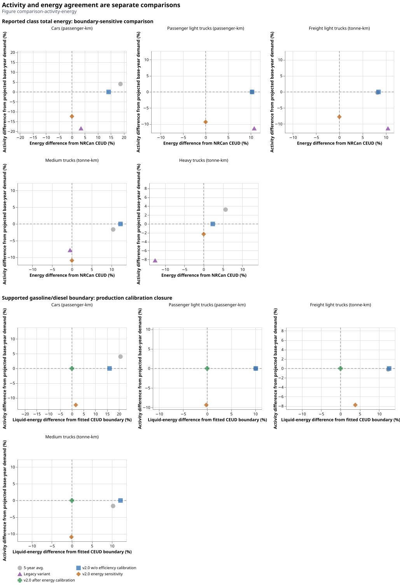

# Choose a representation for the question

Alternative representations preserve the ability to distinguish an empirical
uncertainty from a modeling simplification. They also make comparisons with older
work possible without silently changing the common baseline. A selector is useful
when its intention and affected parameter relationships are clear.

| Modeling purpose | Relevant choice | What changes; what to check |
| --- | --- | --- |
| Represent retirement detail | Fixed lifetimes or annual survival; MOVES or NHTSA/NEMS; tail controls | Acquisition versus surviving-capacity basis, future availability and cohort composition. Check physical stock calibration and complete annual curve endpoints. |
| Use later reference years | CEUD `error`, `constant` or `extrapolated`; period mode/grid | Which inputs are observations versus estimates and which years a vintage represents. Demand retains its observed-year anchor. |
| Examine efficiency uncertainty | ATB efficiency trajectory; optional CEUD energy calibration | Consumption levels/relative improvements and fitted fuel totals. Cost trajectories are selected separately; energy closure is not independent validation. |
| Retain or compress range detail | No range shares, fixed new-capacity shares, representative archetype | Optimizer freedom and joint consumption/cost/embodied-mass aggregation. Confirm common utilization/lifetime and PHEV component limits. |
| Examine vehicle economics | Cost trajectory, currency/year, financing parameters | Comparable monetary values and period/source-year alignment. Do not infer technology choice from purchase price alone. |
| Represent charging time | None, NHTS or TTS; explicit time mapping | Hourly ceilings versus annual equality/floor, inherited behavior and final representative-weight limitation. |
| Explore activity by age | VKT schedule preparation | Current age-dependent products are diagnostic; the schema still emits the flat annual utilization representation. |
| Explore service growth or material choice | CER demand scenario/car split; conventional/lightweight LDV materials | Demand allocation and new-vehicle manufacturing mass. Their scientific assumptions remain distinct from source-data quality. |

Use the [scenario guide](../scenario_configuration.md) for exact YAML fields,
supported combinations and run commands. It is the single practical selector
reference. Methods in this report explain the rationale; the source/configuration
registry and typed validators determine what can execute.

## Compare like with like

A comparison should identify its source edition, region, reference year, actual
observation years, physical capacity basis, service units, fuel boundary and
representation. Change only the intended choice. Keep the uncalibrated baseline
when assessing calibration, and separate defect corrections from that effect.

The legacy fleet reconstruction and charger-cost comparison describe different
reference variants. The original inherited-input SQLite identity is unresolved
for part of the legacy energy reconstruction; saved outputs and active notebook
recipes are not interchangeable evidence. Recorded comparisons retain their
configured absolute/relative tolerances and original period/vintage labels.
Passing a database tolerance is not evidence of scientific equivalence where
the quantities or coverage differ.

*Figure comparison-activity-energy. The recorded Ontario 2025 comparison separates
service and total-energy residuals for the current backend and inherited recipe.
Its exploratory energy-sensitivity points use that notebook's total-energy
boundary; they are not the new production gasoline/diesel calibration. Agreement
with a fitted quantity is closure. Legacy recipe reconstruction does not prove
which saved SQLite was produced by a historical execution.*

The refreshed baseline gives the following diagnostics. Current activity closes
to its fitted CEUD target for all five classes. The total-energy column uses
vehicle-input energy, including electricity, against CEUD's reported class total;
it is a **boundary-sensitive residual**, not an identified efficiency error.

| Class | Current total-energy difference from reported CEUD | Reconstructed legacy service difference from CEUD |
| --- | ---: | ---: |
| Cars | +11.33% | −16.44% |
| Passenger light trucks | +7.59% | −9.12% |
| Freight light trucks | +5.75% | −9.15% |
| Medium trucks | +9.51% | −5.53% |
| Heavy trucks | −0.17% | −5.90% |

The comparison is Ontario reference 2025 with CEUD 2023 held constant. The inherited
recipe is `Update data_20260618_fixed lifetime (1).ipynb` (SHA-256 starts
`ada5b14fca8d`); its active `fixed_lifetime=False` argument takes precedence over
the filename. The explicit inherited snapshot `canoe_ON_16d.sqlite` has hash prefix
`b4db7481fb0f`. The original named all-region input is unavailable, so historical
execution equivalence remains unresolved. Full identities are in the figure
manifest and captured comparison.

Configured database row comparisons use absolute tolerance $10^{-9}$ in each
parameter's native unit and relative tolerance $10^{-6}$. Those tolerances do not
resolve different capacity definitions, missing coverage or source identities;
the reported legacy differences are not described as a parity pass.

## Read the status correctly

**Implemented** means code and configuration support the behavior. **Reviewed
assumption** means a documented decision supplies missing evidence. **Diagnostic
finding** describes a specific recorded calculation. **Unresolved question** marks
a limit that can change interpretation. **Proposed improvement** is not executable
behavior. A review marker or successful build does not promote one status to another.
