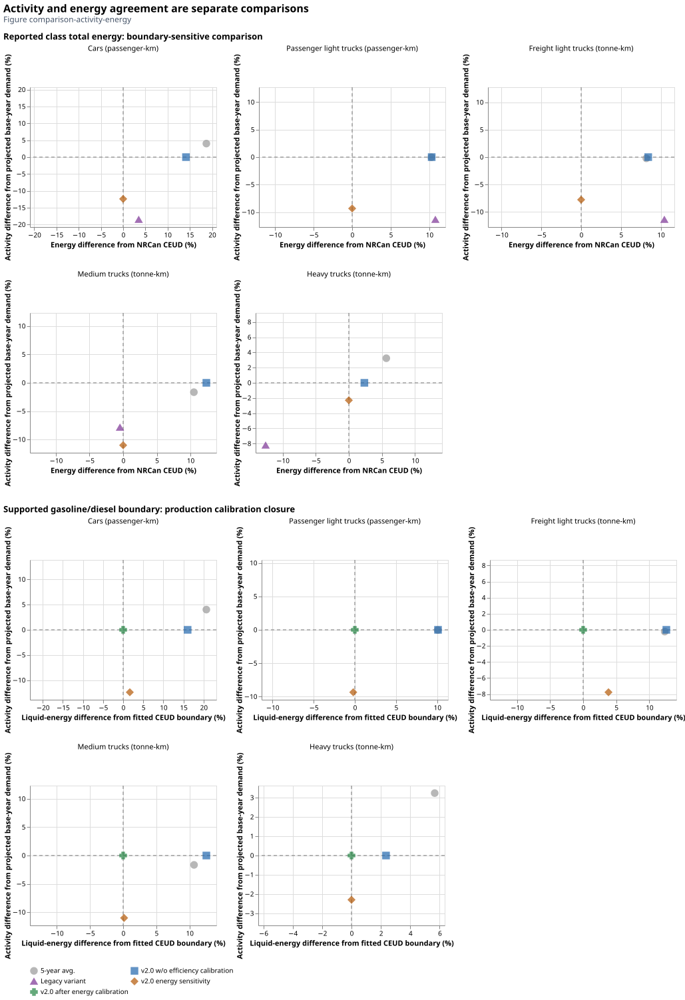

# Choose a representation for the question

Change one representation at a time and keep the comparison basis visible.
Match region, vintage and operating-period conventions, source edition, service
units, capacity basis and fuel boundary. Record any changes to those conditions
alongside the result.

| Research question | Choice to vary | What changes |
| --- | --- | --- |
| How much of each cohort remains available? | Fixed lifetime or annual survival, with either registered source schedule | Changes in retirement and surviving stock over time. Match physical survivors before comparing against installed-equivalent capacity. |
| How does timing affect the result? | Prospective closing or legacy opening conditions, reference year and source extension | Changes to the years represented by model periods or estimated from historical observations. |
| How much freedom does the optimizer have within a powertrain? | Separate unconstrained range variants, fixed within-family shares or one representative | Changes to technology choice and how consumption, cost and manufacturing emissions combine within a family. |
| How does charger representation affect requirements? | Aggregate profiles or annual aggregate/explicit charging | Hourly ceilings constrain timing. Exact explicit power shares can require additional capacity and annual throughput. |
| How sensitive are operating and investment results? | Independently selected consumption and cost trajectories, demand scenario, or material choice | Changes to fuel use, prices, service demand or new-vehicle manufacturing emissions. |

The [scenario guide](../scenario_configuration.md#parameter-settings) lists
selectors and compatible combinations. For scientific methods, use the
[retirement](ageing.md), [technology](technology.md) and
[charging infrastructure](infrastructure.md) chapters.

## A recorded comparison of activity and energy

*Figure comparison-activity-energy. Ontario reference 2025, with 2023 CEUD
values held constant for historical parameters. Activity residuals use the
backend's 2025 demand projection as zero. The upper view compares total
vehicle-input energy with CEUD's reported class totals. The lower view compares
only covered gasoline and diesel energy and includes the optional calibration.
Legacy fuel splits remain unresolved and appear only in the total-energy view.
Heavy trucks use the reviewed all-diesel aggregate.*

On this comparison basis, road activity closes to the projected 2025 target
for the five sales-derived car and truck classes shown. The optional energy
calibration preserves that activity and closes the comparable gasoline/diesel
balance. It fits a common consumption multiplier to each supported class.
BEV electricity can contribute to the total-energy residual without a
separately identified electricity target. Read the
[energy calibration method](energy.md#optional-ceud-energy-calibration).

The legacy fleet reconstruction and charger-cost comparison describe different
reference variants. The inherited fleet recipe has hash prefix
`ada5b14fca8d` and selected `fixed_lifetime=False`. The recorded inherited
SQLite snapshot has hash prefix `b4db7481fb0f`. The recipe's original named
all-region input was unavailable, so reconstructing the recipe leaves its
historical execution identity unresolved. For the exact evidence, consult the
[figure manifest](../assets/figures/manifest.json).

## Interpret the checks

A current-backend database comparison matches keys and measures parameter
differences in their native units. The standard scenario tolerances are
$10^{-9}$ absolute and $10^{-6}$ relative. Differences in coverage, source
identity or capacity definitions require a separate explanation. The legacy
example reports departures on its recorded comparison basis. A calibration
residual tests an accounting identity under shared inputs, and a model solve
tests whether the configured system can meet its constraints with the available
supply. Each supports a different conclusion.