# How much energy does travel require?

Consumption measures energy per vehicle-km; service efficiency measures passenger-
or tonne-km per unit energy. The backend averages consumption on a consistent
physical basis before taking its inverse. Averaging efficiencies directly would
give a different answer.

## From rated configurations to fleet consumption

[*NRCan Ratings*](https://open.canada.ca/data/en/dataset/98f1a129-f628-4ce4-b24d-6f16bf24dd64)
describe tested configurations, not actual Canadian driving. Reviewed canonical
families connect eligible configurations to [*Ontario MTO*](https://data.ontario.ca/dataset/vehicle-population-data) survivors or [*Transport Canada iZEV*](https://open.canada.ca/data/en/dataset/42986a95-be23-436e-af15-7c6bf292a2e1) acquisition
records. Distinct-trim medians prevent a family with many catalogue variants from
receiving many copies of its empirical count. Unsupported composition uses the
documented hierarchical catalogue fallback, with coverage retained.

### Empirical composition and matching

Matching proceeds within a vehicle class, model year and powertrain/range cohort.
Reviewed make/model descriptions connect MTO FIT_ACTIVE counts to canonical
families; eligible target-year NRCan configurations provide the consumption
ratings. MTO has no observed powertrain field, so gasoline-compatible catalogue
configurations establish the eligible gasoline match. MTO counts must not be
described as observed gasoline, HEV or electric market shares.

For PHEV and BEV cohorts, iZEV acquisition/request records supply the eligible
family composition and the configured range assignment. These counts are matched
to target-year ratings, including explicitly recorded proxy windows where
own-year composition is insufficient. Reusing a later supported composition
window for an older vintage is an assumption, not a historical registration
observation. The range labels below identify model representations; they are
not statements that every matched vehicle has exactly that rated range.

Within each supported family, distinct eligible trims first produce a median
consumption. The family's empirical count is then allocated once to that median.
Class consumption averages these family medians using normalized count weights;
outer size-class weights subsequently form the car or light-truck cohort. Where
composition cannot support a match, the documented distinct-trim, family and
cohort medians remain visible alongside the coverage denominator.

*Figure ldv-eff-2-gasoline. The car view compares eligible catalogue families,
matched empirical descriptions, the catalogue fallback median and the production
estimate within each size class/model year. Marker sizes show count weights,
not catalogue frequency.*

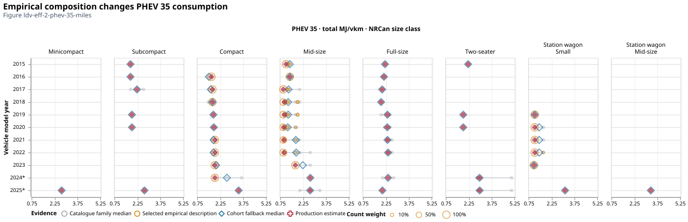

*Figure ldv-eff-2-phev-35-miles. The same matching view for the PHEV35 car
representation retains iZEV composition, range assignment and total MJ/vehicle-km
after charge-depleting/charge-sustaining accounting.*

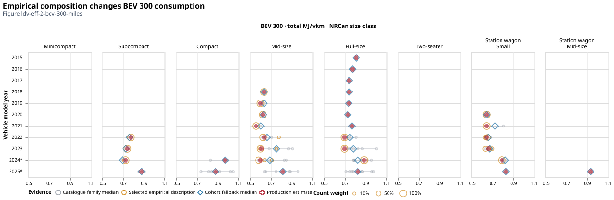

*Figure ldv-eff-2-bev-300-miles. The BEV300 car view shows which observed
descriptions support the representative cohort and how their count-weighted
estimate differs from the catalogue median. It does not establish full-market
or surviving-fleet coverage of incentive records.*

Asterisks on the 2024 and 2025 rating-year labels mark years after the 2023
production projection anchor. These later catalogue and composition observations
are diagnostic evidence; they do not replace the anchored production trajectory.

!!! note "Assumption: composition counts proxy travel weights"
    Family, size-class, annual-cohort and range weights have different meanings.
    Within a [*NRCan CEUD*](https://oee.nrcan.gc.ca/corporate/statistics/neud/dpa/menus/trends/comprehensive_tables/list.cfm) class, using count weights also assumes a common annual distance
    across families. [*Transport Canada iZEV*](https://open.canada.ca/data/en/dataset/42986a95-be23-436e-af15-7c6bf292a2e1) incentive eligibility and acquisition/request timing do not
    make its records a census of sales or surviving stock.

For normalized weights $\boldsymbol{w_i}$, consumption $\boldsymbol{c_i}$ in MJ/vehicle-km and matched
occupancy/payload $\boldsymbol{\ell}$, the service efficiency is

$$\bar c=\sum_iw_i c_i,\qquad \eta=\frac{\ell}{\bar c}.$$

!!! example "Worked example: average consumption before inversion"
    $\boldsymbol{\eta}$ is passenger-km/MJ or tonne-km/MJ, numerically equal to billion service-km/PJ.
    For example, equally weighted consumption of 2 and 4 MJ/km gives 3 MJ/km; at two
    passengers, efficiency is $2/3$ passenger-km/MJ, not the mean of $2/2$ and $2/4$.

### How matching changes the consumption estimate

The following light-truck gasoline sequence separates source-native evidence,
the effect of composition, common energy units and the final vintage bridge.
It precedes occupancy/payload harmonization: these are consumption estimates,
not passenger- or tonne-km per unit energy.

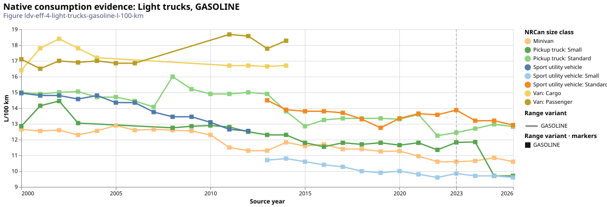

*Figure ldv-eff-4-light-trucks-gasoline-l-100-km. NRCan catalogue summaries
retain source-native L/100 km: each size-class/model-year point is a median of
distinct-trim family medians, before empirical composition weighting. Catalogue
frequency does not represent the number of vehicles sold.*

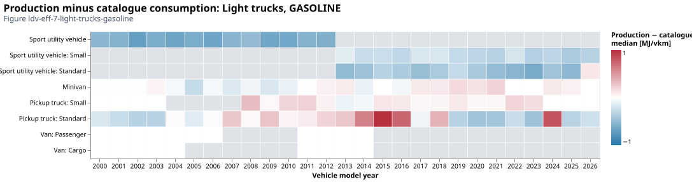

*Figure ldv-eff-7-light-trucks-gasoline. Production minus catalogue-median
consumption by size class/model year, in MJ/vehicle-km. The change isolates the
effect of the selected composition estimator within supported cells. Grey cells
are missing comparisons; white cells indicate coincident estimates.*

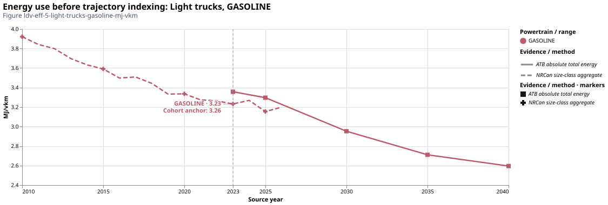

*Figure ldv-eff-5-light-trucks-gasoline-mj-vkm. Explicit heating-value conversion
places harmonized evidence on MJ/vehicle-km before trajectory indexing. The
empirical composition estimate and catalogue comparison retain their distinct
construction and source timing.*

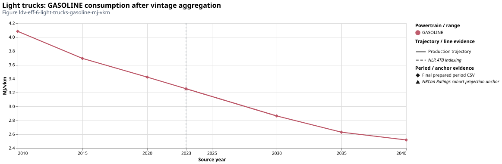

*Figure ldv-eff-6-light-trucks-gasoline-mj-vkm. Annual consumption evidence is
combined using cohort stock weights, and future vintages follow the anchored ATB
relative trajectory. Model-vintage aggregation can shift a point from a single
source-year rating. Final service efficiency is calculated only after the
matched occupancy or payload is applied.*

## Trucks and the observed-to-projected bridge

!!! note "Assumption: fleet-year truck consumption proxies cohorts"
    [*NRCan CEUD*](https://oee.nrcan.gc.ca/corporate/statistics/neud/dpa/menus/trends/comprehensive_tables/list.cfm) truck consumption describes a fleet year, not a measured model-year cohort.
    The backend uses this as a vintage proxy. Emerging powertrains use relative [*NLR ATB*](https://atb.nlr.gov/transportation/2024/data)
    performance against diesel; medium-truck and heavy-truck aggregation retains the
    [weight/vocation/haul assumptions](vehicles.md#trucks-need-weight-haul-and-vocation-assumptions).
    Fuel-specific physical litres are converted with their own heating values.

For existing medium- and heavy-duty vehicles, no observed consumption series by
truck model year is available. Let $F_f(y)$ be the CEUD fleet-year rate in
L/100 km, $H_f$ the configured fuel heating value in MJ/L, and $d$ diesel. The
historical proxy assigned to cohort year $y$ is

$$c_f(y)=F_f(y)H_f/100,\qquad
c_r(y)=c_d(y)\frac{c^{ATB}_r(y_0)}{c^{ATB}_d(y_0)}.$$

The first expression applies to observed medium-truck gasoline/diesel and
heavy-truck diesel. The second estimates unobserved powertrains $r$ using the
diesel fleet history and their ATB consumption ratio at the common reference
$y_0=2023$. This holds the relative powertrain advantage fixed through the
historical proxy, while allowing the observed diesel fleet-year trend to vary.
It does not infer individual vintage performance from an aggregate fleet rate.

The latest existing cohort then supplies a stock-weighted consumption anchor
$\bar c_r$. For projected annual years,

$$c_r^{projected}(y)=\bar c_r
\frac{c^{ATB}_{q(r)}(y)}{c^{ATB}_{q(r)}(y_0)},$$

where $q(r)=r$ except that gasoline follows the configured diesel improvement
index. The anchor's payload is retained for future service efficiency. Own
powertrain stock weights are used when available; the configured diesel-stock
proxy and any incomplete cohort coverage remain in the audit. Truck weight,
vocation and haul aggregation shape the ATB ratios rather than creating observed
Canadian truck-vintage consumption.

The aligned road reference is 2023. Observations through that year establish the
historical anchor; annual 2024–2025 values use [*NLR ATB*](https://atb.nlr.gov/transportation/2024/data) relative changes before vintage
aggregation. For LDV range variants, with consumption $\boldsymbol{c}$ in MJ/km, projected year $\boldsymbol{y}$, reference
$\boldsymbol{y_0}=2023$, and powertrain/range variant $\boldsymbol{r}$:

$$c_r(y)=c_{anchor}\frac{c^{ATB}_r(y)}{c^{ATB}_{anchor}(y_0)}.$$

!!! note "Assumption: an empirical anchor with projected relative changes"
    Here $\boldsymbol{c_{anchor}}$ is the empirical consumption for the reference class and
    powertrain; the [*NLR ATB*](https://atb.nlr.gov/transportation/2024/data) denominator uses its matching reference variant. The ratio
    carries technology improvement and relative range performance. It does
    not turn [*NLR ATB*](https://atb.nlr.gov/transportation/2024/data) levels into Canadian observations. BEV300 and PHEV35 are common
    historical projection indices; future range variants retain relative [*NLR ATB*](https://atb.nlr.gov/transportation/2024/data) levels.
    Sparse source years follow explicit source policies rather than invented observations.

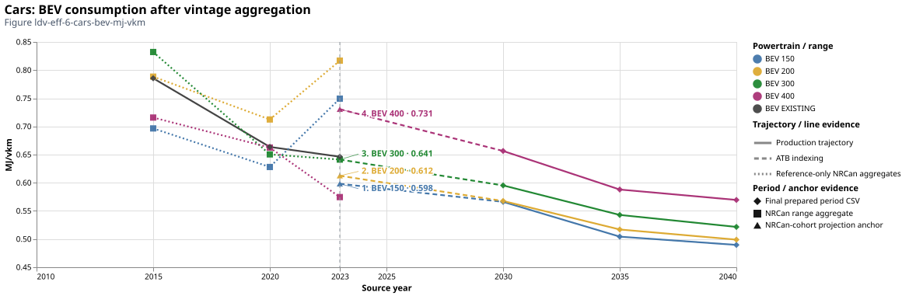

*Figure ldv-eff-6-cars-bev-mj-vkm. The Ontario car BEV diagnostic separates
cohort evidence from indexed range trajectories in MJ/vehicle-km. The captured
notebook build uses reference 2023 and explicit future ranges. The bridge is
constructed from an observed anchor and relative [NLR ATB](https://atb.nlr.gov/transportation/2024/data) changes; continuity is not
validation of future performance.*

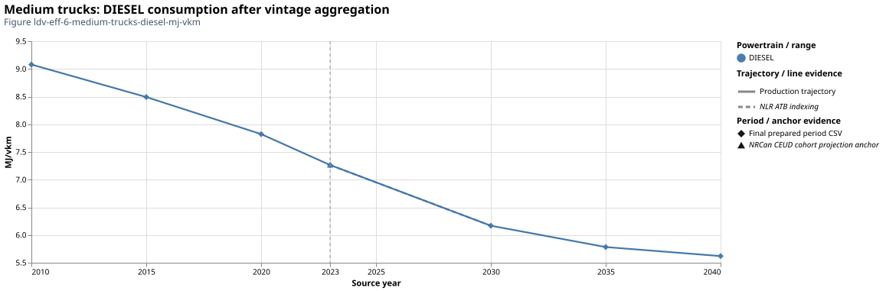

*Figure ldv-eff-6-medium-trucks-diesel-mj-vkm. The medium-truck fleet-year proxy
and indexed diesel projection use the configured weight/vocation mix. This is a
class-average consumption history, not measured efficiency by truck model year.
Both bridge figures retain source years and selections in the publication manifest.*

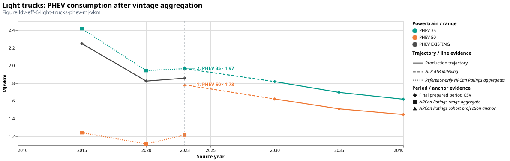

*Figure ldv-eff-6-light-trucks-phev-mj-vkm. The light-truck PHEV view retains
the energy-equivalent consumption and range representations before the final
payload/occupancy division. The PHEV distance utility factor is applied to its
physical components before service efficiency is calculated.*

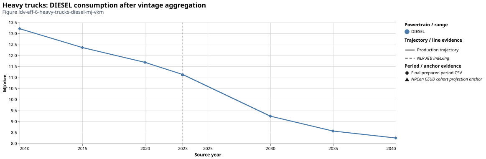

*Figure ldv-eff-6-heavy-trucks-diesel-mj-vkm. Historical diesel consumption
uses CEUD fleet-year proxies; future vintages use the observed-cohort anchor and
relative ATB improvement. It is a production estimate in MJ/vehicle-km, not a
measurement of consumption by truck vintage.*

## PHEVs need component accounting

A PHEV combines charge-depleting (CD) and charge-sustaining (CS) operation. If $\boldsymbol{f}$
is the CD distance utility factor, its physical total consumption is

$$c=f(c_{CD,e}+c_{CD,f})+(1-f)c_{CS,f}.$$

!!! tip "Modeler note: distance utility and energy shares differ"
    Every component is in MJ/vehicle-km after explicit fuel/electricity conversion.
    $\boldsymbol{f}$ is a distance fraction, not the electricity fraction of energy and not annual
    vehicle utilization $\boldsymbol{u}$. Shared input-split contracts represent the resulting
    electric/liquid blend. Its total energy is counted once in reconciliation.
    Published [*NRCan Ratings*](https://open.canada.ca/data/en/dataset/98f1a129-f628-4ce4-b24d-6f16bf24dd64)/[*NLR ATB*](https://atb.nlr.gov/transportation/2024/data) electricity already includes charging losses on its stated
    basis; the unity charger transfer preserves that boundary.
    See [infrastructure boundaries](infrastructure.md).

## Optional [*NRCan CEUD*](https://oee.nrcan.gc.ca/corporate/statistics/neud/dpa/menus/trends/comprehensive_tables/list.cfm) energy calibration {#optional-ceud-energy-calibration}

!!! warning "Coverage limit: no separately reported electricity target"
    The registered [*NRCan CEUD*](https://oee.nrcan.gc.ca/corporate/statistics/neud/dpa/menus/trends/comprehensive_tables/list.cfm) car/light-truck fuel tables do not separately report electricity.
    The opt-in method therefore fits a **comparable gasoline-plus-diesel boundary**
    for cars and passenger/freight light trucks, medium trucks and heavy trucks.
    Heavy-truck energy is entirely diesel: its aggregate PJ total supplies the diesel
    target directly. Within that confirmed heavy-truck total, electricity contributes
    zero; this does not identify the efficiency of future electric trucks.
    Other reported fuels and electricity without a reported target remain visible.
    Missing electricity is not a measured zero.

!!! note "Observation basis: 2023 values held at reference 2025"
    The Ontario comparison represents 2025 using the registered [*NRCan CEUD*](https://oee.nrcan.gc.ca/corporate/statistics/neud/dpa/menus/trends/comprehensive_tables/list.cfm) 2023 edition
    and its explicit constant-extension policy. Stock and fuel targets retain their
    2023 observed values; the reconstructed fleet is aged to 2025. Annual utilization
    first matches the independently projected backend 2025 demand, using real GDP
    growth from the latest CEUD activity reference. Energy calibration preserves
    that projected activity. This is a reference-fleet calibration, not a new
    2025 energy observation.

!!! note "Source precision and numerical closure"
    The source reports PJ to six decimals. Independently rounded fuel components can
    differ from the rounded total by a few millionths of a PJ. The compatibility
    check uses that declared precision; fitted-energy closure uses a separate,
    tighter numerical tolerance. Signed residuals remain recorded. A substantive
    medium-truck remainder of 0.095833 PJ is retained as unresolved coverage.

For class $\boldsymbol{c}$ and technology–vintage cohort $\boldsymbol{v}$, reference physical stock $\boldsymbol{N_{cv}}$,
C2A $\boldsymbol{a_c}$, utilization $\boldsymbol{u_c}$,
uncalibrated efficiency $\boldsymbol{\eta^0_{cv}}$ and the emitted liquid-energy fraction
$\boldsymbol{\lambda_{cv}}$, predicted comparable energy in PJ is

$$E^0_c=\sum_v\frac{N_{cv}a_cu_c}{\eta^0_{cv}}\lambda_{cv},\qquad
g_c=\frac{E^{CEUD,liquid}_c}{E^0_c},\qquad \eta^1_{cv}=\frac{\eta^0_{cv}}{g_c}.$$

$\boldsymbol{N}$ is thousand surviving vehicles; $\boldsymbol{a}$ is billion service-km per thousand
vehicles per year at full utilization; $\boldsymbol{u}$ is a dimensionless annual fraction;
$\boldsymbol{\eta}$ is billion service-km/PJ; and $\boldsymbol{\lambda}$ is a dimensionless liquid-energy
fraction. All quantities use the same reference-year physical fleet and region.

!!! warning "Assumption: one effective factor transfers across technologies"
    The degree of freedom is one dimensionless consumption multiplier per supported
    region/class. It preserves fleet/activity, relative consumption trajectories and
    the reviewed PHEV split. The same multiplier is transferred to other powertrains
    and future years, including electricity and hydrogen: **that transfer is an
    explicit effective-level assumption, not a fuel-specific efficiency correction
    identified by [*NRCan CEUD*](https://oee.nrcan.gc.ca/corporate/statistics/neud/dpa/menus/trends/comprehensive_tables/list.cfm)**.
    No technology-, vintage-, range- or fuel-specific correction is uniquely estimated.

!!! tip "Modeler note: supported calibration combinations"
    Historical consumption, projection anchors, future trajectories and representative
    range aggregation use the same adjustment. Unadjusted evidence remains available.
    `efficiencies.ceud_energy_calibration` is false by default; the comparison scenario
    enables it explicitly. The [*NRCan CEUD* notebook](../insights/ceud_calibration_diagnosis.py)
    shows targets, factors, excluded coverage, residuals and final-parameter changes.
    The supported combination is fixed road lifetimes and flat annual utilization;
    configuration validation rejects survival-curve or age-dependent combinations.

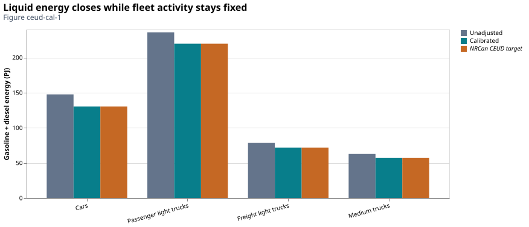

*Figure ceud-cal-1. The fitted liquid-fuel total closes on the specified boundary.
This establishes arithmetic closure, not independent validation of consumption,
fleet composition or the cause of the original mismatch. Off/on results use the
same physical fleet, activity and captured source definitions.*

For the recorded Ontario 2025 fleet, with utilization matched to the backend's
projected 2025 demand, the fitted factors are:

| Class | Unadjusted comparable energy (PJ) | [*NRCan CEUD*](https://oee.nrcan.gc.ca/corporate/statistics/neud/dpa/menus/trends/comprehensive_tables/list.cfm) gasoline/diesel target (PJ) | Consumption multiplier |
| --- | ---: | ---: | ---: |
| Cars | 151.375830 | 130.469305 | 0.861890 |
| Passenger light trucks | 241.974079 | 219.787701 | 0.908311 |
| Freight light trucks | 80.816287 | 71.790711 | 0.888320 |
| Medium trucks | 64.415281 | 57.445597 | 0.891801 |
| Heavy trucks | 160.698184 | 157.009704 | 0.977047 |

!!! info "Diagnostic finding: the fitted consumption adjustment"
    Consumption falls by about 2.3–13.8% on the fitted boundary. Heavy-truck service
    efficiency increases by about 2.35%. Efficiency changes
    by the reciprocal factor, not by the same percentage. These are effective class
    adjustments under the stated fleet/activity assumptions, not measurements of
    technology-specific test-to-road bias.

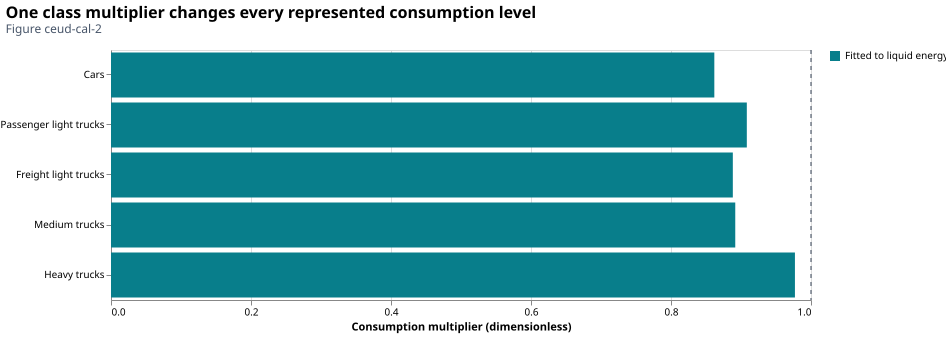

*Figure ceud-cal-2. One factor per supported class changes the consumption level
of all its represented vehicles. Values above one reduce service efficiency;
values below one increase it. Heavy trucks now fit their confirmed diesel aggregate;
the factor is estimated from that energy target rather than fixed at one.*

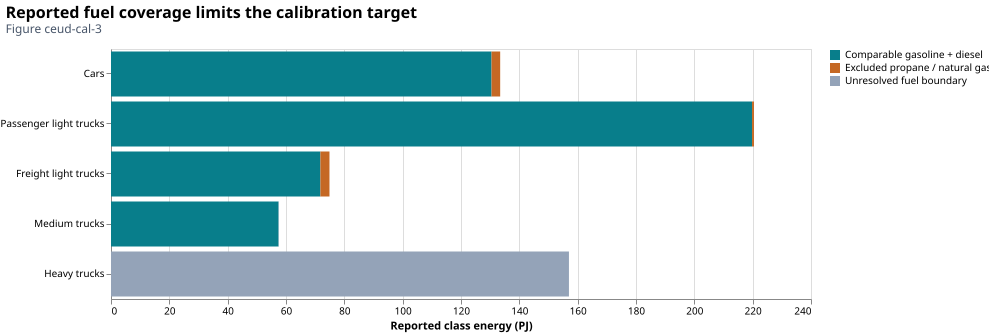

*Figure ceud-cal-3. Gasoline/diesel, excluded reported fuels and unresolved coverage
remain separate. This prevents a fitted subtotal from appearing to validate the
whole energy account. For the other classes, missing separately reported electricity
remains unknown; heavy trucks use the confirmed diesel-only total.*

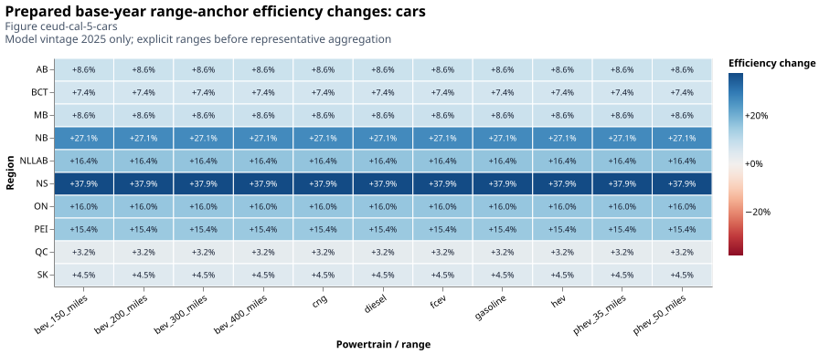

*Figure ceud-cal-5-cars. At the base-year cohort anchor only, regions are rows
and powertrains/ranges are columns. Cells show the relative change in prepared
range-anchor service efficiency, $\eta^1/\eta^0-1=1/g-1$. The car heatmap uses the explicitly
prepared regional calibration scenario; it does not extrapolate the Ontario
factor to other provinces. These explicit range rows precede representative
aggregation. The common class multiplier gives emitted representatives the same
percentage adjustment; the paired final-database audit separately verifies that
propagation. Historical and future relative trajectories remain unchanged.*

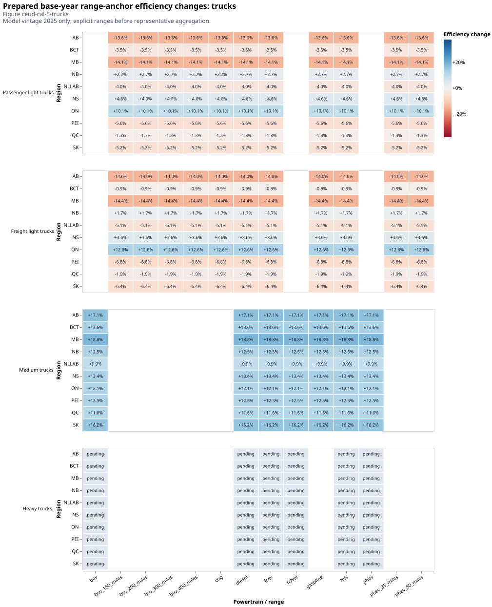

*Figure ceud-cal-5-trucks. Separate facets retain passenger light trucks, freight
light trucks, medium trucks and heavy trucks. Percentage changes make the
passenger/freight units comparable. Tooltips in the notebook retain the prepared
range-anchor before/after efficiencies and units, rather than final aggregated
representative levels. Heavy-truck cells show the adjustment fitted to the diesel
aggregate. Blank cells indicate
unrepresented class/powertrain combinations rather than a zero adjustment.*

Region codes preserve the backend's source boundaries: **BCT** combines British
Columbia with the three territories; **NLLAB** and **PEI** denote Newfoundland and
Labrador and Prince Edward Island. No BC-only calibration is inferred from BCT.

!!! note "Confirmed boundary: heavy-truck energy is diesel"
    The reviewed CEUD heavy-truck energy boundary is entirely diesel.
    Table 36's `Heavy Truck Energy Use1 (PJ)` therefore supplies the complete diesel
    energy target. It is selected once, rather than added to a separate diesel
    component. Table 37's diesel L/100 km series continues to supply the historical
    consumption proxy; the two quantities serve different stages of the calculation.
    The same class-factor method now calibrates heavy-truck consumption while
    preserving the projected activity, physical stock and relative trajectories.

!!! info "Verified implementation: final-parameter propagation"
    The paired final-database check verifies all 574 efficiency rows, including future
    and representative vehicles: 225 change by the specified class factors, including
    all 33 heavy-truck rows, with
    maximum relative factor error $4.44\times10^{-16}$. Comparable liquid energy closes
    within $2.84\times10^{-14}$ PJ; activity, PHEV split parameters and all other
    numerical parameter tables are unchanged. The 31 recorded efficiency-input
    fingerprints agree across the builds. This establishes implementation and
    accounting properties, not scientific acceptance of the adjustment.
