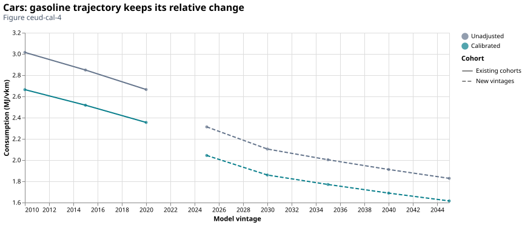

# How much energy does travel require?

Consumption measures energy per vehicle-km; service efficiency measures passenger-
or tonne-km per unit energy. The backend averages consumption on a consistent
physical basis before taking its inverse. Averaging efficiencies directly would
give a different answer.

## From rated configurations to fleet consumption

[*NRCan Ratings*](https://open.canada.ca/data/en/dataset/98f1a129-f628-4ce4-b24d-6f16bf24dd64)
describe tested configurations, not actual Canadian driving. Reviewed canonical
families connect eligible configurations to [*Ontario MTO*](https://data.ontario.ca/dataset/vehicle-population-data) survivors or [*Transport Canada iZEV*](https://open.canada.ca/data/en/dataset/42986a95-be23-436e-af15-7c6bf292a2e1) acquisition
records. Distinct-trim medians prevent a family with many catalogue variants from
receiving many copies of its empirical count. Unsupported composition uses the
documented hierarchical catalogue fallback, with coverage retained.

!!! note "Assumption: composition counts proxy travel weights"
    Family, size-class, annual-cohort and range weights have different meanings.
    Within a [*NRCan CEUD*](https://oee.nrcan.gc.ca/corporate/statistics/neud/dpa/menus/trends/comprehensive_tables/list.cfm) class, using count weights also assumes a common annual distance
    across families. [*Transport Canada iZEV*](https://open.canada.ca/data/en/dataset/42986a95-be23-436e-af15-7c6bf292a2e1) incentive eligibility and acquisition/request timing do not
    make its records a census of sales or surviving stock.

For normalized weights $\boldsymbol{w_i}$, consumption $\boldsymbol{c_i}$ in MJ/vehicle-km and matched
occupancy/payload $\boldsymbol{\ell}$, the service efficiency is

$$\bar c=\sum_iw_i c_i,\qquad \eta=\frac{\ell}{\bar c}.$$

!!! example "Worked example: average consumption before inversion"
    $\boldsymbol{\eta}$ is passenger-km/MJ or tonne-km/MJ, numerically equal to billion service-km/PJ.
    For example, equally weighted consumption of 2 and 4 MJ/km gives 3 MJ/km; at two
    passengers, efficiency is $2/3$ passenger-km/MJ, not the mean of $2/2$ and $2/4$.

## Trucks and the observed-to-projected bridge

!!! note "Assumption: fleet-year truck consumption proxies cohorts"
    [*NRCan CEUD*](https://oee.nrcan.gc.ca/corporate/statistics/neud/dpa/menus/trends/comprehensive_tables/list.cfm) truck consumption describes a fleet year, not a measured model-year cohort.
    The backend uses this as a vintage proxy. Emerging powertrains use relative [*NLR ATB*](https://atb.nlr.gov/transportation/2024/data)
    performance against diesel; medium-truck and heavy-truck aggregation retains the
    [weight/vocation/haul assumptions](vehicles.md#trucks-need-weight-haul-and-vocation-assumptions).
    Fuel-specific physical litres are converted with their own heating values.

The aligned road reference is 2023. Observations through that year establish the
historical anchor; annual 2024–2025 values use [*NLR ATB*](https://atb.nlr.gov/transportation/2024/data) relative changes before vintage
aggregation. With consumption $\boldsymbol{c}$ in MJ/km, projected year $\boldsymbol{y}$, reference
$\boldsymbol{y_0}=2023$, and powertrain/range variant $\boldsymbol{r}$:

$$c_r(y)=c_{anchor}\frac{c^{ATB}_r(y)}{c^{ATB}_{anchor}(y_0)}.$$

!!! note "Assumption: an empirical anchor with projected relative changes"
    Here $\boldsymbol{c_{anchor}}$ is the empirical consumption for the reference class and
    powertrain; the [*NLR ATB*](https://atb.nlr.gov/transportation/2024/data) denominator uses its matching reference variant. The ratio
    carries technology improvement and relative range performance. It does
    not turn [*NLR ATB*](https://atb.nlr.gov/transportation/2024/data) levels into Canadian observations. BEV300 and PHEV35 are common
    historical projection indices; future range variants retain relative [*NLR ATB*](https://atb.nlr.gov/transportation/2024/data) levels.
    Sparse source years follow explicit source policies rather than invented observations.

*Figure ldv-eff-6-cars-bev-mj-vkm. The Ontario car BEV diagnostic separates
cohort evidence from indexed range trajectories in MJ/vehicle-km. The captured
notebook build uses reference 2023 and explicit future ranges. The bridge is
constructed from an observed anchor and relative [NLR ATB](https://atb.nlr.gov/transportation/2024/data) changes; continuity is not
validation of future performance.*

*Figure ldv-eff-6-medium-trucks-diesel-mj-vkm. The medium-truck fleet-year proxy
and indexed diesel projection use the configured weight/vocation mix. This is a
class-average consumption history, not measured efficiency by truck model year.
Both bridge figures retain source years and selections in the publication manifest.*

## PHEVs need component accounting

A PHEV combines charge-depleting (CD) and charge-sustaining (CS) operation. If $\boldsymbol{f}$
is the CD distance utility factor, its physical total consumption is

$$c=f(c_{CD,e}+c_{CD,f})+(1-f)c_{CS,f}.$$

!!! tip "Modeler note: distance utility and energy shares differ"
    Every component is in MJ/vehicle-km after explicit fuel/electricity conversion.
    $\boldsymbol{f}$ is a distance fraction, not the electricity fraction of energy and not annual
    vehicle utilization $\boldsymbol{u}$. Shared input-split contracts represent the resulting
    electric/liquid blend. Its total energy is counted once in reconciliation.
    Published [*NRCan Ratings*](https://open.canada.ca/data/en/dataset/98f1a129-f628-4ce4-b24d-6f16bf24dd64)/[*NLR ATB*](https://atb.nlr.gov/transportation/2024/data) electricity already includes charging losses on its stated
    basis; the unity charger transfer preserves that boundary.
    See [infrastructure boundaries](infrastructure.md).

## Optional [*NRCan CEUD*](https://oee.nrcan.gc.ca/corporate/statistics/neud/dpa/menus/trends/comprehensive_tables/list.cfm) energy calibration {#optional-ceud-energy-calibration}

!!! warning "Coverage limit: no separately reported electricity target"
    The registered [*NRCan CEUD*](https://oee.nrcan.gc.ca/corporate/statistics/neud/dpa/menus/trends/comprehensive_tables/list.cfm) car/light-truck fuel tables do not separately report electricity.
    The opt-in method therefore fits a **comparable gasoline-plus-diesel boundary**
    for supported car/light-truck/medium-truck classes. Other reported fuels, electricity
    without a reported target, and unsupported heavy-truck fuel detail remain visible.
    Missing electricity is not a measured zero.

!!! note "Observation basis: 2023 values held at reference 2025"
    The Ontario comparison represents 2025 using the registered [*NRCan CEUD*](https://oee.nrcan.gc.ca/corporate/statistics/neud/dpa/menus/trends/comprehensive_tables/list.cfm) 2023 edition
    and its explicit constant-extension policy. Stock, activity and fuel targets
    therefore retain their 2023 observed values; the reconstructed fleet is aged to
    2025. This is a reference-fleet calibration, not a new 2025 energy observation.

!!! note "Source precision and numerical closure"
    The source reports PJ to six decimals. Independently rounded fuel components can
    differ from the rounded total by a few millionths of a PJ. The compatibility
    check uses that declared precision; fitted-energy closure uses a separate,
    tighter numerical tolerance. Signed residuals remain recorded. A substantive
    medium-truck remainder of 0.095833 PJ is retained as unresolved coverage.

For class $\boldsymbol{c}$ and technology–vintage cohort $\boldsymbol{v}$, reference physical stock $\boldsymbol{N_{cv}}$,
C2A $\boldsymbol{a_c}$, utilization $\boldsymbol{u_c}$,
uncalibrated efficiency $\boldsymbol{\eta^0_{cv}}$ and the emitted liquid-energy fraction
$\boldsymbol{\lambda_{cv}}$, predicted comparable energy in PJ is

$$E^0_c=\sum_v\frac{N_{cv}a_cu_c}{\eta^0_{cv}}\lambda_{cv},\qquad
g_c=\frac{E^{CEUD,liquid}_c}{E^0_c},\qquad \eta^1_{cv}=\frac{\eta^0_{cv}}{g_c}.$$

$\boldsymbol{N}$ is thousand surviving vehicles; $\boldsymbol{a}$ is billion service-km per thousand
vehicles per year at full utilization; $\boldsymbol{u}$ is a dimensionless annual fraction;
$\boldsymbol{\eta}$ is billion service-km/PJ; and $\boldsymbol{\lambda}$ is a dimensionless liquid-energy
fraction. All quantities use the same reference-year physical fleet and region.

!!! warning "Assumption: one effective factor transfers across technologies"
    The degree of freedom is one dimensionless consumption multiplier per supported
    region/class. It preserves fleet/activity, relative consumption trajectories and
    the reviewed PHEV split. The same multiplier is transferred to other powertrains
    and future years, including electricity and hydrogen: **that transfer is an
    explicit effective-level assumption, not a fuel-specific efficiency correction
    identified by [*NRCan CEUD*](https://oee.nrcan.gc.ca/corporate/statistics/neud/dpa/menus/trends/comprehensive_tables/list.cfm)**.
    No technology-, vintage-, range- or fuel-specific correction is uniquely estimated.

!!! tip "Modeler note: supported calibration combinations"
    Historical consumption, projection anchors, future trajectories and representative
    range aggregation use the same adjustment. Unadjusted evidence remains available.
    `efficiencies.ceud_energy_calibration` is false by default; the comparison scenario
    enables it explicitly. The [*NRCan CEUD* notebook](../insights/ceud_calibration_diagnosis.py)
    shows targets, factors, excluded coverage, residuals and final-parameter changes.
    The supported combination is fixed road lifetimes and flat annual utilization;
    configuration validation rejects survival-curve or age-dependent combinations.

*Figure ceud-cal-1. The fitted liquid-fuel total closes on the specified boundary.
This establishes arithmetic closure, not independent validation of consumption,
fleet composition or the cause of the original mismatch. Off/on results use the
same physical fleet, activity and captured source definitions.*

For the recorded Ontario 2025 fleet, the fitted factors are:

| Class | Unadjusted comparable energy (PJ) | [*NRCan CEUD*](https://oee.nrcan.gc.ca/corporate/statistics/neud/dpa/menus/trends/comprehensive_tables/list.cfm) gasoline/diesel target (PJ) | Consumption multiplier |
| --- | ---: | ---: | ---: |
| Cars | 147.649622 | 130.469305 | 0.883641 |
| Passenger light trucks | 236.017741 | 219.787701 | 0.931234 |
| Freight light trucks | 78.826946 | 71.790711 | 0.910738 |
| Medium trucks | 62.829660 | 57.445597 | 0.914307 |

!!! info "Diagnostic finding: the fitted consumption adjustment"
    Consumption falls by about 6.9–11.6% on the fitted boundary. Efficiency changes
    by the reciprocal factor, not by the same percentage. These are effective class
    adjustments under the stated fleet/activity assumptions, not measurements of
    technology-specific test-to-road bias.

*Figure ceud-cal-2. One factor per supported class changes the consumption level
of all its represented vehicles. Values above one reduce service efficiency;
values below one increase it. Heavy trucks retain one because their target fuel
boundary is unsupported, not because their efficiency is independently verified.*

*Figure ceud-cal-3. Gasoline/diesel, excluded reported fuels and unresolved coverage
remain separate. This prevents a fitted subtotal from appearing to validate the
whole energy account. Missing separately reported electricity remains unknown.*

*Figure ceud-cal-4. The selected Ontario gasoline-car trajectory retains its
relative change between model vintages under the common multiplier. Historical and future
levels move together; future improvement is still inherited from the source
trajectory and is not identified by the fitted reference total.*

!!! info "Verified implementation: final-parameter propagation"
    The paired final-database check verifies all 574 efficiency rows, including future
    and representative vehicles: 192 change by the specified class factors, with
    maximum relative factor error $4.44\times10^{-16}$. Comparable liquid energy closes
    within $2.84\times10^{-14}$ PJ; activity, PHEV split parameters and all other
    numerical parameter tables are unchanged. The 31 recorded efficiency-input
    fingerprints agree across the builds. This establishes implementation and
    accounting properties, not scientific acceptance of the adjustment.
