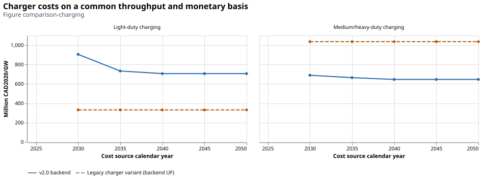

# What infrastructure supports the vehicles?

Charging capacity is inferred from a mixture of observed public ports and
assumptions about private provision. A port count is neither rated power nor annual
energy throughput. Keeping these quantities separate explains many apparent cost
differences with legacy infrastructure estimates.

## Ports become electrical capacity

Transport Canada's [EV dashboard](https://tc.canada.ca/en/road-transportation/innovative-technologies/electric-vehicles/canada-electric-vehicle-dashboard)
provides public-port evidence. BEV physical stock and configured vehicles-per-port
ratios determine required ports. Private LDV ports are the required total minus
public ports; reviewed type shares distribute them. PHEVs do not enter this
stock-to-port calibration. Public-port observation dates can differ from the
vehicle-stock reference date and remain explicit in the audit.

For port type $j$, count $n_j$ and rated power $p_j$ in kW,

$$K=10^{-6}\sum_j n_jp_j\quad[\mathrm{GW}].$$

National public type shares proxy provincial mixes. BCT public counts combine BC
and the territories. MHDV provision uses its own vehicle-to-port ratio and power
mix. None of these inferences establishes observed private infrastructure coverage.

## Costs use total expenditure divided by rated power

The production estimator matches per-port capital cost $q_{jy}$ and rated power
$p_{jy}$ at source year $y$. With port-count shares $w_j$,

$$P_y^{GW}=\frac{\sum_jw_jq_{jy}}{\sum_jw_jp_{jy}}.$$

If $q$ is CAD/port and $p$ kW/port, the ratio is CAD/kW, numerically equal to
million CAD/GW. This is not the arithmetic mean of separate per-GW rates using
port-count shares. Monetary harmonization then expresses the result in the
scenario's dollar year. Fixed O&M uses the reviewed 1% capital-cost ratio while
the infrastructure remains alive. Investment rows apply only to new chargers.

The [Dunsky infrastructure study](https://natural-resources.canada.ca/energy-efficiency/transportation-energy-efficiency/resource-library/electric-vehicle-charging-infrastructure-canada)
and reviewed supplemental inputs supply port cost/power assumptions. Existing
and future rates retain their explicit source-year selection, end holds and mixes.
The [canonical infrastructure table](../assumptions.md#charging-and-hydrogen-refueling-infrastructure)
owns the detailed values.

## Utilization and energy boundaries

Current reviewed utilization is 0.20 for existing/new LDV and MHDV chargers.
With electrical capacity $K$ in GW, 31.536 PJ/(GW·year) converts continuous power
to annual energy: $E=31.536Ku$. The emitted charger transfer efficiency is 1.0.
This internal accounting choice avoids counting charging losses again where
vehicle consumption already includes them. The former 0.95/0.80 manual factors
remain evidence but are not applied.

This boundary has limits: motorcycle consumption lacks charging losses, and the
intercity-bus source does not establish its charging-loss boundary. A shared unity
transfer does not resolve those gaps. PHEV input energy is counted once, not once
for each component plus again for a blend.

Legacy charger costs may be expressed per PJ/year rather than per GW. Conversion
requires an explicit utilization and throughput basis. The comparison notebook
keeps that conditional normalization separate from source-price differences and
does not interpret missing variable-cost rows as zero costs.

*Figure comparison-charging. Backend and supplied legacy charger-cost CSVs are
shown in million CAD2020/GW after converting the legacy annual-throughput rate at
the backend utilization of 0.20. Port mixtures, source jurisdictions and equipment
boundaries still differ. The legacy variant's embedded utilization/loss assumptions
are undocumented, so this is a conditional normalization, not proof of cost parity.*

For matched source years 2030–2050, the recorded backend LDV rates are 113.0–172.9%
above the normalized legacy rates; MHDV rates are 33.5–37.6% below them. The legacy
2025 rate has no matching backend cost-year bridge and is left unmatched. These
gaps combine source and equipment-mix differences; the comparison does not isolate
a causal contribution from each assumption.

## Hydrogen refueling uses a different capacity definition

Hydrogen stations use effective annual throughput in PJ/year, with implicit C2A
of one and no additional utilization factor. Their independent investment and
fixed costs originate in reviewed [OEO inputs](https://github.com/TemoaProject/oeo/tree/master/database_documentation),
converted from 2018 USD. Distribution/refueling efficiency is 0.995; station life
is ten years. No historical station stock is invented. Charger life is fifteen
years; both fixed-cost schedules stop at their lifetime boundary.

These parameters describe supporting capacity and cost. They do not by themselves
prove spatial accessibility, queueing performance or a feasible optimized network.
