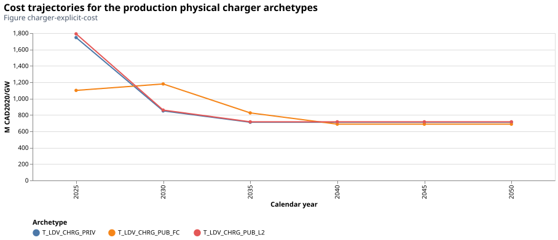
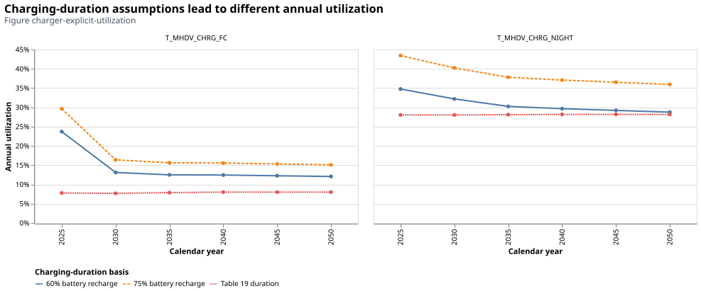
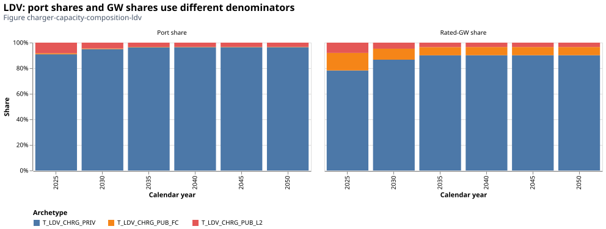
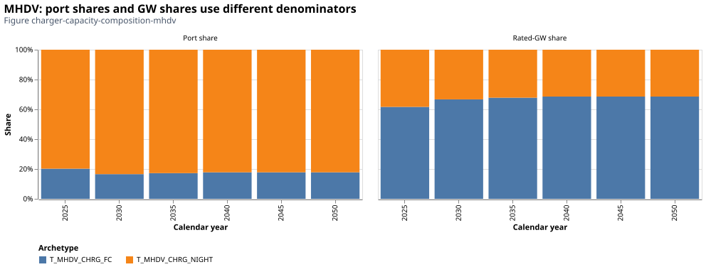

# What infrastructure supports the vehicles?

The backend distinguishes port counts, rated electrical capacity and annual energy
throughput. The same fetched [*Dunsky inputs*](https://natural-resources.canada.ca/energy-efficiency/transportation-energy-efficiency/resource-library/electric-vehicle-charging-infrastructure-canada) support two scenario representations,
selected by `ev_chargers.charger_type_classes`:

| Representation | Charging technologies | Annual utilization |
| --- | --- | --- |
| `aggregated` | One LDV and one MHDV class, each with existing/new technologies | LDV target 0.20, with an annual floor of 0.196 when hourly profiles are selected. MHDV equality at 0.30. |
| `explicit` | LDV public L2, public fast and private; MHDV overnight and fast | Component-specific source assumptions and the home proxy below |

Both use the shared source-to-archetype calculation. [Registered Dunsky extraction](../../config/parameters/dunsky_charger_inputs.yaml)
supplies costs, ratings, composition and operating assumptions; [production rules](../../config/parameters/charging_and_range_representation.yaml)
own their interpretation. The [manual CSV](../../inputs/0_manual_params/charger_parameters.csv)
retains supplemental inputs and reviewed aggregate overrides. The
[assumptions table](../assumptions.md#charging-and-hydrogen-refueling-infrastructure)
records the boundaries and remaining proxies.

## Prepared BEV stock determines existing ports

Existing provision starts from prepared **physical surviving BEV stock**, before
its conversion to solver capacity. Scenario vehicles-per-port ratios are separate
for LDVs, medium trucks and heavy trucks. PHEVs do not enter this stock calibration.
Bus electricity uses the MHDV charger output, although bus stock does not enter
the existing-port inference.

The pinned December 31, 2025 [AFDC public/open inventory](https://afdc.energy.gov/stations/)
provides provincial L1/L2/DCFC ports. BC and the territories combine into BCT.
For LDVs, total required ports minus observed public ports gives inferred private
provision. These observations proxy LDV public access: missing vehicle-class
metadata prevents treating them as a verified LDV-only inventory.

With counts $N_j$ and ratings $p_j$ in kW, electrical capacity is

$$K=10^{-6}\sum_jN_jp_j\quad[\mathrm{GW}].$$

Aggregate LDV capacity retains the reviewed private L1/L2 mix. Explicit capacity
separates AFDC public L2/fast ports from inferred private ports; negligible public
L1 ports are omitted and audited. MHDV port totals use the separate medium/heavy
vehicles-per-port ratios. Aggregate MHDV stock uses the reviewed 80/20 port split
between 50 and 350 kW. Explicit MHDV stock uses the first modeled year's national
Dunsky composition and archetype ratings. Port observation dates, stock years
and selected power years remain distinct in the audit.

## Costs combine expenditure and rated power

Dunsky Tables 6 and 38 supply **evolving annual port composition**, using disjoint
LDV and public/private MHDV components. Counts interpolate between source points
and hold after 2040.

For a charger archetype or aggregate class $a$, convert each per-port cost $q_{jy}$
to the scenario's CAD dollar year before aggregating at source year $y$:

$$C_{a,y}=\frac{\sum_{j\in a}N_{jy}q_{jy}}{\sum_{j\in a}N_{jy}p_{jy}}.$$

CAD/kW is numerically equal to million CAD/GW. Equivalently, component costs per GW
can be averaged with **rated-power shares**, $N_{jy}p_{jy}/\sum_kN_{ky}p_{ky}$.
Using port-count shares for that average would change the denominator.

LDV DCFC costs and ratings are matched to **Table 12**: 125/175/250/300 kW in
2025/2030/2035/2040, holding 300 kW afterward. Home/public L1/L2 retain their
registered ratings. Private L2 uses the public-L2 price proxy; public MHDV overnight
cost scales linearly from the Table 21 50 kW cost to its Table 19 100 kW rating.
These choices proxy unavailable prices.

Home Level 1 uses the reviewed midpoint of the NREL installation-cost range.
The [assumptions reference](../assumptions.md#charging-and-hydrogen-refueling-infrastructure)
records the per-port amount and dollar year.

Prospective investment vintages use interval-end source years; legacy mode uses
vintage labels. Existing fixed costs use first-model-year costs and ratings and
receive no investment row. Annual fixed O&M is 1% of capital cost while the
15-year charger cohort remains alive.

*Figure charger-explicit-cost. LDV costs use matched expenditure and rated power;
changing source composition also changes the aggregate rate.*

## Utilization describes a separate energy assumption

For rated GW $K$ and annual factor $u$, $E=31.536Ku$ PJ/year. Cost aggregation does
not use $u$. Combining components into an energy-equivalent archetype requires

$$u_a=\frac{\sum_{j\in a}N_jp_ju_j}{\sum_{j\in a}N_jp_j}.$$

| Explicit component | Annual utilization basis |
| --- | --- |
| Public LDV L2/DCFC and workplace L2 | Dunsky Table 31 reported port utilization; DCFC is not rescaled when using the Table 12 cost-matched rating |
| Home L1/L2 | Scenario `ld_home_utilization: 0.08`, extended as a home-charging proxy |
| MHDV | Table 19 charging hours/session × vehicles/operating day × configured 300 operating days/year ÷ 8,760 |

The home proxy is informed by [Jonas et al., Table 2](https://doi.org/10.3390/en16041592):
FLO residential L2 telemetry from BC/QC in 2018–2019 covers 2,657 ports and 675,560
sessions. The product $156.61\times0.73/1440\approx0.079393$ uses mean active
minutes/session and mean sessions/port/day. Multiplying differently weighted means
is an approximation, not a directly measured annual rated-power energy factor.
Extension to L1, other provinces and future vintages remains a modeling proxy.

MHDV parameter notes retain each component's session duration, daily vehicle count
and operating-day assumption. The annual target is weighted by rated power, not
by port counts alone. Point-year registration-stock and 60%/75% battery-recharge
comparisons remain [notebook research sensitivities](../insights/charger_infrastructure_diagnosis.py); they do not replace the
production duration reference.

*Figure charger-explicit-utilization. The MHDV duration reference is production;
battery-energy alternatives expose sensitivity to a different throughput basis.*

## Power shares constrain the charger mix

Charger costs differ, so unconstrained Temoa investment could concentrate on the
cheapest way to supply charging energy and omit other charger types. In `explicit`
mode, `limit_capacity_share` retains the Dunsky composition by constraining
**period-wide shares of available GW**, including active existing equipment.

The figures compare port shares with rated-power shares,
$N_{jy}p_{jy}/\sum_kN_{ky}p_{ky}$, within each vehicle class. These are source-year
illustrations. The model evaluates mix targets in the closing year for prospective
periods and the opening year for legacy periods. On a five-year grid, the model
period labeled 2025 thus uses 2030 in prospective mode or 2025 in legacy mode.

*Figure charger-capacity-composition-ldv. In 2025, public fast chargers represent
0.8% of LDV ports but 13.7% of rated capacity.*

*Figure charger-capacity-composition-mhdv. In 2025, fast and ultrafast chargers
represent 20.2% of MHDV ports but 61.7% of rated capacity.*

For LDVs, the targets fix L2 versus fast shares within public charging, then public
versus private shares within all LDV chargers. For MHDVs, they fix overnight versus
fast/ultrafast shares, using the same national mix in each province. These are
equipment-capacity shares, not charging-energy shares.

Applying source-year power shares to several active vintages approximates the stock
mix; it does not enforce exact port counts across vintages. With fixed existing
stock and annual utilization equalities, the targets can require additional
capacity, charging throughput and EV uptake.
The [opt-in annual screen](../publication.md#charging-profiles-and-charger-infrastructure)
checks that coupling in a completed explicit database; full solver feasibility
remains a separate acceptance check.

## Representation and accounting limits remain explicit

Explicit chargers require `charging_profiles.travel_behavior_source: none`.
Registered hourly profiles describe pooled LDV charging. See
[charging profiles](charging.md) for the native scaling rule and the
representative-time check.

Charger transfer is 1.0 under the wall-energy interpretation of ATB and NRCan
ratings. This avoids applying a second charging loss. The NRCan PHEV basis
requires confirmation. Motorcycle charging losses remain unrepresented and the
intercity bus proxy's loss basis is unknown. Rated capacity and annual energy
give no local coverage or queueing estimates.

## Hydrogen refueling uses annual throughput

Hydrogen stations retain effective capacity in PJ/year, implicit C2A of one and no
additional utilization factor. Reviewed [OEO inputs](https://github.com/TemoaProject/oeo/tree/master/database_documentation)
supply LDV/MHDV investment rates 41.1/36.88 and annual fixed rates 2.05/1.84 million
2018 USD per PJ/year, converted to the scenario's CAD year. Transfer efficiency is
0.995, [HDSAM-based](https://hdsam.es.anl.gov/index.php) life is ten years, and no
historical station stock is invented. Fixed costs end at the lifetime boundary.
