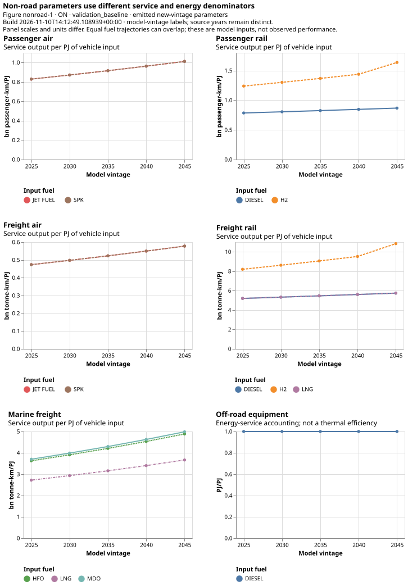

# Air, rail, marine and off-road equipment

The backend distinguishes **non-road transport** (air, rail and marine) from
**off-road equipment**. These modes do not inherit the road-vehicle stock, mileage
or make/model methodology. Their evidence often measures energy and service
intensity without a provincial count of physical vehicles.

## Estimate service where fleet counts are absent

If provincial energy is $E_{rt}$ PJ and national service intensity is $i_t$
PJ per billion passenger-km or tonne-km, estimated provincial activity is

$$Q_{rt}=\frac{E_{rt}}{i_t}.$$

This transfers a national intensity to a province. The implied activity is not an
independent provincial observation. Likewise, treating annual service capacity as
the fleet measure avoids inventing aircraft, train or vessel counts. Annual
utilization is one under that capacity definition.

| Mode | Evidence-to-parameter approach | Material limitation |
| --- | --- | --- |
| Passenger/freight air | CEUD energy/intensity determines service; reviewed CIMS aircraft costs and FAA capacity/load/speed/utilization normalize investment and maintenance to service; REGEN supplies improvement relationships. | Incumbent capacity uses turbo fuel, while demand also includes aviation gasoline. Freight capacity reported as US short tons needs conversion. |
| Passenger/freight rail | CEUD national intensities and provincial energy establish incumbents; CIMS costs/lifetimes and reviewed alternative-powertrain ratios supply other parameters. | Electric passenger-rail energy is absent from the selected CEUD evidence; diesel alone represents the incumbent service. |
| Marine freight | Shared CEUD service intensity and energy establish capacity; GREET supplies the HFO/MDO consumption relationship; reviewed cost/lifetime evidence supplies capital and operating costs. | HFO/MDO energy shares split the incumbent capacity; the relative-consumption factor describes a predefined modeled trip. |
| Off-road equipment | CEUD off-road energy service is represented separately, with reviewed efficiency/cost/lifetime selectors where supplied. | Do not relabel its energy demand as passenger-km, tonne-km or a measured equipment count. |

Primary evidence comes from [CEUD](https://oee.nrcan.gc.ca/corporate/statistics/neud/dpa/menus/trends/comprehensive_tables/list.cfm),
[FAA Economic Values](https://www.faa.gov/regulations_policies/policy_guidance/benefit_cost),
[CIMS](https://github.com/EMRG-SFU/cims), [EPRI REGEN](https://us-regen-docs.epri.com/v2025/assumptions/transportation.html)
and [GREET](https://greet.anl.gov/greet/versions.html). Registered excerpts and
source-specific qualifications are identified in the [source inventory](../source_inventory.md).

## Turnover and alternatives

Where only annual service-capacity totals exist, a reviewed fixed lifetime $L$
supports a linear remaining-capacity proxy $\max(0,1-a/L)$ at age $a$. Additions
are the current total minus surviving earlier capacity, bounded below by zero.
This reconstructs a service-capacity history; it is not measured vehicle survival.

Historical energy per service is averaged before inversion. Future technology
efficiencies use reviewed relative multipliers and source-year policies; sparse
REGEN/manual series use explicit holds. Future demand follows the same observed-
year/GDP relationship described in [activity and demand](activity.md).

## A worked boundary example

*Figure nonroad-1. Final new-vintage parameters separate passenger, freight and
energy-service denominators. Differences between technologies reflect their
registered ratios and source assumptions; they are not optimized mode choices.
Off-road PJ/PJ must not be compared numerically with passenger-km/PJ or tonne-km/PJ.
The [exact parameter rows](../assets/figures/nonroad_efficiency_rows.csv) retain
technology, vintage, input/output commodity and units.*

SPK means synthetic paraffinic kerosene; LNG, liquefied natural gas; HFO/MDO,
heavy fuel oil/marine diesel oil; and H2, hydrogen. Equal jet-fuel/SPK or diesel/LNG
parameter paths can overlap. That equality reflects the implemented relationship,
not separate empirical identification of each fuel's performance.

Suppose a province uses 20 PJ and the national intensity is 2 PJ per billion
tonne-km. Estimated activity is 10 billion tonne-km. A 10% lower assumed intensity
would raise inferred activity to 11.11 billion tonne-km with energy unchanged.
Energy and inferred activity therefore cannot validate each other independently.

| Assumed intensity (PJ/billion tonne-km) | Same observed energy (PJ) | Inferred activity (billion tonne-km) |
| ---: | ---: | ---: |
| 1.8 | 20 | 11.11 |
| 2.0 | 20 | 10.00 |
| 2.2 | 20 | 9.09 |

These illustrative values explain the arithmetic; they are not recorded Canadian
results. Mode-specific parameter audits retain actual sources, units and selected
years. [Detailed assumptions](../assumptions.md#existing_capacity) identify coverage
gaps that the compact example cannot resolve.
