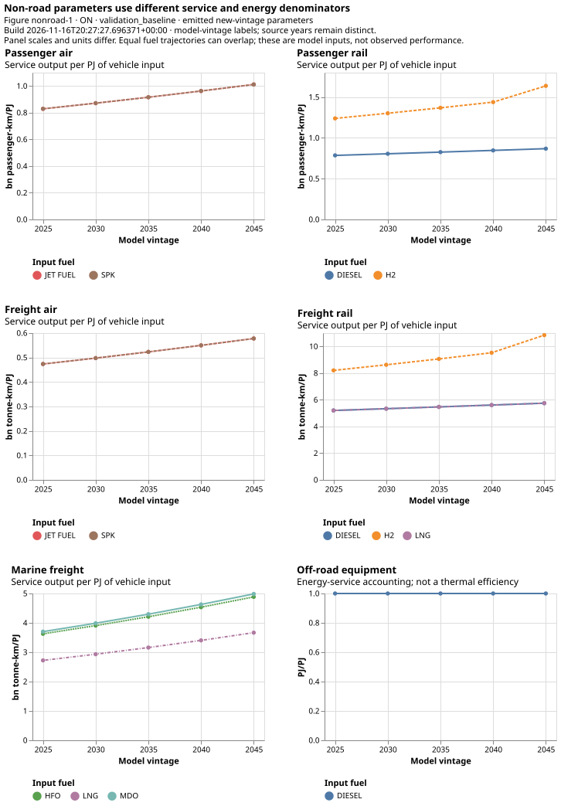

# Air, rail, marine and off-road equipment

The backend distinguishes **non-road transport** (air, rail and marine) from
**off-road equipment**. These modes do not inherit the road-vehicle stock, mileage
or make/model methodology. Their evidence often measures energy and service
intensity without a provincial count of physical vehicles.

## Estimate service where fleet counts are absent

If provincial energy is $\boldsymbol{E_{rt}}$ PJ and national service intensity is $\boldsymbol{i_t}$
PJ per billion passenger-km or tonne-km, estimated provincial activity is

$$Q_{rt}=\frac{E_{rt}}{i_t}.$$

!!! warning "Assumption: service is inferred from energy and intensity"
    This transfers a national intensity to a province. The implied activity is not an
    independent provincial observation. Likewise, treating annual service capacity as
    the fleet measure avoids inventing aircraft, train or vessel counts. Annual
    utilization is one under that capacity definition.

| Mode | Evidence-to-parameter approach | Material limitation |
| --- | --- | --- |
| Passenger/freight air | [*NRCan CEUD*](https://oee.nrcan.gc.ca/corporate/statistics/neud/dpa/menus/trends/comprehensive_tables/list.cfm) energy/intensity determines service; reviewed [*SFU CIMS*](https://github.com/EMRG-SFU/cims-models/tree/main/csv/model) aircraft costs and [*FAA Economic Values*](https://www.faa.gov/regulations_policies/policy_guidance/benefit_cost) capacity/load/speed/utilization normalize investment and maintenance to service; [*EPRI REGEN*](https://us-regen-docs.epri.com/v2025/assumptions/transportation.html) supplies improvement relationships. | Incumbent capacity uses turbo fuel, while demand also includes aviation gasoline. Freight capacity reported as US short tons needs conversion. |
| Passenger/freight rail | [*NRCan CEUD*](https://oee.nrcan.gc.ca/corporate/statistics/neud/dpa/menus/trends/comprehensive_tables/list.cfm) national intensities and provincial energy establish incumbents; [*SFU CIMS*](https://github.com/EMRG-SFU/cims-models/tree/main/csv/model) costs/lifetimes and reviewed alternative-powertrain ratios supply other parameters. | Electric passenger-rail energy is absent from the selected [*NRCan CEUD*](https://oee.nrcan.gc.ca/corporate/statistics/neud/dpa/menus/trends/comprehensive_tables/list.cfm) evidence; diesel alone represents the incumbent service. |
| Marine freight | Shared [*NRCan CEUD*](https://oee.nrcan.gc.ca/corporate/statistics/neud/dpa/menus/trends/comprehensive_tables/list.cfm) service intensity and energy establish capacity; [*ANL GREET*](https://greet.anl.gov/greet/versions.html) supplies the HFO/MDO consumption relationship; reviewed cost/lifetime evidence supplies capital and operating costs. | HFO/MDO energy shares split the incumbent capacity; the relative-consumption factor describes a predefined modeled trip. |
| Off-road equipment | [*NRCan CEUD*](https://oee.nrcan.gc.ca/corporate/statistics/neud/dpa/menus/trends/comprehensive_tables/list.cfm) off-road energy service is represented separately, with reviewed efficiency/cost/lifetime selectors where supplied. | Do not relabel its energy demand as passenger-km, tonne-km or a measured equipment count. |

See the [source inventory](../source_inventory.md) for registered excerpts
and their scope.

## Turnover and alternatives

!!! note "Assumption: linear remaining service capacity"
    Where only annual service-capacity totals exist, a reviewed fixed lifetime $\boldsymbol{L}$
    supports a linear remaining-capacity proxy $\max(0,1-a/L)$ at age $\boldsymbol{a}$. Additions
    are the current total minus surviving earlier capacity, bounded below by zero.
    If survivors exceed the annual estimate, retire the excess proportionally across
    surviving cohorts. The result is a reconstructed service-capacity history.

!!! note "Projection assumptions: relative multipliers and source-year holds"
    Historical energy per service is averaged before inversion. Future technology
    efficiencies use reviewed relative multipliers and source-year policies; sparse
    [*EPRI REGEN*](https://us-regen-docs.epri.com/v2025/assumptions/transportation.html)/manual series use explicit holds. Future demand follows the same observed-
    year/GDP relationship described in [activity and demand](activity.md).

## A worked boundary example

*Figure nonroad-1. Final new-vintage parameters separate passenger, freight and
energy-service denominators. Differences between technologies reflect their
registered ratios and source assumptions; they are not optimized mode choices.
Off-road PJ/PJ must not be compared numerically with passenger-km/PJ or tonne-km/PJ.
The [exact parameter rows](../assets/figures/nonroad_efficiency_rows.csv) retain
technology, vintage, input/output commodity and units.*

!!! tip "Modeler note: overlapping paths retain shared assumptions"
    SPK means synthetic paraffinic kerosene; LNG, liquefied natural gas; HFO/MDO,
    heavy fuel oil/marine diesel oil; and H2, hydrogen. Equal jet-fuel/SPK or diesel/LNG
    parameter paths can overlap. That equality reflects the implemented relationship,
    not separate empirical identification of each fuel's performance.

!!! example "Worked example: sensitivity of inferred activity"
    Suppose a province uses 20 PJ and the national intensity is 2 PJ per billion
    tonne-km. Estimated activity is 10 billion tonne-km. A 10% lower assumed intensity
    would raise inferred activity to 11.11 billion tonne-km with energy unchanged.
    Energy and inferred activity therefore cannot validate each other independently.

Mode-specific audits retain the actual sources, units and selected years.
See [existing capacity assumptions](../assumptions.md#existing_capacity).
