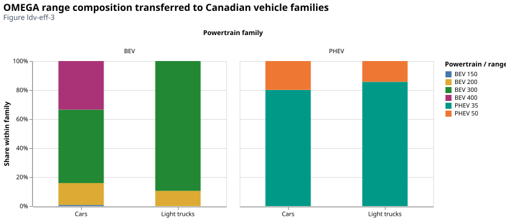
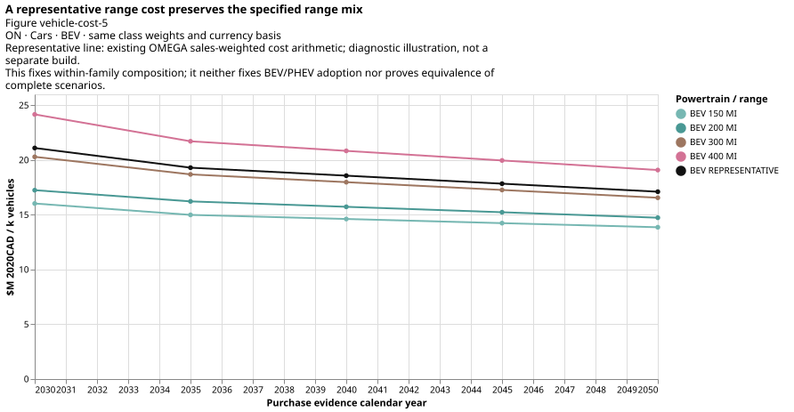
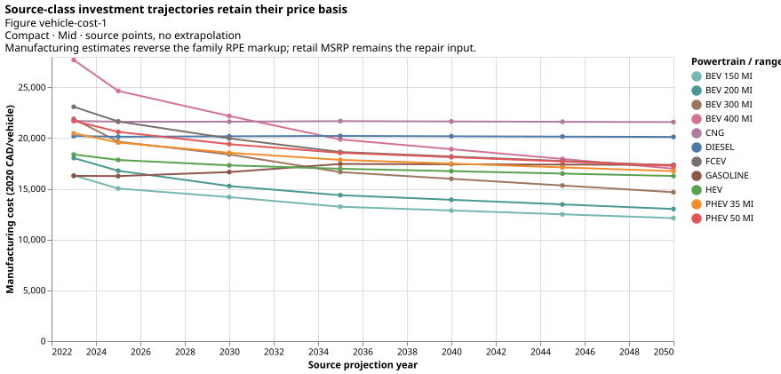
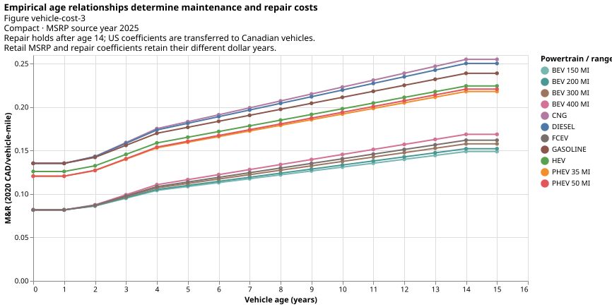

# What changes when we choose different vehicles?

Range, powertrain, price, operating cost and manufacturing emissions describe
different attributes of the same represented vehicle. The backend shares relevant
composition weights across these attributes, while preserving each quantity's
physical and monetary meaning. A parameter comparison alone does not demonstrate
which technology an energy-system optimizer will choose.

## Range is a representation choice

!!! note "Assumption: transfer the registered range composition"
    [*EPA OMEGA*](https://github.com/USEPA/EPA_OMEGA_Model) MY2022 US sales and ranges
    provide the inherited BEV/PHEV range mix. The registered extract allocates BEVs to
    four range buckets and PHEVs to two. These are transferred Canadian/future weights,
    not observed future Canadian preferences.

| New-vehicle mode | Meaning for the model |
| --- | --- |
| `none` | Retain separate range technologies without the additional range-share constraint. |
| `new_capacity_shares` | Minimum shares sum to one within each family, fixing its range mix while leaving total BEV/PHEV adoption to the model. |
| `representative_archetype` | Replace the range alternatives with a weighted representative vehicle, carrying consumption, cost and embodied mass consistently. |

Existing PEV stock uses representative ranges under all three new-vehicle modes.
For range shares $\boldsymbol{w_r}$ and efficiencies $\boldsymbol{\eta_r}$ in the same service/energy units,

$$\eta_{rep}=\left(\sum_r\frac{w_r}{\eta_r}\right)^{-1},\qquad
P_{rep}=\sum_rw_rP_r,\qquad M_{rep}=\sum_rw_rM_r.$$

!!! warning "Aggregation limit: preserve total energy, inspect components"
    Consumption is averaged before inversion; prices $\boldsymbol{P}$ and embodied masses $\boldsymbol{M}$
    are additive per-vehicle attributes. Utilization, C2A, survival and lifetime must
    be compatible across ranges. PHEV total-energy conservation does not establish
    exact preservation of every per-vintage liquid/electric component under the
    shared horizon-mean blend representation.

!!! info "Diagnostic finding: retained PHEV component approximation"
    In the recorded Ontario off/on pair, total-energy conservation passes and the
    maximum per-vintage PHEV component approximation is 0.05898% in both cases. The
    common calibration factor preserves that existing approximation; it does not
    remove the shared-blend representation's limitation.

*Figure ldv-eff-3. Sales weights describe the registered [EPA OMEGA](https://github.com/USEPA/EPA_OMEGA_Model) market and chosen
bucket definitions. Their sum-to-one check establishes allocation integrity,
not representativeness of Canadian or future sales.*

*Figure vehicle-cost-5. The Ontario car BEV illustration applies the same class
weights and currency basis to separate ranges and their [EPA OMEGA](https://github.com/USEPA/EPA_OMEGA_Model)-weighted cost.
Aggregation preserves weighted purchase cost while removing within-family range
choice. This arithmetic comparison is not a separate optimized scenario.*

## Purchase price and investment cost

!!! note "Cost basis: retail prices and manufacturing-cost proxies"
    [*NLR ATB*](https://atb.nlr.gov/transportation/2024/data) supplies source-year vehicle prices under separate technology trajectories.
    The backend applies reviewed retail-price-equivalent divisors: 1.5 for LDVs and
    1.2 for medium/heavy vehicles. The result is a manufacturing-cost proxy, not an
    observed factory cost. Retail MSRP remains the input to the repair model below.
    [*CER CEF*](https://www.cer-rec.gc.ca/en/data-analysis/canada-energy-future/) monetary factors express values in the selected common currency and dollar
    year; changing that year does not change the technology's source year.

!!! tip "Modeler note: compare compatible cost denominators"
    Road capacity is measured in thousand vehicles. Numerically, a price of 30,000
    CAD/vehicle becomes 30 million CAD per thousand vehicles. Keep this denominator
    distinct from non-road service-capacity costs and charger costs per GW.

*Figure vehicle-cost-1. Source trajectories use a common displayed currency/year
and explicit class/technology selection. Crossings are properties of those source
assumptions, not evidence of optimized adoption. The cost notebook retains source
year, retail/manufacturing basis and aggregation evidence.*

!!! info "Diagnostic finding: source price crossings"
    The Mid source can price an FCEV below a long-range BEV in some LDV classes/years.
    This relationship is present in the selected [*NLR ATB*](https://atb.nlr.gov/transportation/2024/data) inputs;
    [*NLR ATB*'s fuel-cell assumptions](https://atb.nlr.gov/transportation/2024/fuel_cell_electric_vehicle_assumptions)
    explain their modeling basis without establishing the cause of each crossing.

## Maintenance and repair

!!! warning "Empirical limit: warranty estimates and sparse age evidence"
    The complete age-dependent cost coefficients remain in registered source inputs
    and rules.
    The [*NLR ATB* cost methodology](https://atb.nlr.gov/transportation/2024/levelized_cost_of_driving_assumptions)
    incorporates [*Burnham et al. (2021)*, §3.5.4](https://publications.anl.gov/anlpubs/2021/05/167399.pdf).
    Its repair evidence comes from extended-warranty cost estimates, not directly
    observed repair bills. The ten-year evidence window, a reported year-six artifact
    and sparse alternative-powertrain observations limit extrapolation. Age $\boldsymbol{a}$
    changes repair burden, while
    powertrain-specific maintenance is added separately.

For LDV class $\boldsymbol{c}$ and powertrain $\boldsymbol{p}$, the implemented source relationship is

$$R_{acp}=s_c m_p b_{\min(a,14)}\exp(\beta P),\qquad
C^{MR}_{acp}=R_{acp}+M_p.$$

!!! warning "Transfer assumptions: dollar bases and terminal-age hold"
    $\boldsymbol{R}$, $\boldsymbol{b}$ and $\boldsymbol{M}$ are on the source USD/mile basis; $\boldsymbol{s_c}$ and $\boldsymbol{m_p}$ are
    dimensionless class/powertrain multipliers; $\boldsymbol{P}$ is retail MSRP in the source's
    specified USD basis and $\boldsymbol{\beta}$ has reciprocal-USD units. The age-14 value is
    held for older ages. The source MSRP dollar basis and empirical coefficient
    dollar basis are retained separately; a monetary conversion cannot resolve that
    empirical mismatch. US repair behavior is transferred to Canadian vehicles.

For medium/heavy trucks, the registered [*ANL BEAN*](https://publications.anl.gov/anlpubs/2023/11/179337.pdf) relationship is

$$C^{MR}_{acp}=m_p(A_{cp}a+B_{cp}),$$

!!! warning "Empirical limit: truck coefficient age support"
    where $\boldsymbol{A}$ is source currency/(mile·year), $\boldsymbol{B}$ source currency/mile, and $\boldsymbol{a}$ years.
    The registered [*ANL BEAN*](https://publications.anl.gov/anlpubs/2023/11/179337.pdf) coefficients do not establish a validated age domain.
    [*Islam et al. (2022)*, §3.3](https://publications.anl.gov/anlpubs/2023/11/179337.pdf)
    describes the methodological basis; it does not independently validate future
    Canadian class/age costs. Missing
    vehicle-class evidence uses explicit proxies, not a fitted smoothing curve.

*Figure vehicle-cost-3. Age-dependent source relationships are shown before service
normalization. The LDV terminal-age hold and transferred empirical basis are
modeling limitations, not independently measured Canadian trajectories.*

!!! tip "Modeler note: normalize operating costs to service"
    Convert cost per vehicle-km to cost per service-km by dividing by the applicable
    occupancy/payload. A cost in CAD/passenger-km or CAD/tonne-km is multiplied by 1,000
    to obtain million CAD per billion service-km. The production cost layer retains
    source years, conversions and the actual operating-period/vintage age.

## Manufacturing emissions

[*ANL GREET*](https://greet.anl.gov/greet/versions.html) supplies vehicle-cycle
mass for materials, manufacture/assembly and end-of-life treatment, without
recycling credits in the selected scope. These are per-vehicle lifetime totals,
applied to new vehicles only. They are not annualized by mileage or lifetime and
are distinct from fuel-cycle and operating emissions.

!!! note "Assumption: held manufacturing evidence and material coverage"
    Shared class/range weights aggregate the masses. CO2 uses kt per thousand vehicles;
    CH4 and N2O use tonnes per thousand vehicles. The registered 2025 simulation is held
    through the horizon. Lightweight-material choices apply to LDVs; a common switch
    does not imply equivalent medium/heavy-truck evidence. Full restrictions and the
    known [*ANL GREET*](https://greet.anl.gov/greet/versions.html) range-selector issue remain in [embodied-emission assumptions](../assumptions.md#emission_embodied).