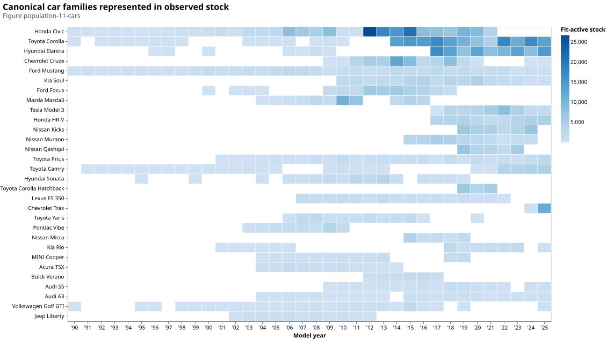
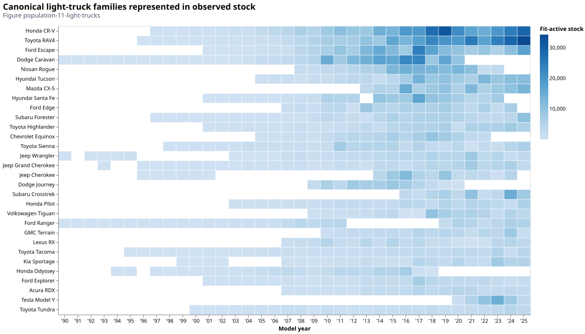

# Which vehicles does the model represent?

The backend needs representative vehicles, but its sources describe different
populations. A registration record counts a vehicle in an administrative category;
a fuel-consumption rating describes a tested configuration; a projected archetype
describes a technology. They cannot be combined by matching a class name alone.

## From registrations to representative classes

[*Ontario MTO*](https://data.ontario.ca/dataset/vehicle-population-data) reports
provide make/model/model-year counts and registration status. The backend uses
`FIT_ACTIVE` as an in-use stock proxy. It does not interpret all registered statuses
as vehicles providing service. Canonical identities and their valid model-year
intervals connect [*Ontario MTO*](https://data.ontario.ca/dataset/vehicle-population-data) codes to [*NRCan Ratings*](https://open.canada.ca/data/en/dataset/98f1a129-f628-4ce4-b24d-6f16bf24dd64) size classes and [*NLR ATB*](https://atb.nlr.gov/transportation/2024/data) archetypes. Unresolved
identities remain visible and do not acquire invented class weights.

[*NRCan Ratings*](https://open.canada.ca/data/en/dataset/98f1a129-f628-4ce4-b24d-6f16bf24dd64) size classes distinguish vehicles such as compact cars, small SUVs and
standard pickups. [*NLR ATB*](https://atb.nlr.gov/transportation/2024/data) uses a smaller
set of representative engineering classes. The reviewed crosswalk is necessary
to connect Canadian rated consumption to technology-specific projections and
prices. It is year-sensitive: a familiar model name does not establish that a
particular powertrain or configuration existed in every model year.

For mapped stock counts $\boldsymbol{n_s}$ in size class $\boldsymbol{s}$, the shared weight is

$$w_s=\frac{n_s}{\sum_{j\in\mathcal M}n_j},\qquad \sum_{s\in\mathcal M}w_s=1.$$

!!! warning "Limitation: weights describe the mapped subset"
    $\boldsymbol{\mathcal M}$ is the set of supported mapped classes; $\boldsymbol{w_s}$ is dimensionless.
    This normalizes the observed subset. It does not recover the composition of
    unmapped vehicles. The same regional class weights feed consumption, investment
    costs, mileage profiles and relevant survival/manufacturing calculations.

!!! note "Assumption: transfer a shared Ontario composition"
    Ontario LDV composition is transferred to other modeled regions and held across
    powertrains and vintages. Passenger and freight light trucks share that mix.
    These are consequential simplifications, not observed provincial or future mixes.
    ICBC vehicle-population evidence for British Columbia and SAAQ evidence for Quebec
    are planned additions; they do not yet supply production composition weights.
    The canonical [composition assumptions](../assumptions.md#shared-road-fleet-composition)
    record their scope.

The following **2025 MTO report snapshots** show what the accepted mapping yields.
Each cell counts surviving FIT_ACTIVE vehicles of a canonical family and model year,
with cars and light trucks ranked separately. These views retain the vintage structure
behind the pooled class weights; the report year is not the vehicle's model year.

*Figure population-11-cars. The leading accepted car families in the 2025 Report A,
ordered by total mapped FIT_ACTIVE stock. A blank cell means no accepted observation
for that family/model-year pair; it does not establish a rejected applicability interval.*

*Figure population-11-light-trucks. The corresponding light-truck mapping results.
The [vehicle-population notebook](../insights/vehicle_population_diagnosis.py) retains
matched abbreviated MTO keys, reviewed model-year intervals and mapping coverage.*

## Ontario as 100 vehicles

The [documentation-support notebook](../insights/documentation_support.py) provides
separate marginal views of size, canonical family and powertrain. The represented
reference year is 2025; captions retain each source's actual observation year.
[*Ontario MTO*](https://data.ontario.ca/dataset/vehicle-population-data) and [*StatCan*](https://www.statcan.gc.ca/en/developers/wds) do not supply a common vehicle-level joint distribution, so the
illustration does not assign a powertrain to a named make/model.

*Figure fleet-100-1. One hundred symbols per declared population, allocated by
largest remainders from exact counts. The adjacent [exact-share table](../assets/figures/ontario_100_shares.csv)
retains small represented categories that receive no symbol. Here **n = # of symbols**.
Mapping coverage remains in the vehicle-population notebook;
unknown class membership is not redistributed into known cars or light trucks.*

!!! note "Observation years and source populations"
    The [*Ontario MTO*](https://data.ontario.ca/dataset/vehicle-population-data) snapshot is **2025**.
    LDV powertrain shares use **new registrations** from
    [*StatCan 20-10-0025-01*](https://www150.statcan.gc.ca/t1/tbl1/en/tv.action?pid=2010002501),
    annualized from four quarters for **2025**. Production uses this current table where
    available and [*20-10-0021-01*](https://www150.statcan.gc.ca/t1/tbl1/en/tv.action?pid=2010002101)
    only for older years before its coverage. These are vintage-specific acquisition
    proxies; total registrations combine surviving vintages. A production cohort uses
    the latest available registration year at or before its annual vintage, with an
    explicitly recorded earliest-year backfill where history is unavailable.
    The panels therefore describe different source populations:

| Marginal population | Denominator | Leading categories |
| --- | ---: | --- |
| [*Ontario MTO*](https://data.ontario.ca/dataset/vehicle-population-data) mapped cars | 1,389,080 FIT_ACTIVE vehicles | Mid-size 34.93%; compact 32.38%. Leading five: Honda Civic, Toyota Corolla, Hyundai Elantra, Chevrolet Cruze, Ford Mustang. |
| [*Ontario MTO*](https://data.ontario.ca/dataset/vehicle-population-data) mapped light trucks | 3,771,590 FIT_ACTIVE vehicles | Small SUV 73.95%; standard SUV 10.18%; minivan 9.18%. Leading five: Honda CR-V, Toyota RAV4, Ford Escape, Dodge Caravan, Hyundai Tucson. |
| [*StatCan*](https://www150.statcan.gc.ca/t1/tbl1/en/tv.action?pid=2010002501) cars | 100,204 represented new registrations | Gasoline 70.40%; hybrid 22.82%; BEV 4.08%; PHEV 2.70%; diesel 0%. |
| [*StatCan*](https://www150.statcan.gc.ca/t1/tbl1/en/tv.action?pid=2010002501) light trucks | 615,001 represented new registrations | Gasoline 76.55%; hybrid 12.84%; BEV 4.42%; PHEV 2.16%; diesel 4.04%. |

Powertrain denominators exclude unrepresented other fuels, as production does when
normalizing supported fuel shares. Four other-fuel car registrations and zero
other-fuel light-truck registrations are omitted from the illustration; these are not
reassigned to a represented fuel. Table
[*23-10-0308-01*](https://www150.statcan.gc.ca/t1/tbl1/en/tv.action?pid=2310030801)
complements new registrations for medium/heavy trucks, which the LDV new-registration
tables do not cover. Its all-vintage fuel composition is an explicit truck proxy.

!!! warning "Mapped composition is conditional"
    Of 10,040,176 vehicles counted as [*Ontario MTO*](https://data.ontario.ca/dataset/vehicle-population-data) FIT_ACTIVE in the coverage denominator, 4,784,867
    (47.66%) have unresolved mappings. Mapped non-LDVs and out-of-scope records
    remain in the mapping audit. Unknown vehicle class prevents assigning those records
    to either car or light-truck denominators. In particular, the 73.95% small-SUV
    share must not be read as a share of all Ontario light trucks. Normalization
    preserves the known subset's weights, not the missing population's composition.

!!! warning "Limitation: administrative denominators differ"
    The [*StatCan* new-registration table](https://www150.statcan.gc.ca/t1/tbl1/en/tv.action?pid=2010002501)
    and [*Ontario MTO*](https://data.ontario.ca/dataset/vehicle-population-data) administrative records have different coverage and classifications. The
    difference between their denominators is not itself a measured fleet shortfall.

## Trucks need weight, haul and vocation assumptions

!!! note "Assumption: medium-truck classes and vocations"
    Medium trucks use [*Ontario MTO* Report 4](https://data.ontario.ca/dataset/vehicle-population-data) gross-vehicle-weight classes in Ontario and
    reviewed [*Wards*](https://wardsintelligence.informa.com/automotive-data) sales shares elsewhere. The crosswalk includes Ontario Class 2b
    but outside-Ontario evidence starts at Class 3. Within a weight class, the data
    do not identify vocational shares; available [*NLR ATB*](https://atb.nlr.gov/transportation/2024/data) freight vocations receive equal
    weights. School, transit and refuse vehicles are not quietly added to freight.

The 2025 MTO Report 4 contains **291,230** vehicles in the selected medium-truck
GVWR classes. Normalize those selected counts, rather than Report 4's total across
all weight classes. The resulting weights are shared by consumption, purchase cost
and mileage adapters. Outside Ontario, the selected 2020 Wards shares use a different
population and have no Class 2b coverage:

| GVWR class / ATB class | Ontario observed count (2025) | Ontario aggregation weight | Wards aggregation weight elsewhere (2020) |
| --- | ---: | ---: | ---: |
| 2b / Class 2 | 191,601 | 65.7903% | Not covered |
| Class 3 | 14,637 | 5.0259% | 34.0460% |
| Class 4 | 12,358 | 4.2434% | 8.5187% |
| Class 5 | 7,082 | 2.4318% | 29.9513% |
| Class 6 | 59,707 | 20.5017% | 4.0947% |
| Class 7 | 5,845 | 2.0070% | 23.3893% |

The observed weight of class $g$ is $w_g=n_g/\sum_j n_j$. If $m_g$ eligible freight
vocations exist in that class, each receives $w_g/m_g$. Only the class weights are
observed: equal vocation shares are the configured assumption. The report's original
counts remain in the vehicle-population notebook's Report 4 evidence.

!!! note "Assumption: shipments proxy haul and cab type"
    Heavy-truck weights use [*StatCan* shipment evidence](https://www150.statcan.gc.ca/t1/tbl1/en/tv.action?pid=2310014201).
    Pooled origin-or-destination tonne-km proxy regional haul patterns, counting
    within-province shipments once. The reviewed 350-mile division proxies day-cab
    versus sleeper use. Day-cab vocations are then equally split. Shipment distance
    is not a direct observation of cab type or vocational sales.

For Ontario, the registered 2011–2017 shipment evidence yields the following
tonne-km-weighted shares. A provincial shipment is included if its origin or destination
is Ontario and counted once when both are Ontario. These are shipment weights, not
vehicle-count weights:

| Haul proxy | Observed tonne-km | Haul aggregation weight | Resulting ATB vocation weights |
| --- | ---: | ---: | --- |
| Regional / day cab | 193,408,420,968 | 25.5764% | Beverage, drayage and regional day cab: 8.5255% each |
| Long haul / sleeper | 562,789,800,708 | 74.4236% | Long-haul sleeper: 74.4236% |

The three day-cab weights sum to the regional share before display rounding.
Other regions use their own registered origin/destination evidence under the same
configured haul boundary; these Ontario values are an illustration, not national weights.

!!! tip "Modeler note: payload changes service parameters"
    Payload later converts vehicle-km into tonne-km. A change in payload can therefore
    change both service efficiency and cost per tonne-km without changing the vehicle's
    physical fuel consumption or purchase price. [Activity](activity.md) explains that
    relationship before [energy](energy.md) and [costs](technology.md) use it.

## Buses and motorcycles

School, transit and intercity buses retain separate service classes. [*NRCan CEUD*](https://oee.nrcan.gc.ca/corporate/statistics/neud/dpa/menus/trends/comprehensive_tables/list.cfm) stocks
and fuel/activity evidence combine with [*Ontario MTO*](https://data.ontario.ca/dataset/vehicle-population-data) bus ages; available fuel-specific
lifetimes come from [*StatCan*](https://www.statcan.gc.ca/en/developers/wds), with documented proxies for missing cells. School and
transit technology projections use [*NLR ATB*](https://atb.nlr.gov/transportation/2024/data); intercity buses use [*EPRI REGEN*](https://us-regen-docs.epri.com/v2025/assumptions/transportation.html) and explicit
[*NLR ATB*](https://atb.nlr.gov/transportation/2024/data) relative-performance proxies where needed.

Motorcycles use [*NRCan CEUD*](https://oee.nrcan.gc.ca/corporate/statistics/neud/dpa/menus/trends/comprehensive_tables/list.cfm) fleet/service evidence, [*Ontario MTO*](https://data.ontario.ca/dataset/vehicle-population-data) motorcycle ages, [*JGCRI GCAM*](https://github.com/JGCRI/gcam-core/tree/master/input/gcamdata/inst/extdata/energy) technology
relationships and reviewed lifetimes. Their compact representation does not imply
the same empirical support as the LDV make/model treatment. See the source and
class-specific entries in [assumptions](../assumptions.md).

