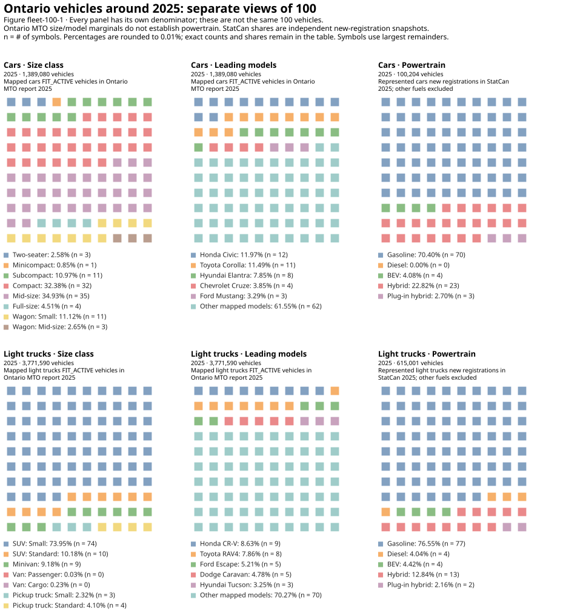

# Which vehicles does the model represent?

The backend needs representative vehicles, but its sources describe different
populations. A registration record counts a vehicle in an administrative category;
a fuel-consumption rating describes a tested configuration; a projected archetype
describes a technology. They cannot be combined by matching a class name alone.

## From registrations to representative classes

[Ontario's MTO reports](https://data.ontario.ca/dataset/vehicle-population-data)
provide make/model/model-year counts and registration status. The backend uses
`FIT_ACTIVE` as an in-use stock proxy. It does not interpret all registered statuses
as vehicles providing service. Canonical identities and their valid model-year
intervals connect MTO codes to NRCan size classes and ATB archetypes. Unresolved
identities remain visible and do not acquire invented class weights.

NRCan size classes distinguish vehicles such as compact cars, small SUVs and
standard pickups. [ATB](https://atb.nlr.gov/transportation/2024/data) uses a smaller
set of representative engineering classes. The reviewed crosswalk is necessary
to connect Canadian rated consumption to technology-specific projections and
prices. It is year-sensitive: a familiar model name does not establish that a
particular powertrain or configuration existed in every model year.

For mapped stock counts $n_s$ in size class $s$, the shared weight is

$$w_s=\frac{n_s}{\sum_{j\in\mathcal M}n_j},\qquad \sum_{s\in\mathcal M}w_s=1.$$

$\mathcal M$ is the set of supported mapped classes; $w_s$ is dimensionless.
This normalizes the observed subset. It does not recover the composition of
unmapped vehicles. The same regional class weights feed consumption, investment
costs, mileage profiles and relevant survival/manufacturing calculations.

Ontario LDV composition is transferred to other modeled regions and held across
powertrains and vintages. Passenger and freight light trucks share that mix.
These are consequential simplifications, not observed provincial or future mixes.
The canonical [composition assumptions](../assumptions.md#shared-road-fleet-composition)
record their scope.

## Ontario as 100 vehicles

The [documentation-support notebook](../insights/documentation_support.py) provides
separate marginal views of size, canonical family and powertrain. The represented
reference year is 2025; captions retain each source's actual observation year.
MTO and StatCan do not supply a common vehicle-level joint distribution, so the
illustration does not assign a powertrain to a named make/model.

*Figure fleet-100-1. One hundred symbols per declared population, allocated by
largest remainders from exact counts. The adjacent [exact-share table](../assets/figures/ontario_100_shares.csv)
retains small categories that receive no symbol. Coverage is reported separately;
unknown class membership is not redistributed into known cars or light trucks.*

The MTO snapshot is **2025**. StatCan table **23-10-0308-01** measures registered
vehicle stock, not sales or new-registration flows; its **2024** observations are
carried forward one year for this illustration. No additional powertrain forecast
is imposed. The panels therefore describe different source populations:

| Marginal population | Denominator | Leading categories |
| --- | ---: | --- |
| MTO mapped cars | 1,389,080 FIT_ACTIVE vehicles | Mid-size 34.93%; compact 32.38%. Honda Civic 11.97%, Toyota Corolla 11.49%, Hyundai Elantra 7.85%. |
| MTO mapped light trucks | 3,771,590 FIT_ACTIVE vehicles | Small SUV 73.95%; standard SUV 10.18%; minivan 9.18%. Honda CR-V 8.63%, Toyota RAV4 7.86%, Ford Escape 5.21%. |
| StatCan cars | 3,188,997 registered vehicles | Gasoline 94.14%; BEV 1.63%; PHEV 0.56%; remaining fuels/categories retained in the exact table. |
| StatCan light trucks | 5,616,959 registered vehicles | Gasoline 92.76%; BEV 1.29%; PHEV 0.53%; remaining fuels/categories retained in the exact table. |

!!! warning "Mapped composition is conditional"
    Of 10,040,176 vehicles counted as MTO FIT_ACTIVE in the coverage denominator, 4,784,867
    (47.66%) have unresolved mappings. Mapped non-LDVs and out-of-scope records are
    also shown separately. Unknown vehicle class prevents assigning those records
    to either car or light-truck denominators. In particular, the 73.95% small-SUV
    share must not be read as a share of all Ontario light trucks. Normalization
    preserves the known subset's weights, not the missing population's composition.

The [StatCan table](https://www150.statcan.gc.ca/t1/tbl1/en/tv.action?pid=2310030801)
and MTO administrative records have different coverage and classifications. The
difference between their denominators is not itself a measured fleet shortfall.

## Trucks need weight, haul and vocation assumptions

Medium trucks use Ontario Report 4 gross-vehicle-weight classes in Ontario and
reviewed Wards sales shares elsewhere. The crosswalk includes Ontario Class 2b
but outside-Ontario evidence starts at Class 3. Within a weight class, the data
do not identify vocational shares; available ATB freight vocations receive equal
weights. School, transit and refuse vehicles are not quietly added to freight.

Heavy-truck weights use [StatCan shipment evidence](https://www150.statcan.gc.ca/t1/tbl1/en/tv.action?pid=2310014201).
Pooled origin-or-destination tonne-km proxy regional haul patterns, counting
within-province shipments once. The reviewed 350-mile division proxies day-cab
versus sleeper use. Day-cab vocations are then equally split. Shipment distance
is not a direct observation of cab type or vocational sales.

Payload later converts vehicle-km into tonne-km. A change in payload can therefore
change both service efficiency and cost per tonne-km without changing the vehicle's
physical fuel consumption or purchase price. [Activity](activity.md) explains that
relationship before [energy](energy.md) and [costs](technology.md) use it.

## Buses and motorcycles

School, transit and intercity buses retain separate service classes. CEUD stocks
and fuel/activity evidence combine with MTO bus ages; available fuel-specific
lifetimes come from StatCan, with documented proxies for missing cells. School and
transit technology projections use ATB; intercity buses use EPRI REGEN and explicit
ATB relative-performance proxies where needed.

Motorcycles use CEUD fleet/service evidence, MTO motorcycle ages, GCAM technology
relationships and reviewed lifetimes. Their compact representation does not imply
the same empirical support as the LDV make/model treatment. See the source and
class-specific entries in [assumptions](../assumptions.md).
